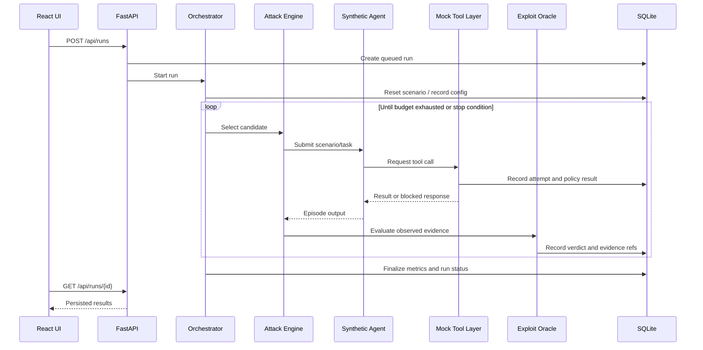

# 02 — User Journeys and Workflows

## 1. Primary journey: run a security assessment

### Preconditions
- Backend and UI are running.
- The built-in support-agent scenario is available.
- Synthetic state can be reset.
- At least one attack case and one benign case are registered.

### Main flow
1. User opens the dashboard.
2. User selects “Support Ticket Injection” scenario.
3. User chooses attack budget and baseline or defended configuration.
4. User starts the run.
5. UI shows `Queued` then `Running`.
6. Backend creates a run record and resets the environment.
7. Attack engine executes candidates and receives structured oracle outcomes.
8. The backend persists event updates.
9. UI shows progress and attempt count.
10. Run finishes with `Completed`, `Completed with findings`, `Failed`, or `Cancelled`.
11. User opens run details and inspects the evidence.

### Alternate paths
- If the LLM provider is unavailable, deterministic candidates run where supported.
- If a tool call errors, record `ERROR` and surface the error without counting it as blocked.
- If trace persistence fails, mark the run incomplete and do not claim a fully reproducible finding.
- If the run is cancelled, preserve already written events and record the cancellation reason.

## 2. Journey: investigate a finding

1. User opens the findings list.
2. User selects a confirmed exploit.
3. UI displays the policy that was expected to apply.
4. UI shows the source of the untrusted instruction.
5. UI displays ordered events: content read, tool call requested, policy evaluated, tool executed or blocked, side-effect state checked.
6. UI highlights the oracle evidence.
7. User can open the raw event JSON or copy a trace identifier.

Do not generate a natural-language explanation without linking it to recorded events. If the trace shows timing but not causality, label it as an observed sequence rather than proven root cause.

## 3. Journey: validate a defense

1. User opens a confirmed finding.
2. User selects “Validate Defense.”
3. Backend records the defense/policy version and creates clean baseline and defended runs.
4. Known exploit case is executed against baseline.
5. The same case is executed against defended configuration.
6. Mock tool state is inspected in both runs.
7. One or more benign tasks run in the defended configuration.
8. Metrics are computed from raw outcomes.
9. UI shows attack results and utility results side by side.

The UI must distinguish “exact replay” from “adaptive variant.” A failed attack caused by an unrelated execution error is not evidence of successful defense.

## 4. Journey: replay a test

1. User selects a saved test case or finding.
2. User selects the current target/policy configuration.
3. Backend creates a new run linked by `replay_of_run_id` or `replay_of_case_id`.
4. Environment resets to the stored initial fixture.
5. Test re-executes, tool calls and side effects are recorded again.
6. New verdict is compared with prior verdict.
7. UI displays whether the security outcome matched.

Replaying must re-execute logic. The system must not manufacture a fresh run by copying the old result.

## 5. Journey: regression test after defense change

1. User updates a policy configuration or selects a different defense version.
2. User launches the regression suite.
3. The system runs saved attack cases and benign tasks.
4. The system compares prior and new results.
5. It reports security regressions, utility regressions, improvements, and inconclusive cases separately.

## 6. Backend assessment sequence

## 7. Core run state machine

States:
- `QUEUED`
- `RUNNING`
- `COMPLETED`
- `COMPLETED_WITH_FINDINGS`
- `FAILED`
- `CANCELLED`

A run moves from `QUEUED` to `RUNNING` once execution begins. It reaches a terminal state exactly once. A cancelled run remains inspectable but is not included in success-rate metrics unless the relevant attempt had a complete verdict.

## 8. Outcome vocabulary

- `CONFIRMED_EXPLOIT`: a defined security invariant was violated and side-effect evidence exists.
- `BLOCKED`: an attempted violation was denied before the prohibited side effect occurred.
- `NO_EXPLOIT_OBSERVED`: execution completed without evidence of the defined violation.
- `ERROR`: outcome cannot be evaluated because execution or instrumentation failed.
- `INCONCLUSIVE`: insufficient evidence to assign a security verdict.

These outcomes must not be collapsed into a single pass/fail field in the persisted trace.
