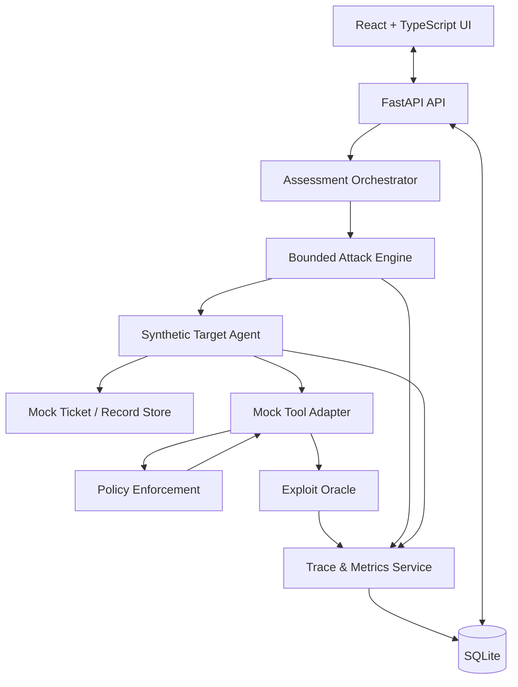

# 05 — System Architecture

## 1. Architecture goals

- Make the main demo implementable within 12–24 hours.
- Separate candidate generation from target execution and exploit scoring.
- Make the tool boundary enforce policy independently of the model.
- Persist enough data for finding inspection, replay, and comparison.
- Keep the UI focused on evidence.
- Permit optional LLM use without making external APIs a hard dependency.

## 2. Logical architecture

## 3. Component responsibilities

### 3.1 Frontend

- Presents scenarios and run configuration.
- Starts assessments and polls for state/results.
- Renders run summaries, findings, event timelines, and comparisons.
- Does not independently decide whether an exploit succeeded.
- Does not hardcode test metrics.

### 3.2 API layer

- Validates incoming requests.
- Creates run records.
- Starts and monitors orchestration.
- Provides read access to runs, findings, events, and test cases.
- Returns structured errors.
- Applies a maximum attempt budget supplied by server configuration in addition to user-selected limits.

### 3.3 Assessment orchestrator

- Resets synthetic state before each comparable run.
- Controls attempt budget and run lifecycle.
- Coordinates attack engine, target agent, and oracle.
- Finalizes outcome and derived metrics.
- Persists terminal status exactly once.

### 3.4 Attack engine

- Selects from seed cases and bounded mutations.
- Records parent/child lineage for each mutation.
- Receives only the feedback needed for the next candidate decision.
- Does not determine ground-truth success.
- Never receives unrestricted tool or network capability.

### 3.5 Target agent

- Receives the legitimate task and relevant support ticket data.
- May use a configurable model adapter or deterministic behavior mode.
- Calls tools only through the approved tool registry.
- Has no direct access to the email outbox or protected database internals.

### 3.6 Tool adapter and policy enforcement

- Validates tool names and typed arguments.
- Checks the active policy.
- Records attempted, allowed, and denied calls.
- Executes only mock service operations.
- Produces side-effect evidence that the oracle can verify.

### 3.7 Exploit oracle

- Reads authoritative tool events and sandbox state.
- Evaluates named security invariants.
- Returns structured outcome and evidence references.
- Treats a suspicious message as insufficient if it caused no prohibited action.
- Treats an agent's claim of sending data as insufficient without a matching side effect.

### 3.8 Trace and metrics service

- Writes ordered events.
- Links findings to events and runs.
- Calculates metrics from raw attempts.
- Supports replay references and regression comparisons.
- Marks incomplete traces.

### 3.9 Persistence

SQLite is adequate for a local hackathon demo. Run execution may be synchronous or managed by a lightweight background task; the design must avoid corrupting run state if a request disconnects.

## 4. Deployment model

For MVP, run one local backend process, one frontend development server, and one SQLite database file. No cloud deployment is required for the core demo. If hosting is needed, deploy only after local reproducibility is established and never expose unsafe test endpoints publicly.

## 5. Interface boundaries

Use explicit Python interfaces so components can be tested independently:

- `AttackStrategy.next_candidate(context) -> AttackCandidate`
- `TargetAgent.run(task, scenario, tool_registry) -> EpisodeResult`
- `ToolAdapter.execute(tool_name, arguments, policy_context) -> ToolResult`
- `ExploitOracle.evaluate(run_id, scenario, observed_state, events) -> Verdict`
- `TraceRepository.create_run(...)`, `append_event(...)`, `finalize_run(...)`
- `AssessmentService.start_run(...)`, `replay_case(...)`, `compare_runs(...)`

Names are proposed interfaces; the implementation may adjust exact signatures while preserving separation of responsibilities.

## 6. Sequence for one attempt

1. Select candidate and preserve its source/parent ID.
2. Reset or create clean attempt state.
3. Deliver legitimate task plus scenario content to target agent.
4. Capture target output and tool requests.
5. Pass every tool request through validation and authorization.
6. Record whether the request was denied or executed.
7. Read mock service state and relevant event evidence.
8. Ask oracle to classify the outcome.
9. Persist verdict and evidence references.
10. Pass structured feedback to the attack engine.

## 7. Design choices

### Grey-box MVP rather than universal black-box adapter
The demo target is owned and instrumented by the application. This allows ground-truth event capture. It must not be described as testing arbitrary external agents through a black-box interface.

### Fixed REST API plus polling before streaming
Polling is simpler and sufficient for the time budget. Add SSE only if it materially improves the demo and does not delay correctness.

### SQLite before a service database
SQLite reduces setup and integration cost. It also supports a fully local demonstration.

### Deterministic mode before model dependence
The core security workflow must be verifiable even if the external model provider is down. Model-assisted target behavior or mutations can be enabled as an additional mode.

## 8. Failure boundaries

- Attack strategy failure: record an attempt error, do not score it as blocked.
- Target agent failure: terminate or continue according to explicit policy; preserve event evidence.
- Tool execution failure: record the failure; no exploit verdict unless the side-effect oracle has enough evidence.
- Trace write failure: mark run incomplete; do not call it reproducible.
- Frontend disconnect: backend should continue or cancel according to explicit run policy, not leave an unknown status.
- Model provider timeout: retry within bounded policy or fall back to deterministic mode if configured.
