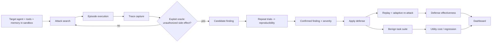
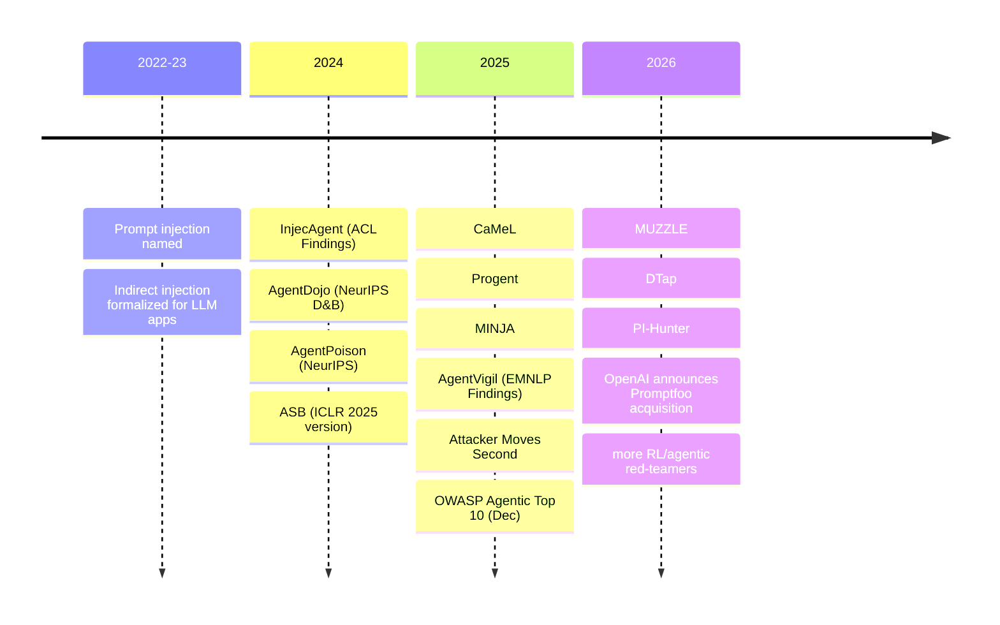

# AGENTBREAK_RESEARCH_FOUNDATION

**Project:** AgentBreak: The Autonomous AI Red Team (CRCE Bit N Build, college round)
**Landscape investigated on:** 2026-10-10 (all web access dates below equal this date unless stated)
**Document status:** Research foundation v1 baseline, preserved and expanded by a continuation audit dated 2026-10-10. Not an implementation plan.

> **Continuation note (2026-10-10).** Sections 0–28 below are the original baseline and are retained so useful analysis, stable IDs, and the initial audit trail are not lost. Sections 29 onward add post-baseline source checks, repository-file inspection, version corrections, deeper comparisons, and a continuation checkpoint. Where an old passage records what was or was not inspected during the initial pass, read it as a historical statement about that pass; the continuation's actual inspection scope is listed separately. The official problem-statement PDF referred to in the research request was not present among the files mounted for this turn. The official wording reproduced in §3 is therefore preserved from the baseline file and has not been independently checked against that PDF in this continuation.

---

## 0. How to read this document

### 0.1 Evidence labels

| Label | Meaning |
|---|---|
| **[E]** | Established evidence: directly supported by a source I opened, with the depth stated |
| **[I]** | Research interpretation: my synthesis across sources |
| **[H]** | Hypothesis: plausible but not verified |
| **[U]** | Unknown: could not be determined from accessible evidence |

### 0.2 Depth-of-reading labels (used in every source record)

| Label | Meaning |
|---|---|
| **FT** | Full text read |
| **AB** | Abstract / venue page read |
| **SEC** | Secondary summary only (blog, aggregator, reference list of another paper) |
| **DOC** | Official documentation pages read |
| **SRC** | Source code inspected |

> **Critical honesty note.** No repository source code (SRC) was inspected in this pass. Only one paper (PI-Hunter, PAP-011) was read in full text. Everything else was read at abstract, venue-page, documentation, or secondary level. Findings are labelled accordingly. Section 25 lists every audit that could not be completed.

### 0.3 Identifier conventions

`REQ-00` = overall problem statement; `REQ-01`…`REQ-07` = official features A–G; `REQ-I01`… = inferred requirements; `PAP-###` papers; `TOOL-###` tools; `BENCH-###` benchmarks/datasets; `GAP-###` candidate gaps; `DIR-##` candidate directions.

---

## 1. Executive summary

**What AgentBreak must do.** The official statement asks for an autonomous platform that probes AI agents for exploitable weaknesses in instructions, memory, retrieved content, tool permissions, and multi-step execution; produces reproducible attack traces; demonstrates exploits in a controlled sandbox; and checks whether defenses stop the same attacks without breaking legitimate behaviour. Seven features (A–G) are listed.

**Headline findings (all dated 2026-10-10).**

1. **The "autonomous attack discovery" space is crowded.** [E] Adaptive/automated red-teaming of tool-using agents already exists as published research and tooling: AgentVigil (EMNLP 2025 Findings, AB), MUZZLE (arXiv, AB), PI-Hunter (arXiv June 2026, FT), DTap/DTap-Red (arXiv May 2026, AB), plus multi-turn orchestrators in PyRIT (DOC). An "adaptive attack generator" alone is therefore **not** a defensible novelty claim (GAP-001: Not a gap).
2. **Static test suites are known to give misleading defense results.** [E] "The Attacker Moves Second" (PAP-004) reports bypassing 12 published defenses, with attack success above 90% for most, many of which had reported near-zero success under static or weak attacks (AB). This directly supports the problem statement's emphasis on adaptive testing and means **defense validation without adaptive re-attack is weak evidence**.
3. **The closest prior art is recent and specific.** [E] PI-Hunter (Google Cloud AI Research, 10 Jun 2026, FT) already combines source-aware test generation, trajectory-level auditing, feedback-driven mutation, and a patch-and-re-explore step. Its authors explicitly say they do not propose remediation and have not verified live production settings. DTap (AB) offers simulated environments, an autonomous red-team agent, and a verifiable judge per instance. Any AgentBreak pitch must be positioned relative to these.
4. **Strong, evidence-backed defenses exist at the system level.** [E] CaMeL (AB) reports 77% of AgentDojo tasks solved with provable security versus 84% undefended; Progent (AB/SEC) enforces tool-level privilege policies. These are natural *defenses under test* for the "Defense Validation" feature rather than competitors.
5. **Memory is the least mature area.** [E] ASB reports memory-poisoning defenses as largely ineffective (repo README, SEC/DOC); MINJA reports >95% injection success and ~70% attack success under benchmark conditions (AB + SEC), but a January 2026 study notes those numbers come from idealized conditions (SEC). Promptfoo's memory-poisoning plugin is a three-step, response-based text check (DOC), not a tool-action check.
6. **No confident "verified gap" was established.** Candidate gaps are mostly *partially supported* or *potential*. The best-supported opportunities concern **evaluation rigor and integration** (closed-loop discover → defend → adaptive re-attack → utility regression; repeatability-verified traces; provenance of multi-stage chains incl. memory), not a new attack algorithm. These are hypotheses (Section 17).
7. **Commercial status.** [E] OpenAI announced acquiring Promptfoo on 2026-03-09 and committed to keep the open-source project (SEC/news). Snyk acquired Invariant Labs (2025) and markets agent red-teaming (SEC). Public transparency of commercial tools is limited; absence of a feature in their docs is not evidence of absence.

**Where no confident conclusion is possible:** whether DTap or commercial platforms already offer closed-loop defense validation with regression; actual implementation depth of any tool (no source inspected); independent reproduction of most headline numbers.

---

## 2. Research scope, methodology, and limitations

### 2.1 What was actually done

- ~17 web searches and 2 full-page fetches on 2026-10-10 (one fetch of a requested arXiv abstract failed because the URL had not previously appeared in results; it was recovered via search).
- Roughly 20 distinct papers/tools were *encountered*; 12 were analysed at AB/DOC level or deeper; **1 at FT**.
- This is **not** a formally registered systematic review and must not be described as one.

### 2.2 Search sources and queries (summary)

Search engine: general web search (returns arXiv, ACL Anthology, NeurIPS/ICLR pages, GitHub, vendor docs, news). Query families used:

1. `AgentDojo benchmark prompt injection agents NeurIPS 2024`
2. `Agent Security Bench ASB ICLR 2025 attacks defenses memory poisoning`
3. `InjecAgent benchmark indirect prompt injection tool-integrated ACL Findings 2024`
4. `"The Attacker Moves Second" adaptive attacks…`
5. `memory injection attack MINJA AgentPoison memory poisoning NeurIPS`
6. `AgentPoison red-teaming … poisoning memory or knowledge bases`
7. `Promptfoo red teaming agents latest news 2026 acquisition`
8. `promptfoo docs red team plugins memory poisoning agentic tool discovery excessive agency`
9. `Microsoft PyRIT … orchestrators converters scorers multi-turn Crescendo`
10. `NVIDIA garak LLM vulnerability scanner probes detectors license`
11. `CaMeL "Defeating Prompt Injections by Design" Progent privilege control`
12. `Progent programmable privilege control … arXiv 2504.11703`
13. `automated red teaming LLM agents indirect prompt injection fuzzing … AgentVigil DoomArena` (extended mode)
14. `DecodingTrust-Agent Platform DTap …`
15. `OWASP Top 10 for Agentic Applications 2026 …`
16. `AI agent red teaming platform commercial 2026 Lakera Straiker Mindgard Snyk Invariant Labs`
17. Full-text fetch: PI-Hunter (arXiv 2606.12737v1).

### 2.3 Inclusion / exclusion criteria used

- **Include:** work on LLM agents with tools, retrieved content, or memory; automated/adaptive red-teaming; defense evaluation; benchmarks with tool actions; runtime privilege/flow enforcement.
- **Exclude:** pure chatbot jailbreak work with no agent component (kept only as background); marketing pages without technical content (kept only for commercial status); duplicates/versions (collapsed to latest arXiv version, venue noted).
- **Date range:** 2023→2026-10; emphasis on 2024–2026.
- **Peer review status:** recorded per paper only where a venue page was seen; otherwise "arXiv preprint; venue status unknown".

### 2.4 Principal limitations

| Limitation | Consequence |
|---|---|
| No source-code inspection | All implementation-level claims are DOC/AB/SEC; capability claims are "documented", not "implemented-verified" |
| Single full-text paper | Critical appraisal of other papers is restricted to what abstracts/summaries reveal |
| Search engine coverage | May have missed relevant 2026 papers (the field is moving fast) |
| Secondary numeric claims | Marked SEC; do not quote as established without checking the paper |
| Commercial tools | Public documentation only |
| Model names in papers (e.g., "GPT-5.4-mini", "Claude-4.6-sonnet", "Gemini-3.1-pro" in PI-Hunter) | Reported as stated by that paper; not independently checked |

---

## 3. Official problem statement (source of truth)

Wording preserved from the provided problem-statement document.

**Title:** AgentBreak: The Autonomous AI Red Team

**Backstory.** AI agents are increasingly being trusted with tools, private records, external services, and multi-step decision-making. However, these capabilities introduce new security risks. A malicious instruction hidden inside a document, a poorly configured tool permission, or a vulnerability in an agent's memory can cause it to perform actions beyond its intended purpose. Traditional security testing often relies on predefined attack scenarios, making it difficult to uncover complex vulnerabilities that emerge as an agent interacts with its environment.

**Problem statement.** Build AgentBreak, an autonomous AI security testing platform that actively probes AI agents to discover exploitable vulnerabilities in their instructions, memory, retrieved content, tool permissions, and multi-step execution. The platform must generate reproducible attack traces, demonstrate vulnerabilities within a controlled sandbox, and evaluate whether security defenses can prevent the same attacks without breaking legitimate agent functionality.

**Key features.**

| ID | Feature | Official wording |
|---|---|---|
| REQ-01 (A) | Autonomous Attack Discovery | Identify vulnerabilities through adaptive adversarial testing rather than relying exclusively on predefined attack cases. |
| REQ-02 (B) | Multi-Stage Attack Analysis | Trace how malicious inputs, retrieved instructions, and agent decisions can combine to produce unauthorized actions. |
| REQ-03 (C) | Tool and Permission Auditing | Detect situations where an agent can access data or execute actions beyond its intended permissions. |
| REQ-04 (D) | Reproducible Attack Traces | Record the inputs, intermediate decisions, tool calls, and outcomes required to reproduce a discovered vulnerability. |
| REQ-05 (E) | Defense Validation | Evaluate proposed mitigations against previously successful attacks and measure whether they prevent exploitation. |
| REQ-06 (F) | Security Evaluation Dashboard | Visualize attack paths, vulnerability severity, exploit success rates, and defense effectiveness. |
| REQ-07 (G) | Regression Testing | Check whether security improvements introduce new vulnerabilities or interfere with legitimate agent behavior. |

### 3.1 Preserved ambiguities (not silently resolved)

| # | Ambiguous wording | Interpretation 1 | Interpretation 2 | Consequence |
|---|---|---|---|---|
| AMB-1 | "probes AI agents" | Black-box: the platform attacks a target agent through its normal interfaces | White-box/grey-box: the platform can instrument the agent's tools, memory, and prompts | Determines whether tool-call interception and ground-truth side-effect checks are possible. Grey-box is far easier to verify exploits in |
| AMB-2 | "autonomous" | An LLM-driven attacker adapts without human input during a run | The *whole pipeline* (setup → attack → report) needs no human steps | Affects scope of orchestration and tolerance for human-in-the-loop |
| AMB-3 | "adaptive adversarial testing" | Adapts to *intermediate agent behaviour* in one episode | Adapts across episodes (search/optimization over attacks) | PAP-004 evidence suggests the second is what defeats defenses |
| AMB-4 | "exploitable vulnerabilities in their instructions" | Weak/overridable system prompt | Instruction-hierarchy confusion between sources | Changes what counts as success |
| AMB-5 | "controlled sandbox" | Simulated tools/mock backends | Real software in isolated containers | Trade-off: realism vs safety/determinism |
| AMB-6 | "evaluate whether defenses can prevent the same attacks" | Replay the *recorded* attacks | Re-run adaptive search against the defended agent | PAP-004: replay alone can overstate defense strength |
| AMB-7 | "without breaking legitimate functionality" | Utility on a fixed task set | Utility under realistic usage distribution | Fixed sets can hide over-refusal |
| AMB-8 | "Regression testing" | Re-run old attacks and tasks after a change | Detect *new* vulnerabilities introduced by a defense | Second requires attack search on the new version, not only replay |
| AMB-9 | "demonstrate vulnerabilities" | Show a successful exploit trace | Show root cause and a minimal repro | Affects trace quality bar |

### 3.2 Inferred requirements (clearly *not* official)

| ID | Inferred requirement | Why it follows |
|---|---|---|
| REQ-I01 | An **exploit oracle** that decides success from *observed side effects*, not model text | "Demonstrate" + "unauthorized actions" |
| REQ-I02 | A **target-agent adapter** interface | Must probe "AI agents" generally |
| REQ-I03 | **Sandbox containment** of tools and synthetic data | "controlled sandbox" |
| REQ-I04 | **Severity model** | Dashboard shows "vulnerability severity" |
| REQ-I05 | **Repeated trials / repeatability statistics** | LLM nondeterminism vs "reproducible" |
| REQ-I06 | **Utility task suite** for benign behaviour | "without breaking legitimate agent functionality" |
| REQ-I07 | **Defense plug-in interface** | "proposed mitigations" |
| REQ-I08 | **Platform self-protection** (harness not injectable, traces scrubbed) | Autonomous attacker reads untrusted content |
| REQ-I09 | **Budget/time controls** | Cost of LLM-driven search |

---

## 4. Domain glossary and technical background

### 4.1 Core concepts

| Term | Definition (as used here) | Easily confused with |
|---|---|---|
| **LLM chatbot** | Generates text from a prompt; no side effects beyond output | Agent |
| **LLM agent / tool-using agent** | An LLM in a loop that plans, calls tools (APIs, code, browsers), reads results, optionally uses memory, and repeats | Chatbot with plugins |
| **System prompt / instructions** | Developer-set text defining behaviour and constraints | User prompt; untrusted content |
| **Untrusted content** | Any text not authored by the principal(s): web pages, emails, documents, tool outputs, retrieved memory | "Data" in classic software, where it cannot be executed |
| **Direct prompt injection (DPI)** | Attacker is the user and tries to override instructions | Indirect |
| **Indirect prompt injection (IPI)** | Instructions hidden in third-party content the agent reads. Formalized for tool-integrated agents in InjecAgent (PAP-003) and used in AgentDojo (PAP-001) | DPI |
| **Excessive agency** | Agent has more capability, permission, or autonomy than the task needs (OWASP LLM category; Promptfoo maps a plugin to it, DOC) | Prompt injection (which can *exploit* excessive agency) |
| **Least privilege** | Grant only the permissions the task requires. Progent (PAP-008) enforces this on tool calls | — |
| **Confused deputy** | A privileged component is tricked by a less-privileged party into misusing its authority. Applies when an agent holds user credentials and obeys injected text [I] | Plain injection |
| **Agent memory** | State persisting beyond the current context: conversation history, vector/RAG stores, episodic records | RAG knowledge base (a related but distinct store) |
| **Memory poisoning** | Writing attacker-controlled content into memory so it is later retrieved and acted upon. MINJA (PAP-006) shows query-only injection; AgentPoison (PAP-007) shows trigger-optimized poisoning | Prompt injection (single-session) |
| **Multi-stage attack / attack chain** | Several steps (e.g., plant → retrieve → act) combine to cause an unauthorized action | Single-shot injection |
| **Runtime control / guardrail** | Mechanism that inspects or restricts behaviour during execution (filters, policy engines, flow trackers) | Training-time alignment |
| **Sandbox** | Isolation limiting side effects of tests; may be simulated tools or isolated real services | Mock (not necessarily isolating) |
| **Adaptive attack** | Attack strategy that changes in response to the target's behaviour or to the defense design (PAP-004) | Templated/static attack |
| **Trajectory / execution trace** | Ordered record of messages, retrieved content, reasoning (if exposed), tool calls, results, and final output | Chat transcript |
| **Exploit success** | Observed violation of a stated security property (e.g., unauthorized tool call executed) | "Model said something suspicious" |
| **Severity** | Impact × exploitability of a finding; **no standard for agent findings was found in this pass** [U] | Success rate |
| **Security–utility trade-off** | Cost in benign task success paid for security. AgentDojo reports both (AB); ASB introduces a combined NRP metric (AB) | — |
| **Regression** | A previously passing behaviour (secure or useful) now fails after a change | — |
| **Reproducibility** | Same inputs/config produce the same outcome; for LLM agents typically *statistical*, not exact | Determinism |

### 4.2 Why agents change the security picture [I]

- A chatbot's worst output is bad text; an agent's worst output is a **side effect** (email sent, record changed, data exfiltrated).
- Agents ingest **untrusted data into the same channel as instructions**; the model has no hardware-enforced boundary between them (AgentDojo abstract describes tool-returned data hijacking the agent, AB).
- Multi-step execution lets a small deviation early compound; memory lets a deviation persist beyond the session.
- Static prompt tests can't see these because the vulnerability is in the *interaction* between model, tools, content, and state (PI-Hunter introduction frames prompt injection as a system-level vulnerability, FT).

### 4.3 Concrete safe example (synthetic)

A "support agent" has tools `read_ticket`, `lookup_customer`, `send_email`. A ticket body (untrusted) contains hidden text telling the agent to email a customer record to an external address. **Vulnerability** = agent can both read tickets and send external email without a data-flow check. **Exploit** = the sandbox's mock mail server records an outbound message containing the synthetic record. The security violation is the recorded side effect, not the model's wording.

---

## 5. Problem decomposition and system boundaries

### 5.1 Boundary distinctions (what changes the evaluation)

| Distinction | Why it matters | Evidence |
|---|---|---|
| LLM-only vs agent-with-tools | Attack success must be observed in actions | AgentDojo evaluates dynamic tool calls in a stateful environment (AB) |
| Single interaction vs trajectory | Latent injections activate only on specific retrieval paths | PI-Hunter (FT) |
| Suspicious text vs unauthorized action | Text-based judges can mislead; AgentDojo notes an LLM simulator can itself be fooled by an injection (SEC from arXiv HTML snippet) | PAP-001 |
| Discovered vs demonstrated exploit | Need oracle + repeat trials | [I] |
| Prevention vs detection | Different metrics (block rate vs detection rate) | [I] |
| Model output vs whole system | Defenses at system level (CaMeL, Progent) change security without changing the model | PAP-008, PAP-009 |
| Defense vs known attack vs adaptive variants | Near-zero static ASR does not imply robustness | PAP-004 |

### 5.2 Conceptual pipeline (interpretation, not architecture)

### 5.3 In scope / out of scope (research-level)

- **In scope:** attacks via instructions, retrieved content, tools/permissions, memory, multi-step execution; sandboxed demonstration; defense and regression evaluation.
- **Adjacent (recorded, not central):** multi-agent contagion, supply-chain compromise of tools/MCP servers (OWASP ASI04), jailbreaks for harmful content, training-data poisoning, model backdoors beyond memory (ASB's PoT backdoor is documented but a different layer).
- **Out of scope:** attacking third-party or production systems; real credentials.

---

## 6. Official requirement traceability matrix

The prompt requested 17 columns. They are split into two tables for readability; all columns are covered. "Existing solutions" uses TOOL/PAP IDs from Section 28.

### 6.1 Requirement definition table

| ID | Name | Type | Intended purpose | Technical interpretation | Expected inputs | Expected processing | Expected outputs |
|---|---|---|---|---|---|---|---|
| REQ-00 | Overall platform | Official | Find, demonstrate, and validate defenses for agent vulnerabilities | A harness that attacks a target agent in a sandbox and scores outcomes | Target agent, tool/memory config, benign tasks, defenses | Attack search → execution → oracle → defense eval → regression | Findings, traces, metrics, dashboard |
| REQ-01 | Autonomous Attack Discovery | Official | Beat static test limits | An attacker policy (LLM-driven or search-based) that conditions on observed target behaviour/feedback | Agent interface, goal specs, feedback signal | Generate → execute → score → mutate/plan | Candidate attacks with outcomes |
| REQ-02 | Multi-Stage Attack Analysis | Official | Explain how steps combine | Causal/provenance linking of inputs → decisions → tool calls → effects | Full trajectories | Taint/provenance tracking, step attribution | Attack-path graph / chain description |
| REQ-03 | Tool and Permission Auditing | Official | Find over-privilege and reachable-but-unintended actions | Compare *declared* permission policy with *exercised/reachable* capabilities | Tool schemas, policy, observed calls | Static surface mapping + dynamic probing | Permission-violation findings |
| REQ-04 | Reproducible Attack Traces | Official | Let others replay a finding | Structured trace + environment snapshot + seeds + repeat statistics | Run records | Serialization, replay, repeat trials | Replayable bundle + repeatability stat |
| REQ-05 | Defense Validation | Official | Show mitigation works | Apply defense to the same target, rerun prior successes (and ideally adaptive search) | Defense configuration, prior exploits | Replay, compare outcomes | Prevention rate with caveats |
| REQ-06 | Security Evaluation Dashboard | Official | Communicate results | Views of attack paths, severity, ASR, defense effectiveness | All results | Aggregation, visualization | UI/report |
| REQ-07 | Regression Testing | Official | Catch new breakage | Re-run exploit set + benign suite across versions | Versioned agent/defense configs | Diff of outcomes | Regression report |

### 6.2 Requirement evaluation table

| ID | Success criteria (proposed) | Evaluation method | Existing solutions | Known limitations (evidenced) | Unresolved questions | Dependencies | Evidence |
|---|---|---|---|---|---|---|---|
| REQ-00 | End-to-end demo: finding → confirmed trace → defense → measured effect → utility check | Walk through on a synthetic agent | PAP-011, PAP-012 (partial); TOOL-002/003/004 (components) | Closest systems lack at least one stage in public evidence [U for DTap] | Is a combined loop already offered by DTap or commercial tools? | All | §9–§18 |
| REQ-01 | Attacker finds ≥1 exploit not in a fixed seed set, with stated budget | Compare to templated baseline; ablate adaptivity | PAP-005, PAP-010, PAP-011, PAP-012; TOOL-002 (Crescendo/TAP DOC) | Adaptive search is costly and needs a success signal (PAP-004 notes attacks are slow/expensive [AB-level]) | Best feedback signal without leaking oracle? | REQ-I01, REQ-I02 | PAP-004/005/010/011 |
| REQ-02 | Each confirmed exploit shows ordered causal chain from untrusted source to effect | Manual audit of sample chains; automated provenance check | PAP-011 (trajectory auditing, FT); PAP-009 (data-flow tracking, AB) | PI-Hunter's evaluator is rubric/LLM-based (FT) → judgement risk | How to attribute causality when the LLM reasoning is opaque? | REQ-04 | PAP-011 |
| REQ-03 | Tool-call outside declared policy detected with ground-truth log | Seeded over-permissioned configs; detection recall/precision | PAP-008 (enforcement); TOOL-004 (excessive-agency plugin, DOC); PAP-011 (static interface analysis) | Promptfoo's plugin is a behavioural text check (DOC); enforcement ≠ audit | Who defines "intended permissions"? | REQ-I03 | PAP-008, PAP-011 |
| REQ-04 | Replay bundle reproduces outcome in ≥k of n runs with reported interval | Re-run on clean env | TOOL-002 (memory DB, DOC); BENCH-001 (traces, DOC/AB) | Exact replay impossible with sampling LLMs [I]; no public tool found that reports per-finding repeatability [U—not-found ≠ absent] | Pin model/seed? API providers' nondeterminism? | REQ-I05 | PAP-001 |
| REQ-05 | Prevention rate on recorded and on re-optimized attacks, with utility alongside | Same-agent A/B with/without defense | PAP-001/002 (defenses evaluated); PAP-008/009 (defenses) | Replay-only evaluation overstates robustness (PAP-004) | Budget for adaptive re-attack | REQ-01, REQ-I06 | PAP-004 |
| REQ-06 | Shows attack paths, severity, ASR, defense effect | Usability check against REQ-02/04/05 data | TOOL-004 UI (DOC); BENCH-001 registry (AB) | Dashboards display what the backend measures; weak metrics → misleading dashboards [I] | Severity scheme | REQ-I04 | — |
| REQ-07 | Re-run exploit + benign suites across versions; flag deltas | Pre/post comparison | TOOL-004 CI usage (SEC/DOC) | Fixed suites miss *new* vulnerabilities from a defense [I] | How to attack the *defended* agent adaptively | REQ-05 | PAP-004 |

---

## 7. Detailed analysis of the seven key features

For each: meaning, techniques, related work, failure modes, minimal vs ambitious interpretation, what **must not be claimed**.

### REQ-01 Autonomous Attack Discovery
- **Meaning.** Attack inputs are produced by a feedback-driven process rather than only a fixed list.
- **Techniques.** LLM-attacker loops with scoring (PyRIT multi-turn executors, DOC); genetic/MCTS fuzzing (AgentVigil: black-box fuzzing with adaptive seed selection and semantically guided mutators, AB/SEC); multi-agent web red-teaming (MUZZLE, AB); evolutionary query generation with trajectory audit (PI-Hunter, FT); RL-trained injectors (cited by other papers: arXiv 2602.05746, 2510.04885, 2603.13026; SEC-reference-list only); GCG/TAP adapted to AgentDojo (arXiv 2606.10525, AB).
- **Evidence of effectiveness.** AgentVigil, PI-Hunter, and PAP-004 show adaptive methods outperform static baselines in their own settings. PI-Hunter (FT) reports e.g. for one model/benchmark/attack, source recall 0.255→0.834 and instruction recall 0.436→0.824 versus an unconstrained red-teaming-agent baseline—**these are exposure/localization metrics, not unauthorized-action rates**.
- **Failure modes.** Cost; reward hacking against an LLM judge; mode collapse (PI-Hunter explicitly measures diversity because baselines "degenerate to near-zero diversity" under defenses, FT); results tied to specific backbones.
- **Minimum credible:** a loop that mutates attacks using observed trajectory feedback and beats a templated baseline on a stated budget.
- **Ambitious:** cross-episode search against defended agents; learned attacker.
- **Must not claim:** "first autonomous agent red-teamer", "discovers unknown vulnerabilities" without showing the exploit was not in the seed set.

### REQ-02 Multi-Stage Attack Analysis
- **Meaning.** Explain how content → decision → tool call → effect chains arise.
- **Techniques.** Trajectory-level audit (PI-Hunter, FT); data-flow/capability tracking as a *defense* (CaMeL, AB); causal diagnostics proposed for defense (AgentSentry, arXiv 2602.22724, cited in PI-Hunter; SEC).
- **Gap signal.** PI-Hunter says developers lack visibility into how injections propagate (FT) and tackles it for *prompt-injection ingestion paths*; memory-mediated chains are not its focus [I].
- **Failure modes.** LLM-judged "causality"; non-determinism makes attribution unstable.
- **Minimum credible:** per-finding ordered chain (source → agent step → tool call → effect) built from the actual log.
- **Must not claim:** "root cause identified" when only a correlation in a trace was shown.

### REQ-03 Tool and Permission Auditing
- **Meaning.** Detect agent capability beyond intended permissions.
- **Techniques.** Tool-level policy enforcement (Progent: DSL for privilege policies, proxy over tool calls, AB/SEC); static analysis of tool surface (PI-Hunter §3.1, FT); behavioural plugins (Promptfoo `excessive-agency`, `tool-discovery`, DOC).
- **Important distinction.** *Auditing* (find over-privilege) vs *enforcing* (block it). Public sources in this pass emphasize enforcement and behavioural probes; a systematic **declared-vs-exercised privilege diff** was **not found** [U; not proof of absence] (GAP-003).
- **Must not claim:** that an agent is "least-privilege compliant" from a finite set of probes.

### REQ-04 Reproducible Attack Traces
- **Meaning.** A trace sufficient to reproduce.
- **Practice found.** PyRIT stores conversations, scores, attack results in SQLite/Azure SQL (DOC); the Invariant benchmark repository was built because there was no standard way to explore results/traces across agents (vendor blog, AB-level); garak writes per-attempt logs and hit logs (SEC).
- **Core difficulty.** LLM sampling and provider-side changes → exact replay is not guaranteed [I]. Reproducibility therefore should be reported as a **rate over n replays**, plus recorded environment and config.
- **Must not claim:** "deterministic reproduction" for non-deterministic models; "reproducible" without stating n and conditions.

### REQ-05 Defense Validation
- **Meaning.** Measure whether mitigations stop prior exploits.
- **Evidence.** AgentDojo/ASB evaluate defenses with utility alongside security (AB); CaMeL and Progent were evaluated on AgentDojo (CaMeL: 77% vs 84% tasks, AB; Progent: reported ASR reduction from 41.2% to 2.2% in AgentDojo per a secondary summary, SEC—verify before quoting).
- **Key caveat.** PAP-004: static evaluations can show near-zero ASR that collapses under adaptive attack. Any AgentBreak "defense effectiveness" number is only as good as the attack effort behind it.
- **Must not claim:** "defense X is secure/effective" — only "reduced success against attack set S under budget B".

### REQ-06 Security Evaluation Dashboard
- **Meaning.** Visualize attack paths, severity, exploit success, defense effectiveness.
- **Practice.** Promptfoo has an evaluation UI and sharing (DOC/SEC); CoPyRIT GUI is pre-release (DOC, release notes); commercial platforms advertise dashboards and compliance mapping (SEC).
- **Insight.** The dashboard is **product differentiation**, not academic novelty; its credibility depends on REQ-02/04/05 data quality.
- **Must not claim:** a severity score is "standardized" — no agent-specific severity standard was found [U].

### REQ-07 Regression Testing
- **Meaning.** Check new vulnerabilities or utility loss after security changes.
- **Practice.** Promptfoo documents CI/PR/scheduled scans (SEC/DOC-level); AgentDojo's paired utility/security design supports comparing versions (AB).
- **Gap signal.** Fixed regression suites cannot find vulnerabilities newly *introduced by* a defense unless attacks are re-searched on the defended system (AMB-8, [I]).
- **Must not claim:** "no new vulnerabilities introduced" from a pass of a fixed suite.

---

## 8. Agent security threat model and attack taxonomy

### 8.1 Assets and security properties

| Asset | Property to maintain (target agent) | Platform-side concern |
|---|---|---|
| Instructions/config | Integrity; not overridable by untrusted content | Don't leak target prompts into shared traces |
| Private records | Confidentiality; access only per policy | Use synthetic data only |
| Memory/persistent state | Integrity; provenance of entries | Isolate memory per test run |
| Tool credentials & permitted ops | Least privilege; no use outside intent | Use mock credentials; never real keys |
| Tool calls and side effects | Only authorized effects occur | Side effects occur in sandbox only |
| Traces & findings | — | Integrity of evaluation results; scrub secrets; access control |
| Execution state | Not corruptible mid-run | Reset between episodes |

### 8.2 Attacker capabilities and preconditions

| Actor / capability | Precondition | Evidence |
|---|---|---|
| Malicious user query (DPI) | Legitimate user access | ASB DPI (AB) |
| Malicious retrieved/tool-returned content (IPI) | Ability to place content in a source the agent reads | InjecAgent, AgentDojo (AB) |
| Query-only memory injection | Ordinary user interaction with a memory-enabled agent | MINJA (AB) |
| Direct write to memory/knowledge base | Write access to store | AgentPoison (AB) |
| Misconfigured permissions | Defender error | OWASP agentic list (SEC); Promptfoo docs |
| Multi-interaction distributed instructions | Multiple sessions | Promptfoo "gradual memory poisoning" (DOC) |
| Compromised external data source | Control of source | PI-Hunter (FT) |

### 8.3 Attack taxonomy (class-level; each is a *category*, not an exploit)

OWASP's Top 10 for Agentic Applications 2026 (published 2025-12-09; secondary sources; list includes ASI01 Agent Goal Hijack, ASI02 Tool Misuse, ASI03 Identity/Privilege Abuse, ASI04 Supply Chain, ASI05 Unexpected Code Execution, ASI06 Memory & Context Poisoning, ASI07–ASI10 inter-agent, cascading failures, human-trust, rogue agents) is used as a *labelling aid*; its internal ASI07–ASI10 titles were summarized from secondary pages and should be checked against the primary OWASP document.

| Class | Objective | Entry point | Mechanism | Observable evidence | Existing defenses | Known limitation of defenses | Source |
|---|---|---|---|---|---|---|---|
| Direct prompt injection | Override instructions | User turn | Instruction confusion | Disallowed tool call/response | Delimiters, sandwich, paraphrase (ASB DOC) | ASB reports limited defense effectiveness overall (AB) | PAP-002 |
| Indirect prompt injection | Hijack via data | Tool output, docs, email | Untrusted data treated as instruction | Unauthorized tool call | CaMeL, Progent, spotlighting, MELON, PIGuard | Adaptive attacks bypass many (PAP-004; PI-Hunter shows residual exposure under three defenses, FT) | PAP-001/003/004 |
| Tool abuse / excessive agency | Misuse permitted tools | Any | Over-permissive tool set | Out-of-intent call | Privilege policies (Progent) | Needs correct policy authoring (Progent explores LLM-generated policies, AB) | PAP-008 |
| Permission-boundary failure | Access data/actions beyond purpose | Config | Missing checks | Access log | Capability enforcement (CaMeL) | Utility cost (CaMeL 77 vs 84%, AB) | PAP-009 |
| Sensitive-data exposure | Exfiltrate records | IPI/DPI | Data flows to outbound tool | Outbound message with record | Data-flow policies | Requires provenance | PAP-009 |
| Memory poisoning (query-only) | Persist malicious reasoning | User queries | Records retrieved later | Later query triggers bad action | Sanitization, detection | ASB: largely ineffective (DOC); MINJA authors' summaries claim defenses largely ineffective (SEC) | PAP-006 |
| Memory/KB backdoor | Trigger-based malicious behaviour | Memory/KB write | Embedding-space trigger | Triggered bad action, normal otherwise | Provenance, verification | Effective with few poisoned records (AB) | PAP-007 |
| Multi-stage chain | Compose steps | Mixed | Plant→retrieve→act | Cross-step trace | Hard; system-level isolation | Little direct evaluation found [U] | — |
| Defense evasion | Bypass filter/monitor | Any | Adaptive optimization (gradient, RL, search, human) | ASR under defense | Stronger evaluation | PAP-004 | PAP-004 |
| Supply chain / malicious tool (adjacent) | Hidden functionality | Tool/MCP | Compromised dependency | Unexpected behaviour | Scanning (Invariant/Snyk MCP scan, SEC) | Out of core scope | — |

### 8.4 Containment requirements for the platform itself (REQ-I03, REQ-I08)

Research-derived constraints (framed as requirements to satisfy, not implementation):

1. **Synthetic everything:** records, credentials, endpoints.
2. **Side-effect simulation:** tools write to controlled stand-ins whose state can be inspected (also gives ground truth for the exploit oracle).
3. **No external network** from tool simulators, except explicit allow-lists.
4. **Per-run isolation** of memory and state; reset between episodes.
5. **Execution limits:** step caps, timeouts, token/cost budgets.
6. **Harness hardening:** treat all content the attacker agent reads as untrusted — PAP-004 and others show LLM-based judges can themselves be fooled; AgentDojo notes an LLM simulator may be fooled by an injection (SEC).
7. **Trace hygiene:** scrub secrets; store with access control.
8. **Authorization:** only test agents the operator owns/authorizes.

---

## 9. Academic literature review

### 9.1 Corpus counts (honest)

| Stage | Count | Note |
|---|---|---|
| Records encountered in searches | ~20 papers/preprints + ~6 tools/products | Not exhaustive |
| Selected as high-relevance | 12 papers | PAP-001…PAP-012 below |
| Read in full text | **1** (PAP-011) | |
| Read at abstract/venue/doc level | 11 | |
| Secondary-only mentions | ~8 (reference-list items) | Listed in §28.3 |

### 9.2 Paper records (condensed; limitations of reading depth stated)

**PAP-001 — AgentDojo** [AB + vendor blog]
- Debenedetti, Zhang, Balunović, Beurer-Kellner, Fischer, Tramèr. *NeurIPS 2024 Datasets & Benchmarks*. arXiv 2406.13352 (v1 19 Jun 2024; v3 24 Nov 2024). Peer-reviewed venue confirmed on NeurIPS page. DOI 10.52202/079017-2636. Code: github.com/ethz-spylab/agentdojo (repo seen via aggregator; license not verified).
- Contribution: extensible *environment* (not static suite) for agents executing tools over untrusted data; 97 realistic tasks, 629 security test cases; supports designing attacks/defenses.
- Findings (AB): models fail many tasks even without attacks; known attacks break some security properties but not all.
- Learn: paired utility/security measurement; stateful tool environments; extensibility for adaptive attacks.
- Does **not** establish: robustness to strong adaptive attackers (PAP-004 later shows many defenses fall).
- Open: coverage of memory persistence [U].

**PAP-002 — Agent Security Bench (ASB)** [AB + repo README]
- Zhang et al. (8 authors; lead Hanrong Zhang; senior author Yongfeng Zhang per repo contributor list). *ICLR 2025*. arXiv 2410.02644 (v1 Oct 2024 … v4 30 May 2025). Code: github.com/agiresearch/ASB.
- Contribution: 10 scenarios, 10 agents, 400+ tools, 27 attack/defense types, 7 metrics (final abstract; earlier arXiv versions said 23 types and 8 metrics—version drift noted), 13 LLM backbones; attacks: DPI, observation/indirect PI, memory poisoning, Plan-of-Thought backdoor, mixed; 11 defenses.
- Findings (AB): highest average attack success rate 84.30%; defenses of limited effectiveness; new NRP metric for utility–security balance.
- Learn: covers memory + backdoor + prompt layers; treats memory/RAG as black box.
- Caveat: built on the AIOS framework (repo summary, SEC); scenario realism and attack strength not appraised [U].

**PAP-003 — InjecAgent** [AB]
- Zhan, Liang, Ying, Kang. *Findings of ACL 2024*, pp. 10471–10506. DOI 10.18653/v1/2024.findings-acl.624. arXiv 2403.02691. Code: github.com/uiuc-kang-lab/InjecAgent.
- Contribution: 1,054 test cases, 17 user tools, 62 attacker tools; 30 agents evaluated; ReAct-prompted GPT-4 vulnerable 24% of the time; a "hacking prompt" setting roughly doubles that (AB).
- Learn: simple formalization of IPI for tool agents.
- Caveat: simulated tool outputs rather than a stateful environment (AgentDojo positions itself as the more dynamic one, AB-level) [I].

**PAP-004 — The Attacker Moves Second** [AB + SEC blog]
- Nasr, Carlini, Sitawarin, Schulhoff, Hayes, Ilie, Pluto, Song, Chaudhari, Shumailov, Thakurta, Xiao, Terzis, Tramèr. arXiv 2510.09023 (10 Oct 2025). **Venue status unknown** (arXiv preprint as seen).
- Contribution/finding (AB): defenses are usually evaluated against static or weak optimization attacks; using gradient descent, RL, random search, and human-guided exploration, the authors bypass 12 defenses with success above 90% for most, while most had reported near-zero.
- Learn: defense validation *must* include adaptive attack effort; human red-teaming was the most effective in their study (per paper text snippets, SEC-level).
- Caveat: attacker resource levels are large; results on jailbreak and injection defenses, not all agent-level architectural defenses [I]. It does not say system-level designs like CaMeL are broken.

**PAP-005 — AgentVigil** [AB]
- Wang, Siu, Ye, Shi, Nie, Zhao, Wang, Guo, Song. *Findings of EMNLP 2025* (pp. 23159–23172). arXiv 2505.05849 (v4 14 Jun 2025).
- Contribution: black-box fuzzing framework for IPI against agents; reward modelling, adaptive seed selection, semantically guided mutators; evaluates on a fuzzing set (99 tasks) and a test set (100 tasks) (AB/SEC). Later work calls it MCTS-based (SEC).
- Learn: black-box adaptive discovery is feasible.
- Note: the arXiv title later appears as "AgentXploit" in citing papers (SEC)—identity confirmed by shared arXiv ID.

**PAP-006 — MINJA** [AB + SEC]
- Dong et al. *NeurIPS 2025*. arXiv 2503.03704. Query-only memory injection with "bridging steps" and a progressive shortening strategy (AB). Secondary sources report >95% injection and ~70% attack success across three agents/four settings (SEC).
- Caveat: a January 2026 study (arXiv 2601.05504, SEC) states these numbers reflect idealized conditions and examines robustness to memory state/retrieval parameters.

**PAP-007 — AgentPoison** [AB]
- Chen, Xiang, Xiao, Song, Li. *NeurIPS 2024*. arXiv 2407.12784; DOI 10.52202/079017-4136; code github.com/BillChan226/AgentPoison.
- Contribution: backdoor-style attack by poisoning long-term memory or RAG KB; optimized triggers; tested on RAG-based driving, QA, and EHR agents (AB). A blog reports average ASR >80% (SEC).
- Requires direct write to memory/KB (stronger precondition than MINJA).

**PAP-008 — Progent** [AB + SEC]
- Shi, He, et al. arXiv 2504.11703. Tool-level privilege control with a DSL; works as a proxy over tool calls; explores LLM-generated policies; evaluated on AgentDojo, ASB, AgentPoison (SEC). Code: github.com/sunblaze-ucb/progent.
- Learn: deterministic, tool-call-level defense to use as a *defense under test*.

**PAP-009 — CaMeL ("Defeating Prompt Injections by Design")** [AB]
- Debenedetti, Shumailov, Fan, Hayes, Carlini, Fabian, Kern, Shi, Terzis, Tramèr. arXiv 2503.18813. Privileged/Quarantined LLM split + interpreter tracking capabilities/data flow; 77% of AgentDojo tasks solved with provable security vs 84% undefended (AB). Code: github.com/google-research/camel-prompt-injection.
- Limitation noted by summarizers: not complete protection against all attacks; utility cost (SEC).

**PAP-010 — MUZZLE** [AB]
- arXiv 2602.09222 (Feb 2026). Multi-agent framework that identifies/ranks vulnerable UI elements, generates context-aware payloads, refines from execution feedback for web agents (AB). Venue unknown.

**PAP-011 — PI-Hunter** [**FT**]
- He, Miculicich, Sharma, Fox, Lee, Tang, Pfister, Le (Google Cloud AI Research, Google, MSU). arXiv 2606.12737v1, 10 Jun 2026. **Preprint; venue unknown.**
- **Problem:** expose and localize latent injections in external sources an agent ingests, and analyze propagation, rather than only optimize attack success.
- **Approach:** (1) static analysis of tools/interfaces/sources, flagging privileged actions; (2) evolutionary exploitation: source-aware meta-seeding, trajectory execution, rubric-based LLM evaluator, feedback-driven mutation, meta-mutation; (3) a Patcher applies *transient* mitigations (e.g., system-prompt blacklisting, restricting interfaces, isolating sources) to force exploration toward unexplored paths.
- **Setup:** AgentDojo and AgentDyn; ReAct and Planner-Executor agents; defenses Spotlighting, MELON, PIGuard; metrics: source/instruction precision & recall and entropy-based diversity; default 5 seed queries and 10 iterations; gains saturate around 8–10 iterations.
- **Results (as reported, FT):** consistently higher exposure and diversity than an unconstrained red-teaming-agent baseline; still exposes residual injections under defenses (e.g., under PIGuard baseline instruction recall 0 vs 0.1942 for PI-Hunter).
- **Authors' limitations:** untested in live real-world environments; **no remediation proposed** (explicitly left to future work).
- **Critical appraisal (mine, [I]):** metrics measure *finding planted injections*, which is auditing ground-truth recall—useful but not the same as demonstrating unauthorized actions; evaluator is LLM-rubric-based; no repeated-trial confidence intervals seen in the sections read; comparison baseline is the authors' own; code availability not verified [U].
- **Relevance:** REQ-01, REQ-02, REQ-03 (static surface mapping), partial REQ-05 (tested under defenses, but the "Patcher" is an exploration device, not defense validation).

**PAP-012 — DTap / DTap-Red / DTap-Bench** [AB]
- Authors include Chengquan Guo et al. (AI-secure group lineage per author pages, SEC). arXiv 2605.04808 (May 2026); also on Research Square (preprint, rs-9918418; not peer-reviewed as seen). Claims: 14 real-world domains, 50+ simulation environments mimicking systems such as Google Workspace, PayPal, Slack; an autonomous red-teaming agent exploring prompt/tool/skill/environment injection vectors; a benchmark with a verifiable judge per instance; open-sourced at decodingtrust-agent.com (claim; not inspected).
- Relevance: **closest platform-level prior art** for REQ-00/01/03/04. Whether it offers defense validation loops or regression (REQ-05/07) is **[U]** from the abstract.

### 9.3 Secondary-only works (not analysed; identified for follow-up)

AgentDyn (arXiv 2602.03117); MELON (ICML 2025); AgentSentry (2602.22724); "Assessing Automated Prompt Injection Attacks in Agentic Environments" (2606.10525, AB-level: adapts GCG and TAP in AgentDojo); "Agent Against Agent" (2608.05108); "Governing Execution Risk in Agentic AI Systems: A Trajectory-Guided Framework for Red Teaming" (2608.04018); "Adaptive Attacks Break Defenses Against Indirect Prompt Injection Attacks on LLM Agents" (Zhan et al., Findings of NAACL 2025); GPT-Red (cited as arXiv 2607.26115 in one result—identifier not verified); DoomArena and AgentSpec (named in a related-papers list, SEC); AutoRedTeamer; SIRAJ; GOAT; PEAR.

### 9.4 Critical appraisal across the corpus

| Appraisal question | Finding |
|---|---|
| Are attacks too weak/predictable? | PAP-004 argues yes for much defense evaluation (AB). |
| Real harmful action vs text? | AgentDojo/InjecAgent measure tool actions in simulated environments (AB); Promptfoo's memory plugin checks response content (DOC). |
| Does a defense benefit from knowing test cases? | Static evaluation sets enable this; PAP-004 addresses it directly. |
| Adaptive attacks included? | Increasingly (PAP-005/010/011/012) but not standard in defense papers (PAP-004). |
| Utility preserved? | Reported in AgentDojo, ASB (NRP), CaMeL; unevenly elsewhere. |
| Confounds (model, state, seeds)? | Mostly unreported in what I read; [U]. |
| Repeated trials / CIs? | Not seen in the sections read [U]. |
| Independent reproduction? | Not found in this pass [U]; one follow-up (2601.05504) questions MINJA's realism (SEC). |
| Claims stronger than evidence? | "First" claims appear in several abstracts (Progent, DTap, AgentPoison, InjecAgent); these are self-asserted and should not be repeated without checking. |

### 9.5 Literature synthesis [I]

1. **Evolution:** hand-written injections → benchmarked static suites (InjecAgent, AgentDojo, ASB) → adaptive/automated attack search (AgentVigil, MUZZLE, PI-Hunter, DTap-Red, RL-based injectors) → system-level defenses (CaMeL, Progent) → pressure to evaluate defenses adaptively (PAP-004).
2. **Relatively well understood:** that IPI works on tool agents; that prompt-level defenses are brittle under adaptive attack.
3. **Still hard:** reliable memory-poisoning defense; verifying attack success beyond LLM judges; severity; reproducibility under nondeterminism; cost of adaptive search.
4. **Independence of evidence:** many results come from a few groups and benchmarks (AgentDojo is reused by CaMeL, PI-Hunter, and others) → shared-benchmark risk [I].
5. **Inconsistencies:** ASB arXiv versions differ in counts (23 vs 27 types; 8 vs 7 metrics); MINJA headline vs later realism study.
6. **Closest to AgentBreak:** PAP-011, PAP-012, PAP-005, PAP-004, PAP-008/009 (as defenses).

---

## 10. Critical appraisal notes for the most important papers

(Short form; PAP-011 appraised in §9.2.)

- **PAP-004** is the most decision-relevant paper for REQ-05/07. Strength: broad set of defenses, multiple attacker families. Limitation (mine): attacker budgets are large, so it shows *existence* of bypasses, not typical attacker cost. The paper urges simple, human-analyzable defenses (from blog quoting the paper, SEC).
- **PAP-001/002/003** form the public benchmark base; all have a fixed attack catalogue plus extension points. AgentDojo's design explicitly invites adaptive attacks (AB).
- **PAP-006/007** differ in attacker precondition (query-only vs write access); mixing them in a single "memory poisoning rate" would be misleading.
- **PAP-009 vs PAP-004:** CaMeL's guarantees rest on its design assumptions; PAP-004 targets detector/training/prompt-style defenses; do not extrapolate "all defenses fail" from either [I].

---

## 11. Research landscape and evolution

Dates are from sources opened; 2022–23 entries rely on citations inside other papers (SEC).

---

## 12. Existing frameworks, tools, and commercial solutions

### 12.1 Classification

| ID | System | Category | Relationship to AgentBreak |
|---|---|---|---|
| TOOL-001 | AgentDojo (BENCH-001) | Agent security benchmark/environment | **Complementary component** / evaluation substrate |
| TOOL-002 | Microsoft PyRIT | Automated red-team framework | **Partial substitute** (attack orchestration, scoring, memory DB) |
| TOOL-003 | NVIDIA garak | LLM vulnerability scanner | Partial/reference; model-level focus |
| TOOL-004 | Promptfoo | Red-team + eval framework (OSS + enterprise) | **Partial substitute**; widest agent plugins; CI |
| TOOL-005 | PI-Hunter (PAP-011) | Research prototype | **Closest research prior art** |
| TOOL-006 | DTap / DTap-Red | Platform + benchmark | **Closest platform prior art** |
| TOOL-007 | AgentVigil / MUZZLE | Research attackers | Reference |
| TOOL-008 | CaMeL, Progent | Runtime defenses | **Defenses under test** |
| TOOL-009 | Snyk (Invariant Labs: Guardrails, MCP scan, Evo agents) | Commercial | Reference; partial substitute [U] |
| TOOL-010 | Lakera Red, Mindgard, others | Commercial | Reference [U] |

### 12.2 System records (only verified fields; "—" = unknown)

**TOOL-002 PyRIT** [DOC; no SRC]
- Maintainer: Microsoft; Status: active—release v0.12.0 notes list CLI scenarios, GUI (CoPyRIT, "pre-release", used by Microsoft's AI Red Team), YAML config, registry-based scorers; 25+ strategy "RedTeamAgent" scenario (release notes, DOC).
- Components: seeds, scenarios, attack techniques, executors, converters, targets, scorers; multi-turn Crescendo and TAP supported; scorers include true/false, Likert, classification (DOC).
- Trace/memory: SQLite or Azure SQL storing conversations, scores, attack results (DOC).
- License: MIT per source header of an orchestrator module in the docs (DOC).
- Agent-specific tool/permission auditing, multi-step *tool* trajectories, memory poisoning lifecycle: **not found in what I read** [U].

**TOOL-003 garak** [DOC/README; no SRC]
- NVIDIA; Apache-2.0 (FAQ: "will continue to be licensed with Apache 2.0", DOC). Probes → generators → detectors; README states it combines static, dynamic, and adaptive probes. Wikipedia (SEC) lists stable release 0.17.0 dated 2026-09-09. FAQ says garak is not a benchmark and scores decrease as probes improve.
- Focus: model/dialog-system failures (jailbreak, leakage, injection, toxicity); agent tool-permission auditing **not found** [U].

**TOOL-004 Promptfoo** [DOC; no SRC]
- Founded 2024 (Ian Webster, Michael D'Angelo); OpenAI announced intent to acquire on 2026-03-09, to integrate into OpenAI Frontier and to keep open-source (news; one aggregator listed it as "not yet closed" as of 2026-09-24—**closing status [U]**).
- Docs: 85 plugins across 6 categories (plugins page); relevant: `excessive-agency`, `tool-discovery`, `rag-poisoning`, `agentic:memory-poisoning`; OWASP Agentic presets `owasp:agentic[:asiNN]`.
- Memory plugin: sends memory-establishing message, then a poisoned message, then a follow-up question; judged by whether the answer reflects original vs poisoned memory; "standalone plugin; does not use strategies" (DOC). Evidence is **response-level**, not tool-action-level.
- CI usage patterns documented (SEC). License: [U] (not verified here).

**TOOL-001 AgentDojo / BENCH-001** — see PAP-001. Pip-installable `agentdojo`; benchmark CLI supports `--defense` and `--attack` options (README via aggregator, SEC). Suites seen: workspace, banking, travel, slack (SEC). License: [U].

**TOOL-006 DTap** — see PAP-012; code availability claimed; not inspected.

**TOOL-009 Snyk/Invariant** — Snyk acquired Invariant Labs (announced mid-2025, news SEC); markets Guardrails, MCP scanning, and an experimental "Evo" set of agents including a Red Teaming Agent and a Fix Agent (vendor-adjacent blog, SEC). Depth/efficacy **unverified**.

**Commercial landscape note.** Listings (Sep 2026, SEC) name Mindgard, Lakera Red, Pillar Security, Giskard Hub, HiddenLayer, etc. as automated/continuous red-teaming with CI and compliance mapping. Public evidence of methodology is limited; the absence of a feature in public descriptions is **not** evidence of absence.

### 12.3 Direct competitor assessment [I]

- **Direct competitors:** DTap (platform + autonomous attacker, open-source claim), Promptfoo (agent plugins + UI + CI), commercial agent red-teaming platforms.
- **Partial substitutes:** PyRIT (attack orchestration & storage), PI-Hunter (auditing loop).
- **Complementary components:** AgentDojo/ASB/InjecAgent (environments & tasks), CaMeL/Progent (defenses).
- **Opportunity at hackathon scale:** not "another attack generator." See §17.

---

## 13. GitHub and implementation-level investigation (initial-pass status; continuation audit in §32)

**Initial pass only: not performed at source level.** In the original pass, repository directories and source files were not opened. The later, partial source-level inspections conducted for this continuation are recorded in §32 and do not retrospectively change what happened during the first pass.

What *was* indicated by documentation (not code):

| Repo | What docs indicate | Not verified |
|---|---|---|
| github.com/microsoft/PyRIT | Executors/scorers/converters architecture; SQLite memory; Crescendo/TAP; MIT header on an orchestrator module | Trace schema, scoring logic, tool-call interception |
| github.com/NVIDIA/garak | Probes/detectors/generators; Apache-2.0 | Agent-tool coverage, detector quality |
| github.com/ethz-spylab/agentdojo | YAML environment definitions (e.g., `src/agentdojo/data/suites/*/environment.yaml`, seen via aggregator listing) | Attack implementations, logging schema |
| github.com/agiresearch/ASB | Attack/defense YAML arguments, results tables | Code quality, license |
| github.com/sunblaze-ucb/progent, github.com/google-research/camel-prompt-injection | Code released per paper | Anything about behaviour |
| github.com/BillChan226/AgentPoison | Code/data released | — |

Recommended follow-up (not done): open AgentDojo's logging/trace format, PyRIT's memory models, and Promptfoo's agent providers and grading code to determine exactly which events are recorded.

---

## 14. Benchmark and dataset comparison

| ID | Benchmark | Purpose | Tools/tasks | Turn structure | Attack generation | Success definition | Tool actions observed? | Defenses evaluated? | Utility measured? | Memory? | Prototype suitability |
|---|---|---|---|---|---|---|---|---|---|---|---|
| BENCH-001 | AgentDojo (NeurIPS 2024) | Utility+security under IPI | 97 tasks, 629 security cases; email/banking/travel/Slack-type suites | Multi-step, stateful | Shipped attacks; extensible for adaptive | Programmatic checks of environment state (AB: tasks "executed")—exact checker design not inspected | Yes (tool environment) | Yes | Yes | Not a focus [U] | High: pip-installable; needs a model API |
| BENCH-002 | ASB (ICLR 2025) | Broad attacks/defenses across scenarios | 10 scenarios, 400+ tools | Agent loops | 27 attack/defense types | ASR + refusal rate + others (7 metrics) | Tool use is part of the pipeline (AB) | Yes (11) | Yes (NRP) | **Yes** (memory poisoning, RAG) | Medium: AIOS-based; larger setup [U] |
| BENCH-003 | InjecAgent (ACL Findings 2024) | IPI on tool agents | 1,054 cases; 17 user tools, 62 attacker tools | Two-step pattern [I] | Fixed + "hacking prompt" | Attacker-tool call attempted/executed | Simulated | Limited | Not primary | No | High for quick baseline |
| BENCH-004 | AgentPoison data/code | Memory/KB backdoor | Driving, QA, EHR agents | — | Optimized triggers | Triggered malicious action | — | — | Benign performance retained (AB) | Yes | Medium–low |
| BENCH-005 | AgentDyn (arXiv 2602.03117; used by PI-Hunter) | Dynamic open-ended IPI | — [U] | — | — | — | — | — | — | — | Unknown; read before use |
| BENCH-006 | DTap-Bench | Red-team dataset w/ verifiable judges | 14 domains, 50+ simulated environments (claim) | — | Produced by DTap-Red | Per-instance judge | Yes (claim) | — [U] | — [U] | — [U] | Unknown |

**Public vs custom benchmarks [I].** Public suites give credibility and comparability; none of them (from the evidence read) covers *all* seven features. A custom sandbox is needed for permission auditing, memory lifecycle, and defense-regression loops.

---

## 15. Evaluation metrics and experimental validity

### 15.1 Metrics (all definitions are **proposed evaluation criteria** unless sourced)

| Metric | Numerator | Denominator | Test unit | Success condition | Applies to | Caveats |
|---|---|---|---|---|---|---|
| **Attack success rate (ASR)** | Episodes where oracle detects target violation | Episodes attempted | (attack, task, config) episode | Observed forbidden side effect | All classes | Must define attack budget; rate over *which* attack set |
| **Unauthorized action rate** | Episodes with ≥1 out-of-policy tool call executed | All episodes | Episode | Call outside policy in sandbox log | Tool/permission, IPI | Needs a policy |
| **Sensitive-data exposure rate** | Episodes where canary data reaches a sink | Episodes | Episode | Canary string at external sink | Exfiltration | Use unique synthetic canaries |
| **Permission-violation count** | Distinct (tool, argument-class) pairs reachable beyond policy | — | Agent config | Reachability by probing | REQ-03 | Probing is finite → lower bound |
| **Detection rate / FPR / FNR** | TP / FP / FN of a *detector* | Positives / negatives | Episode | Ground truth from oracle | Detector/guardrail evaluation | ASB reports FPR/FNR for defenses (DOC) |
| **Defense effectiveness** | Reduction in ASR with defense vs without, on same attacks and on re-optimized attacks | — | Paired episodes | — | REQ-05 | Report static and adaptive separately (PAP-004) |
| **Legitimate-task success** | Benign tasks completed correctly | Benign tasks | Task | Programmatic check | REQ-I06/07 | Over-refusal shows here |
| **Security–utility trade-off** | e.g., NRP (ASB defines; formula not captured here) | — | — | — | Defense comparison | Verify formula in paper before use |
| **Repeatability** | Replays reproducing exploit | Replays (n) | Finding | Oracle positive | REQ-04 | Report n and an interval |
| **Regression rate** | Previously-passing checks that now fail | Previously-passing checks | Check | — | REQ-07 | Separate security and utility regressions |
| **Time/cost to first exploit** | Wall-clock/tokens until first confirmed finding | — | Run | — | REQ-01 | Includes search overhead |
| **Trace completeness** | Required fields present / required fields | — | Trace | Schema | REQ-04 | Define required fields up front |
| **Exposure/localization (PI-Hunter-style)** | Planted injections found / planted | — | Source/instruction | — | Auditing | Requires known planted payloads; it is *not* ASR |

Thresholds (e.g., "≥90% reproducible") would be **project decisions**, not standards.

### 15.2 Validity threats and design implications (no schedule implied)

| Threat | Implication for design |
|---|---|
| Weak/trivial attacks | Include adaptive search; report attacker budget (PAP-004) |
| Test leakage into defense design | Hold out attacks; re-optimize against the defended system |
| Confounded vulnerable-vs-protected comparisons | Same model, prompts, state, tool env; change only the defense |
| Model nondeterminism | Repeat trials; report rates with intervals |
| Hidden memory state | Snapshot/reset memory per run |
| Misleading aggregates | Report per-class results, not one score |
| Overfitting to predefined attacks | Separate seed set from discovered set |
| Refusals look secure while utility fails | Always pair with benign suite |
| LLM-judge vulnerability | Prefer side-effect oracles; if LLM judge used, test it against injection |

---

## 16. Feature coverage matrix

Labels: **D** documented/demonstrated; **P** partial; **C** via configuration/integration; **CL** claimed, not verified; **NF** not found in inspected evidence (≠ absent); **NA** not applicable; **U** unknown (access).

| System | REQ-01 adaptive discovery | REQ-02 multi-stage | REQ-03 permission audit | REQ-04 repro traces | REQ-05 defense validation | REQ-06 dashboard | REQ-07 regression |
|---|---|---|---|---|---|---|---|
| AgentDojo | P (environment for adaptive attacks, AB) | P (stateful multi-tool) | NF | P (logs; registry) | D (defenses evaluated) | P (registry) | P (paired utility/security) |
| ASB | NF | P (stage-wise attacks) | NF | NF | D (11 defenses) | NF | NF |
| InjecAgent | NF (static + hacking prompt) | NF | NF | NF | P | NF | NF |
| PyRIT | D (Crescendo/TAP, DOC) | P (multi-turn convo, not tool chains) | NF | D (memory DB) | NF | P (GUI pre-release) | NF |
| garak | P (adaptive probes per README) | NF | NF | P (logs) | NF | NF | NF |
| Promptfoo | CL/P (plugin generation, strategies not read) | P (memory plugin multi-message) | P (excessive-agency/tool-discovery, text-level) | D (results export) | U | D (UI) | P (CI use, SEC) |
| PI-Hunter | D | D (propagation/trajectory audit) | P (static interface analysis) | P (records trajectories) | P (tested under defenses; patcher is exploratory) | NF | NF |
| DTap | D (DTap-Red, AB) | U | U | D (controllable, reproducible environments, claim) | U | U | U |
| AgentVigil/MUZZLE | D | P | NF | NF | NF | NF | NF |
| CaMeL / Progent | NA (defenses) | NA | D (enforcement) | NA | NA (are defenses) | NF | NA |
| Snyk/Invariant, Lakera, Mindgard | CL | U | U | U | U | CL | CL |

Reading note: columns marked **U** for DTap are the largest unresolved prior-art risk.

---

## 17. Evidence-based research-gap analysis

For each: hypothesis, supporting evidence, contradicting evidence, existing coverage, type, confidence, falsification, hackathon-size.

### GAP-001 — Adaptive attack generation (REQ-01)
- **Hypothesis:** existing tools lack adaptive agent attackers.
- **Verdict: NOT A GAP** (within scope examined). Contradicting evidence: PAP-005, PAP-010, PAP-011, PAP-012, PyRIT multi-turn executors (DOC), arXiv 2606.10525.
- **Confidence:** high.

### GAP-002 — Closed-loop defense validation with adaptive re-attack and utility regression (REQ-05, REQ-07, REQ-01)
- **Hypothesis:** public tools evaluate defenses mostly with fixed attacks or pair attack discovery and defense evaluation only loosely; a single workflow that (a) confirms exploits, (b) applies a defense, (c) replays *and* re-runs adaptive search on the defended agent, and (d) measures benign utility is not standard.
- **Supporting evidence:** PAP-004 says static evaluation is common and misleading (AB); PI-Hunter's authors state remediation is future work (FT); AgentDojo pairs utility and security but its shipped defenses are evaluated with its shipped attacks (AB-level) [I].
- **Contradicting/uncertain evidence:** DTap's evaluation scope for defenses is unknown (U); Snyk's "Fix Agent" and other commercial claims are unverified (CL); PI-Hunter's Patcher is a related mechanism for another purpose.
- **Type:** product/integration gap with a research-methodology angle.
- **Classification: Partially supported / Potential.** Confidence: medium-low.
- **Falsify by:** reading DTap's full paper and repo, Promptfoo's grading and regression docs, and commercial docs for an equivalent loop.
- **Hackathon-size:** plausible in reduced form (small agent, small attack set).

### GAP-003 — Declared-vs-exercised permission audit (REQ-03)
- **Hypothesis:** tools enforce (Progent) or probe via text (Promptfoo), but few systematically diff *declared policy* against *capabilities actually exercised/reachable* under adversarial probing with ground-truth tool logs.
- **Supporting:** PI-Hunter does static interface mapping but targets prompt-injection exposure (FT); Promptfoo plugins are response-level (DOC).
- **Contradicting:** Progent-LLM generates policies from tasks (AB), related but not an audit; unseen code in DTap [U].
- **Classification: Potential gap.** Confidence: low-medium.
- **Falsify by:** searching for "permission audit", "capability audit", and "least privilege testing" for agents in 2026 literature and in DTap.

### GAP-004 — Memory-poisoning lifecycle tracing (write → persist → retrieve → act) (REQ-02, REQ-04)
- **Hypothesis:** public tools test memory attacks as outcome checks; lifecycle-level provenance tracing and root-cause attribution is rarely provided.
- **Supporting:** Promptfoo's plugin is a 3-step response check (DOC); ASB treats memory as a black box (AB); defenses reported ineffective (DOC/SEC).
- **Contradicting:** MINJA/AgentPoison papers analyze mechanisms (AB); unseen 2026 work likely exists [U].
- **Classification: Potential gap.** Confidence: low.
- **Hackathon-size:** feasible for a synthetic memory store; realism limited.

### GAP-005 — Replay-verified reproducibility (REQ-04)
- **Hypothesis:** tools log traces but rarely report per-finding repeatability under nondeterminism.
- **Supporting:** none found that do (NF, which is weak evidence).
- **Contradicting:** unseen internals of DTap ("reproducible environments," claim) and commercial tools.
- **Classification: Potential gap.** Confidence: low.
- **Falsify:** inspect DTap/AgentDojo/PyRIT result schemas.

### GAP-006 — Multi-stage chain attribution (REQ-02)
- **Classification: Partially supported.** PI-Hunter does trajectory-level audit for injection ingestion (FT) but is LLM-rubric-based and not memory-focused; deterministic provenance-based chain attribution across tools+memory is not found [U]. Confidence: low-medium.

### GAP-007 — Dashboard (REQ-06)
- **Classification: Not a research gap; product-differentiation only.** Existing tools have UIs (Promptfoo DOC; CoPyRIT; vendor platforms CL). Differentiation could come from attack-path views tied to verified traces.

### GAP-008 — Cross-framework portability (adapter layer)
- **Classification: Potential integration gap.** No evidence either way beyond multiple frameworks existing; DTap and AgentDojo use their own environments [I].

### GAP-009 — Severity scoring for agent findings
- **Classification: Unknown.** No agent-specific standard found; may exist in OWASP/MITRE-style material not searched.

### Novelty/prior-art rules applied
Do **not** write "first", "unique", or "state-of-the-art" in project claims. Product differentiation (workflow, evidence, UX) is a legitimate hackathon goal and should be labelled as such.

---

## 18. Prior-art and novelty assessment

| Candidate differentiator | Closest prior art | Status | Unresolved prior-art questions |
|---|---|---|---|
| LLM-driven adaptive attacker | PAP-005/010/011/012; PyRIT | Already done | — |
| Trajectory-audited injection discovery | PAP-011 | Already done (injection ingestion) | Memory/permission variants |
| Defense plug-in evaluated on recorded attacks | AgentDojo/ASB | Already done | — |
| Defense evaluated also against re-optimized attacks + utility loop as one product workflow | PAP-004 (methodology), PAP-011 (patch step) | Partially open | DTap, commercial |
| Declared-vs-exercised permission diff | Progent, Promptfoo plugins | Possibly open | DTap internals |
| Memory lifecycle trace | Promptfoo, ASB, MINJA | Possibly open | 2026 memory-security papers |
| Replay-verified repeatability report | None found | Possibly open | Result schemas |
| Dashboard | Many | Not novel | — |

Searches for synonyms ("agentic auditing", "ingestion path", "red-teaming platform", "adaptive red-teaming agent") surfaced PI-Hunter and DTap, which materially changed the picture relative to a naive "no one has built this" assumption.

---

## 19. Candidate project directions (no winner forced)

### 19.1 Directions

| ID | Direction | Requirements emphasized | Closest prior art | Differentiation status |
|---|---|---|---|---|
| DIR-01 | **Closed-loop validation:** discover → confirm → defend → replay + adaptive re-attack → utility regression | 01, 04, 05, 07 | PAP-004, PAP-011, AgentDojo | Hypothesized (GAP-002) |
| DIR-02 | **Provenance-based attack-chain and root-cause tracing**, including memory | 02, 04 | PAP-011 | Hypothesized (GAP-004/006) |
| DIR-03 | **Permission-boundary auditor** (declared policy vs exercised) | 03 | Progent, Promptfoo plugins | Hypothesized (GAP-003) |
| DIR-04 | **Reproducibility and regression harness** with repeat-trial statistics | 04, 07 | None found | Hypothesized (GAP-005) |
| DIR-05 | **Benchmark-grounded adapter layer** (wrap AgentDojo/InjecAgent-style suites + a custom sandbox) | 00, 05 | AgentDojo, DTap | Integration/credibility value |
| DIR-06 | **Memory-poisoning lifecycle testbed** | 01, 02, 04 | MINJA, ASB, Promptfoo | Hypothesized (GAP-004) |

### 19.2 Scoring methodology

Each criterion scored 1 (poor) to 5 (good) by the author of this document (subjective), equal weights, no calibration against external data. Dependence criteria are inverted so higher is better. This is for discussion, not a decision.

| Criterion | DIR-01 | DIR-02 | DIR-03 | DIR-04 | DIR-05 | DIR-06 |
|---|---|---|---|---|---|---|
| Evidence the idea is not already done | 3 | 3 | 3 | 3 | 2 | 3 |
| Feasible for 2 people in ~24h (reduced form) | 3 | 3 | 4 | 4 | 4 | 3 |
| Low dependence on external model APIs | 2 | 3 | 4 | 3 | 2 | 3 |
| Demo reliability under hackathon conditions | 3 | 3 | 4 | 4 | 4 | 3 |
| Measurability of success | 4 | 3 | 4 | 4 | 4 | 3 |
| Credibility with judges/literature | 5 | 3 | 3 | 3 | 4 | 3 |
| **Total (max 30)** | **20** | **18** | **22** | **21** | **20** | **18** |

**Interpretation [I]:** differences are small and within the noise of subjective scoring. The evidence does **not** support a clear winner. What it does support:

- Directions that depend only on "better attack generation" are weakest on novelty.
- DIR-01 scores highest on literature credibility (it responds directly to PAP-004) but is the most API-dependent; DIR-03/04 are the most reliable to demo.
- Combinations (e.g., DIR-01 on a small sandbox with DIR-04's repeatability statistics) are conceivable but their joint feasibility is **not** assessed here.

Main failure modes (all): LLM-judge unreliability, nondeterministic demos, API rate limits/cost, over-claiming novelty.

---

## 20. Architectural patterns and technical implications

(Decision criteria only; no blueprint.)

| Pattern | Problem | How existing systems do it | Alternatives | Trade-offs | Requirement |
|---|---|---|---|---|---|
| Attack orchestration | Run adaptive attack loops | PyRIT executors with scorers/converters (DOC); PI-Hunter generator–evaluator–patcher (FT); AgentVigil fuzzing | Search (genetic/MCTS) vs LLM-planner vs RL | Cost vs diversity vs reproducibility | REQ-01 |
| Target adapter | Support many agents | AgentDojo environments (AB); PyRIT targets (DOC); garak generators (DOC) | HTTP black-box vs in-process instrumentation | Black-box = broad but weak ground truth; in-process = strong oracle | REQ-I02 |
| Tool-call interception | Observe/limit actions | Progent proxy over tool calls (AB/SEC); CaMeL interpreter (AB) | Wrapper tools; function-call hooks | Interception gives ground truth and enforcement | REQ-03, REQ-04 |
| Policy enforcement | Block unauthorized calls | Progent DSL; CaMeL capabilities | Allow-lists; LLM judges | Deterministic vs flexible; policy authoring burden | REQ-03/05 |
| Memory handling | Test persistence | ASB black-box memory; Promptfoo session-based memory plugin | Instrumented memory store with provenance | Realism vs observability | REQ-02 |
| Event capture & trace schema | Reproduce | PyRIT SQL memory; PI-Hunter records retrieved content, tool calls, reasoning, outputs | Structured JSON trace + env snapshot | Completeness vs size/secret exposure | REQ-04 |
| Exploit verification | Distinguish suspicion from confirmation | AgentDojo programmatic state checks (AB-level); DTap per-instance verifiable judge (claim); PI-Hunter LLM rubric evaluator (FT) | Side-effect oracle vs LLM judge | Oracles are precise but task-specific; LLM judges generalize but can be fooled | REQ-I01 |
| Defense comparison | A/B on same agent | AgentDojo `--defense` option (SEC) | Plug-in interface | Needs paired design | REQ-05 |
| Regression management | Compare versions | CI runs (Promptfoo, SEC) | Stored baselines with diffs | Fixed suites miss new bugs | REQ-07 |
| Sandbox isolation | Contain side effects | Simulated environments (AgentDojo, DTap claims) | Containers with mock services | Simulation = determinism; real services = realism | REQ-I03 |
| Dashboard | Present results | Promptfoo UI; Invariant registry | Custom UI | Only as good as measured data | REQ-06 |

### 20.1 Model/API considerations [I]

- **External APIs:** fast and capable; rate limits, cost, privacy of test content, provider-side drift (hurts reproducibility), and provider-specific tool-calling formats [U for current quotas].
- **Local models:** better control and privacy; weaker tool-use reliability; hardware constraints; likely noisier attacks/judging [U for specific model performance].
- Whatever the choice, record model name/version, decoding settings, and date in every trace.

### 20.2 Suspected vs confirmed [I]

A finding should carry a *status* that changes only with evidence: **suspected** (LLM hypothesis/judge flagged) → **observed** (oracle saw side effect once) → **reproduced** (n replays with stated rate). This directly addresses the instruction not to equate AI-generated hypotheses with verified exploits.

---

## 21. Risk, safety, and responsible-testing considerations

| Risk | Relevance | Constraint on conclusions |
|---|---|---|
| Harness scope escape | Autonomous attacker with tools | Containment, allow-listed network, step caps |
| Unsafe tool side effects | Any real tool | Simulated sinks only |
| Cross-test contamination | Memory/state | Reset per run |
| Injection against the harness/evaluator | Attacker agent reads untrusted text; LLM judges can be fooled (AgentDojo notes this for simulators, SEC) | Prefer deterministic oracles; test the judge |
| Misleading findings / false confidence | Limited attack budget | Report budget and "not found ≠ secure" |
| Sensitive data in traces | Traces include tool I/O | Synthetic data; scrub; access control |
| Credentials | Tool configs | Mock credentials only |
| API/model outages & rate limits | LLM attacker | Budget caps; fallbacks |
| Dataset/license constraints | Using benchmarks | Verify licenses (AgentDojo, ASB, InjecAgent licenses **[U]** here) |
| Dependency security | Open-source stacks | Pin versions; review |
| Misuse of attack generation | Dual-use | Keep to authorized, synthetic targets; do not publish operational payloads against real products |
| Mock ≠ production | Sandbox realism | State clearly that results apply to the simulated target |

---

## 22. Unresolved questions and further research

1. Does DTap (or Promptfoo/commercial tools) implement defense validation with adaptive re-attack and regression? **Read DTap full paper + repo.**
2. How exactly do AgentDojo, PyRIT, and Promptfoo log trajectories (schema)? **Inspect code.**
3. Is there peer-reviewed or independent evidence on repeatability of agent exploits under nondeterminism?
4. Are there 2026 works on permission-auditing agents or memory-lifecycle forensics (GAP-003/004)?
5. What severity scheme is credible for agent findings (GAP-009)?
6. Verify numeric claims marked SEC: Progent 41.2%→2.2%; AgentPoison >80%; MINJA ~70%; NRP formula.
7. Licensing of AgentDojo, ASB, InjecAgent, Promptfoo; Promptfoo acquisition closing status.
8. Primary OWASP document wording for ASI07–ASI10.
9. Is PI-Hunter's code released? DTap's code actually open?
10. Does CaMeL's guarantee survive realistic tool sets used in a custom sandbox?

---

## 23. Glossary and acronym reference (additional)

ASR attack success rate; DPI/IPI direct/indirect prompt injection; KB knowledge base; RAG retrieval-augmented generation; NRP net resilient performance (ASB); PoT plan-of-thought (ASB backdoor); MCP Model Context Protocol; MCTS Monte Carlo tree search; TAP Tree of Attacks with Pruning; GCG Greedy Coordinate Gradient; FPR/FNR false positive/negative rate; CI continuous integration; ASI OWASP Agentic Security Initiative identifiers.

---

## 24. Annotated bibliography (verified identifiers only)

| ID | Citation | Type / status | Identifiers | Notes |
|---|---|---|---|---|
| PAP-001 | Debenedetti et al., *AgentDojo*, NeurIPS 2024 D&B | Peer-reviewed | arXiv:2406.13352; DOI 10.52202/079017-2636; https://proceedings.neurips.cc/paper_files/paper/2024/hash/97091a5177d8dc64b1da8bf3e1f6fb54-Abstract.html | AB |
| PAP-002 | Zhang et al., *Agent Security Bench*, ICLR 2025 | Peer-reviewed | arXiv:2410.02644; https://proceedings.iclr.cc/paper_files/paper/2025/hash/5750f91d8fb9d5c02bd8ad2c3b44456b-Abstract-Conference.html | AB; version drift |
| PAP-003 | Zhan et al., *InjecAgent*, Findings of ACL 2024 | Peer-reviewed (Findings) | arXiv:2403.02691; DOI 10.18653/v1/2024.findings-acl.624 | AB |
| PAP-004 | Nasr et al., *The Attacker Moves Second* | Preprint (venue unknown) | arXiv:2510.09023 | AB |
| PAP-005 | Wang et al., *AgentVigil* | Peer-reviewed (Findings of EMNLP 2025) | arXiv:2505.05849; https://aclanthology.org/2025.findings-emnlp.1258.pdf | AB/SEC |
| PAP-006 | Dong et al., *Memory Injection Attacks on LLM Agents via Query-Only Interaction (MINJA)*, NeurIPS 2025 | Peer-reviewed | arXiv:2503.03704; https://neurips.cc/virtual/2025/poster/118152 | AB + SEC numbers |
| PAP-007 | Chen et al., *AgentPoison*, NeurIPS 2024 | Peer-reviewed | arXiv:2407.12784; DOI 10.52202/079017-4136 | AB |
| PAP-008 | Shi et al., *Progent* | Preprint (venue unknown) | arXiv:2504.11703 | AB/SEC |
| PAP-009 | Debenedetti et al., *Defeating Prompt Injections by Design (CaMeL)* | Preprint (venue unknown) | arXiv:2503.18813 | AB |
| PAP-010 | *MUZZLE* | Preprint | arXiv:2602.09222 | AB |
| PAP-011 | He et al., *PI-Hunter*, 10 Jun 2026 | Preprint | arXiv:2606.12737 | **FT** |
| PAP-012 | *DTap: DecodingTrust-Agent Platform* | Preprint | arXiv:2605.04808; Research Square rs-9918418 | AB |
| Other | garak paper | Preprint | arXiv:2406.11036 | cited via secondary page; not read |

---

## 25. Quality-control audit of baseline v1 (historical status; latest audit in §40)

| Audit | Status | Notes |
|---|---|---|
| Requirement coverage | **Passed** (condensed) | All seven + overall mapped in §6, §7, §16 |
| Literature quality | **Partially complete** | Only one FT; venue status unconfirmed for several |
| Competitor coverage | **Partially complete** | Open-source and a few commercial named; no hands-on tests |
| Repository evidence | **Not completed** | No source inspection |
| Research-gap audit | **Partially complete** | Counter-evidence searched for GAP-001/002; others rely on absence of evidence |
| Metrics audit | **Passed** | Security outcomes defined from side effects, not refusals |
| Feasibility audit | **Partially complete** | Subjective scoring |
| Citation audit | **Partially complete** | Identifiers taken from pages opened; some links not re-verified; SEC items flagged |
| Scope audit | **Passed** | No code or schedule |
| Consistency audit | **Passed with caveat** | Executive summary, matrix, gaps, directions checked against each other manually |

---

## 26. Complete source and repository index (all accessed 2026-10-10 unless stated)

### 26.1 Papers / venue pages
- AgentDojo: https://arxiv.org/abs/2406.13352 ; NeurIPS page above ; vendor blog https://invariantlabs.ai/blog/agentdojo
- ASB: https://arxiv.org/abs/2410.02644 (export.arxiv.org mirror seen); https://github.com/agiresearch/ASB (fork listing and summary seen)
- InjecAgent: https://arxiv.org/abs/2403.02691 ; https://aclanthology.org (2024.findings-acl.624)
- Attacker Moves Second: https://arxiv.org/abs/2510.09023 ; commentary https://simonwillison.net/2025/Nov/2/new-prompt-injection-papers/
- MINJA: https://arxiv.org/abs/2503.03704 ; AgentPoison: https://arxiv.org/abs/2407.12784
- CaMeL: https://arxiv.org/abs/2503.18813 ; Progent: https://arxiv.org/abs/2504.11703
- AgentVigil: https://arxiv.org/abs/2505.05849 ; MUZZLE: https://arxiv.org/abs/2602.09222
- PI-Hunter: https://arxiv.org/abs/2606.12737 (full text read via https://arxiv.org/html/2606.12737v1)
- DTap: https://arxiv.org/abs/2605.04808 (seen via Research Square and aggregator pages)
- Memory-poisoning EHR study: https://arxiv.org/pdf/2601.05504v1 (SEC snippet)

### 26.2 Tools / docs
- PyRIT: https://github.com/microsoft/PyRIT ; https://microsoft.github.io/PyRIT/latest/ ; release notes https://github.com/microsoft/PyRIT/releases
- garak: https://github.com/NVIDIA/garak ; FAQ https://github.com/NVIDIA/garak/blob/main/FAQ.md
- Promptfoo: https://www.promptfoo.dev/docs/red-team/plugins/ ; https://www.promptfoo.dev/docs/red-team/plugins/memory-poisoning/ ; https://www.promptfoo.dev/docs/red-team/agents ; https://www.promptfoo.dev/docs/red-team/owasp-agentic-ai/
- OpenAI–Promptfoo news: https://securityboulevard.com/2026/03/openai-acquires-security-startup-promptfoo-to-fortify-ai-agents ; OpenAI announcement URL listed in a secondary page: https://openai.com/index/openai-to-acquire-promptfoo/ (not opened)
- Snyk/Invariant: https://www.govinfosecurity.com/agentic-ai-security-gets-fuel-snyks-invariant-labs-buy-a-28789
- OWASP Agentic Top 10 (secondary explainers): https://cycode.com/blog/owasp-top-10-agentic-applications/ ; https://www.promptfoo.dev/docs/red-team/owasp-agentic-ai/ ; primary OWASP page not opened

### 26.3 Referenced-only (not opened)
AgentDyn 2602.03117 (official repository README later checked; implementation still open); AgentSentry 2602.22724; MELON (ICML 2025); 2606.10525; 2608.05108; 2608.04018; NAACL 2025 Findings paper by Zhan et al. on adaptive attacks; RL-injector papers 2602.05746, 2510.04885, 2603.13026.

---

## 27. Appendix A: Search and screening log

| Step | Count/Notes |
|---|---|
| Search date | 2026-10-10 |
| Queries run | 16 web searches + 1 full-text fetch (+1 fetch that failed, then searched) |
| Search modes | Mostly standard; one extended (adaptive agent red-teaming) |
| Screening | Title/abstract relevance to agent + tool/memory + adversarial testing/defense; duplicates collapsed by arXiv ID |
| Full-text availability effect | Only PAP-011 read in full; confidence for others is capped accordingly |
| Peer review | Confirmed from venue pages for PAP-001/002/003/005/006/007; unconfirmed for others |

## 28. Appendix B: Items deliberately **not** claimed

- That any system is "the best" or "state of the art."
- That Promptfoo, PyRIT, garak, or DTap *lack* any feature beyond what documentation excerpts show.
- That a gap is verified; none reached "Verified gap."
- Any numeric result beyond those attributed to a source with its depth label.

---

*End of baseline v1 content. Date of initial landscape: 2026-10-10. Continuation appendices follow.*

---

# Continuation audit and expansion (2026-10-10)

The following chapters are an additive research continuation. They do not delete or abbreviate the preceding baseline. Chapter numbers continue from §28 so citations, requirement IDs, and earlier notes remain stable.

## 29. Continuation scope, audit method, and evidence limits

### 29.1 Objective and scope

This continuation prioritizes claims with the highest effect on AgentBreak's technical positioning: the meaning of attack success; primary evidence behind numerical claims; what existing projects expose in their source or documentation; whether candidate gaps have close counterevidence; and the difference between a research contribution and an integrated product workflow. It does **not** select a final product direction, prescribe a stack, or create an implementation schedule.

Research was conducted on 2026-10-10. Sources include official conference/venue pages, arXiv paper versions, official GitHub repositories and selected source files, framework documentation, and official OWASP/OpenTelemetry/virtualization documentation. Secondary summaries are not treated as independent corroboration of original papers.

### 29.2 Evidence and inspection levels used in this continuation

| Label | Meaning in this continuation | Constraint |
|---|---|---|
| **[FT]** | Full paper text read, not merely an abstract | Does not mean experiments were reproduced. PI-Hunter's HTML paper and MINJA's HTML version were read in full at the browser-rendered text level. |
| **[AB]** | Abstract, venue page, or a narrow paper excerpt inspected | Numerical claims remain specific to the reported setting. |
| **[DOC]** | Official documentation or README inspected | A documented capability is not necessarily independently tested. |
| **[SRC]** | One or more named source files opened | Applies only to the named files, not the whole project. |
| **[META]** | Repository metadata, tree, release, or license listing checked | Does not establish code quality or reproducibility. |
| **[SEC]** | Secondary source or unverified summary | Do not promote it to established evidence based on repeated secondary citations. |
| **[I]** | Synthesis/inference | Falsifiable and not attributed to an author unless they make the same claim. |
| **[U]** | Unknown or inaccessible within this pass | No inference of absence is permitted. |

### 29.3 What was and was not inspected

**Inspected at primary-source level:** paper abstracts/venue records for AgentDojo, ASB, InjecAgent, AgentVigil, adaptive IPI defense attacks, *The Attacker Moves Second*, CaMeL, DTap, MUZZLE, AgentDyn, MINJA, and AgentPoison; full-text HTML for PI-Hunter and MINJA; official docs and/or repository material for AgentDojo, ASB, InjecAgent, PyRIT, Promptfoo, garak, Progent, AgentPoison, MUZZLE, and CaMeL. Selected source files are itemized in §32.

**Not done:** no project was installed or run; no benchmark or security defense was independently reproduced; no model API was called for red-team experiments; no new payload was generated against an actual live service; no full repository, dependency, issue, pull-request, commit-by-commit maintenance, or complete license audit was performed. Source blobs read through a repository connector count as source-file inspection, but do not establish that the whole project is correct, safe, reproducible, maintained, or compatible with another environment.

**Official specification limitation:** the research request refers to an official AgentBreak problem-statement PDF, but that PDF was not among the files mounted in this turn. Section 3 preserves the statement transcribed into the existing baseline. Compare it against the official PDF before quoting it as independently verified verbatim text.

### 29.4 Search strategy and selection bias

This was a targeted, iterative investigation, not a registered systematic review. Searches expanded from the baseline references into primary venue pages, direct arXiv papers, repositories, and official docs when ambiguities appeared. This improves coverage of known close prior art but does not provide a recall estimate over all literature. Searching only “agent red-team” can miss adjacent work called fuzzing, benchmark construction, policy enforcement, observability, capability security, memory poisoning, or indirect prompt-injection evaluation. Search ranking and public documentation also bias the findings toward projects with visible English-language repositories.

The date is a snapshot: releases, product capabilities, paper versions, transactions, and docs can change. Quantitative claims below include context to limit, not erase, that limitation.

---

## 30. Version and claim correction ledger

Different versions of a paper or different definitions of success can create apparently contradictory claims. Keep each number attached to its source version and metric.

| Topic | Baseline issue | Evidence inspected in continuation | Updated interpretation |
|---|---|---|---|
| **CaMeL result** | Baseline says 77% of AgentDojo tasks with provable security versus 84% undefended. | Original arXiv abstract says 67%: <https://arxiv.org/abs/2503.18813>. Later peer-reviewed IEEE SaTML 2026 publication says 77% with security guarantees versus 84% for the undefended system, DOI <https://doi.org/10.1109/SaTML68715.2026.00040>. | **The 77% baseline number is supported by the later published version.** The 67% figure is from the earlier arXiv version. Cite the relevant version; do not merge them into one unchanged result. The 84% figure is benchmark task-solving performance in the reported setting, not a universal security score. [AB] |
| **MUZZLE attack count** | Baseline refers to the earlier 37-attack result. | arXiv v1 abstract reports 37 new attacks: <https://arxiv.org/abs/2602.09222>. The inspected repository README reports 44 new attacks, four apps, ten objectives and two agent scaffolds: <https://github.com/gsiros/muzzle>. | Treat 37 as version-specific paper reporting and 44 as a later repository/updated statement unless an exact revised paper version reconciles them. They are not independent replications. [AB/DOC] |
| **MINJA metrics** | Baseline says “>95% injection success” and “~70% attack success.” | Full HTML v5 dated 2026-02-12 reports average injection success of 98.2% and average attack success of 76.8% in its tested setting: <https://arxiv.org/html/2503.03704>. | Replace approximations in quantitative discussion with versioned figures and exact task definitions. Injection success and downstream attack success are separate; they are not automatically real-world unauthorized-action rates. [FT] |
| **MINJA versus AgentPoison** | Baseline discusses both as memory poisoning. | MINJA studies query-only memory injection; AgentPoison studies trigger/backdoor poisoning of memory or knowledge bases, with different attacker access assumptions. <https://arxiv.org/abs/2503.03704>; <https://arxiv.org/abs/2407.12784>. | Keep attacker precondition in every comparison. Rates are not comparable if one adversary can write to the store and another only submits ordinary queries. [FT/AB] |
| **AgentVigil** | Baseline uses abstract-level results. | Official EMNLP Findings 2025 page reports 71% and 70% success in AgentDojo and VWA-adv configurations based on specified o3-mini/GPT-4o settings, nearly twice handcrafted baselines in those scenarios: <https://aclanthology.org/2025.findings-emnlp.1258/>. | Peer-reviewed work; percentages remain benchmark-, model-, and budget-specific, not an overall production compromise probability. [AB] |
| **Adaptive agent-level attacks** | Baseline leans on PAP-004, a broader jailbreak/prompt-injection defense study. | Findings of NAACL 2025 paper evaluates eight IPI defenses on agents and reports bypasses with ASR above 50% in tested settings: <https://aclanthology.org/2025.findings-naacl.395/>. | More directly relevant to agent IPI than broader jailbreak evidence. Neither result proves that every architectural control is defeated. [AB] |
| **ASB success oracle** | Baseline did not distinguish each scorer implementation. | Inspected `main_attacker.py`: `check_attack_success` checks whether `attacker_goal` is a substring of message content; `check_original_success` checks textual expected achievements; `judge_response` calls GPT-4o-mini for a response-compliance judgement. <https://github.com/agiresearch/ASB/blob/main/main_attacker.py>. | This describes specific functions, not every ASB task. It shows why each benchmark metric must be traced to its actual oracle instead of treating framework ASR as a uniform side-effect metric. [SRC] |
| **AgentDojo code** | Baseline said no source-level inspection was performed. | Continuation opened `src/agentdojo/benchmark.py` and `src/agentdojo/task_suite/task_suite.py`; see §32. | The original statement remains true of the initial pass; it is no longer the current audit status. Only those files were examined and no experiment was run. [SRC] |
| **Promptfoo memory plugin** | Baseline calls it a three-stage response-level check. | Current official docs and grader source use a memory-establishing message, poisoned message, and follow-up, with a rubric judging whether false memory changes the answer. Generic/empty output may pass because poisoning was not shown. <https://www.promptfoo.dev/docs/red-team/plugins/memory-poisoning/>; <https://github.com/promptfoo/promptfoo/blob/main/src/redteam/plugins/agentic/memoryPoisoning.ts>. | The plugin tests a defined memory-poisoning behavior via response grading; it does not in itself prove an unauthorized tool action or full persistence/retrieval/effect causal chain. [DOC/SRC] |
| **Promptfoo acquisition status** | Baseline notes OpenAI announced an acquisition and says closing status is unknown. | OpenAI's announcement says “we're acquiring” and “once the acquisition is finalized”; Promptfoo says it “has agreed to be acquired.” <https://openai.com/index/openai-to-acquire-promptfoo/>; <https://www.promptfoo.dev/blog/promptfoo-joining-openai/>. | Verified status is announced intent/agreement, not transaction completion. No definitive closing confirmation was established in this pass; retain unknown. [Company statements] |
| **PyRIT architecture** | Baseline says storage schema/source was not inspected. | Source files `pyrit/memory/sqlite_memory.py`, `pyrit/memory/memory_models.py`, and official framework docs were inspected. Docs describe seeds, scenarios, attacks/executors, converters, targets, scorers, memory and output. <https://github.com/microsoft/PyRIT/blob/main/doc/code/framework.md>. | PyRIT is more extensible than a plain transcript store. Do not claim it cannot score tool actions; instead check whether a given integration captures authoritative side-effect evidence. [SRC/DOC] |
| **OpenTelemetry agent traces** | Baseline does not include active GenAI conventions. | Current agent/framework and GenAI span conventions describe agent invocation, planning, workflow, tool execution and retrieval; status is **Development**. <https://github.com/open-telemetry/semantic-conventions-genai/blob/main/docs/gen-ai/gen-ai-agent-spans.md>; <https://github.com/open-telemetry/semantic-conventions-genai/blob/main/docs/gen-ai/gen-ai-spans.md>. | This weakens “no trace schema exists,” but does not establish a standardized security finding, provenance/oracle, or replay bundle. [DOC] |
| **OWASP taxonomy** | Baseline partly relies on secondary explainers. | Official OWASP page for the 2026 Agentic Top 10 says it was published 2025-12-09 and describes a peer-reviewed framework developed with over 100 practitioners. <https://genai.owasp.org/resource/owasp-top-10-for-agentic-applications-for-2026/>. | Use the taxonomy as a risk-labeling aid, not an evaluation benchmark, calibrated severity score, or proof that controls work. [DOC] |

### 30.1 Why version tracking matters

A 77% security-guaranteed task-solving result for a defined architecture, a 71% ASR for one adaptive attacker on one benchmark, and a 98.2% memory-injection success rate under a query-only threat model do not share a common denominator. Comparing them in one chart without definitions would be numerically legible but scientifically misleading.

---

## 31. Deeper critical review of principal papers

These entries deepen selected papers that were previously abstract-level. They are critical appraisals, not independent replications.

### 31.1 PAP-001 — AgentDojo

**Primary sources:** paper/arXiv <https://arxiv.org/abs/2406.13352>; NeurIPS 2024 Datasets and Benchmarks page <https://proceedings.neurips.cc/paper_files/paper/2024/hash/97091a5177d8dc64b1da8bf3e1f6fb54-Abstract-Datasets_and_Benchmarks_Track.html>; repository <https://github.com/ethz-spylab/agentdojo>. **Evidence:** venue/abstract [AB], README and selected source files [SRC].

AgentDojo is a dynamic, stateful environment for evaluating prompt-injection attacks and defenses in agents that operate on tools and untrusted content. The paper reports 97 realistic tasks and 629 security test cases. Rather than evaluate a list of prompts against final text alone, the benchmark exposes the agent to controlled application state and tools; some security/utility criteria can be checked against simulated state.

**Code observations.** `src/agentdojo/benchmark.py` defines utility and security outcomes by user-task/injection-task pair, logs pipeline/suite/task identifiers, attack type, generated injections, messages, errors and duration, and serializes `TaskResults`. `TraceLogger` is wired into task execution. `src/agentdojo/task_suite/task_suite.py` provides the suite abstraction. Workspace tasks include stateful tools for email, calendars and cloud-drive files. These are observations about the inspected revision, not claims of a generic adapter for arbitrary external agents.

**Usefulness.** AgentDojo is both a benchmark substrate and an example of ground-truth evaluation where controlled application state is observable. It supports security/utility comparisons, structured test cases and trace logging. It is relevant to REQ-01, REQ-04 and REQ-05.

**Limits.** A dynamic environment does not mean every shipped attack algorithm is adaptive or that the benchmark autonomously searches across defended versions. A task-result trace does not itself establish a causal graph from untrusted content through a decision to a particular side effect. State-based checks are stronger than text alone only for the properties they actually check. A checker that confirms an email was not sent can miss an unauthorized read; a successful checker can still miss alternate state paths. The README notes that the API is under development, so versions should be pinned.

**AgentBreak implication.** Use AgentDojo as an evaluation substrate or design precedent, not as proof of novelty. Record commit/package/suite versions, model/agent configuration, budget, and whether success is determined programmatically. No AgentDojo experiment was run in this continuation.

### 31.2 PAP-002 — Agent Security Bench (ASB)

**Primary sources:** ICLR 2025 OpenReview page <https://openreview.net/forum?id=V4y0CpX4hK>; repository <https://github.com/agiresearch/ASB>. **Evidence:** paper metadata/metric table [AB], README and `main_attacker.py` [SRC].

ASB spans ten scenarios and multiple attack/defense types, including direct and observation/indirect prompt injection, Plan-of-Thought backdoors and memory poisoning. The repository builds on AIOS/PyOpenAGI and exposes configs, data, memory-defense modules, scripts, runtimes and experiment harnesses. This breadth matters: a test platform that covers only prompt injection in one tool stack would not cover the taxonomy ASB was designed to explore.

**Metric caveat.** ASB includes a net resilient performance measure (NRP). The paper's formula is:

\[
\mathrm{NRP}=\mathrm{PNA}\times(1-\mathrm{ASR})
\]

where PNA is the paper's task-performance/normal-task-ability measure and ASR is attack success under that benchmark's protocol. The paper text examined reports aggregate PNA 29.46%, ASR 46.91%, NRP 15.64%; a GPT-4o row reports PNA 79%, ASR 64.41%, NRP 28.12%. These are benchmark-specific. NRP makes the security/utility interaction visible but can conceal why a total is low; always show its components separately.

**Source-level scoring audit.** In the inspected `main_attacker.py`, `check_attack_success` returns true if the attacker goal appears as a substring in any message content. `check_original_success` searches for expected task achievements in text; `judge_response` uses GPT-4o-mini to judge whether an answer complies with a request. This means some paths use textual predicates and/or an LLM judge, not a universal side-effect oracle. It is not sufficient to claim all ASB tasks use these helpers.

**Operational constraints.** README setup references Python 3.11, `requirements.txt`, AIOS/PyOpenAGI and scripts under `scripts/`. The inspected file imports Chroma, OpenAI, PyTorch and data tools and creates a thread pool with `max_workers=5000`. This may complicate resource use, but without execution we cannot predict actual runtime/RAM or assert setup failure. MIT repository licensing does not independently cover external model/API terms, datasets or dependencies.

**Applicability.** ASB is strong prior art for broad attack taxonomies and security/utility measurement. It is not by itself proof of a universal deterministic side-effect oracle, generic adapter layer or standard replay bundle. Inspect each metric path before reusing a benchmark number.

### 31.3 PAP-003 — InjecAgent

**Sources:** ACL Findings 2024 <https://aclanthology.org/2024.findings-acl.624/>; repository <https://github.com/uiuc-kang-lab/InjecAgent>. **Evidence:** peer-reviewed abstract [AB], README/license [DOC/SRC].

InjecAgent contains 1,054 test cases spanning 17 user tools and 62 attacker tools. It formalizes the situation where a malicious instruction arrives in external content the agent reads, not directly in the user's prompt. The paper reports a 24% vulnerability rate for ReAct-prompted GPT-4 in its specified setting, rising under a “hacking prompt” setting. That is a benchmark observation, not a production-wide prior probability.

The README records released model outputs and support for additional provider models/prompts. The repository tree includes data, assets, source, requirements, README and an MIT license file. An anticipated `src/evaluate.py` path was not found during inspection, so the evaluator implementation was not verified. No installation was attempted.

InjecAgent provides structured IPI cases and an important baseline, but not by itself the complete persistent memory lifecycle and adaptive defense-regression workflow specified for AgentBreak. Numbers should not be compared directly with AgentDojo without aligning tasks, models, tools and oracle definitions.

### 31.4 PAP-004 — The Attacker Moves Second

**Source:** arXiv:2510.09023 <https://arxiv.org/abs/2510.09023>. **Evidence:** abstract-level preprint [AB]; venue status not established in this pass.

The paper argues that defenses evaluated only against static strings or computationally weak attacks may look robust but fail against an attacker who optimizes specifically against them. It reports use of gradient-based optimization, reinforcement learning, random search and human-guided exploration, bypassing twelve defenses with ASR above 90% for most in the tested setting.

**Interpretation boundary.** This is methodological evidence against replaying a fixed corpus and declaring a defense robust. Its abstract addresses jailbreak and prompt-injection defenses broadly; it does not prove every system-level agent design, privilege boundary or capability architecture can be broken in the same way. Attack budget, objective, defense and environment must accompany every quote. The appropriate conclusion for REQ-05/REQ-07 is that adaptive evaluation should be a separate condition—not that all defenses are futile.

### 31.5 PAP-005 — AgentVigil

**Source:** Findings of EMNLP 2025, DOI 10.18653/v1/2025.findings-emnlp.1258 <https://aclanthology.org/2025.findings-emnlp.1258/>. **Evidence:** peer-reviewed venue abstract [AB].

AgentVigil is a black-box optimization framework that seeds from a corpus and uses Monte Carlo Tree Search (MCTS)-based seed selection to iteratively refine inputs. Its abstract reports 71% success in AgentDojo and 70% in VWA-adv against specified agent configurations based on o3-mini/GPT-4o, nearly doubling handcrafted baselines in those settings. It also reports transfer to unseen tasks/internal models and testing against defenses; its real-world navigation demonstration is a bounded case study, not a general production claim.

The black-box framing applies where an evaluator cannot inspect target internals. However, search may optimize the score instead of the security property; the judge needs independent validation. Success rates in benchmark environments do not imply successful data exfiltration in production unless the oracle directly checks the relevant effect. For REQ-01, compare confirmed violations under matched budgets, attack diversity, time-to-first exploit, and false-positive load—not just the number of generated strings.

### 31.6 PAP-006 — MINJA: Memory Injection Attacks on LLM Agents via Query-Only Interaction

**Source:** full-text HTML v5 <https://arxiv.org/html/2503.03704>; abstract <https://arxiv.org/abs/2503.03704>. **Evidence:** full HTML read [FT], experiment not reproduced.

MINJA's distinguishing threat model is persistent-memory poisoning under **query-only** access. It asks whether malicious content can be induced into or exploited through memory without assuming direct write access to the backing store. The inspected full-text version reports average injection success of 98.2% and average attack success of 76.8% in its experimental setting. These findings are evidence that ordinary interactions can threaten some memory-enabled agents under the paper's assumptions.

**Limits.** Memory architecture and write policy vary. Success depends on tasks, agents, models, storage/retrieval behavior and evaluator definition. “Injection success” (malicious content influencing persistent context) is not the same as downstream attack success, and neither should automatically be read as a confirmed unauthorized API action in production.

**Relevance to AgentBreak.** Cross-session evaluation needs to observe the write event, memory ID, content origin/hash, retrieval event, subsequent decision/tool calls and outcome. A three-turn transcript does not prove the poisoned content was persisted and later retrieved. Reset behavior matters too: leaked memory across trial arms invalidates comparisons.

### 31.7 PAP-007 — AgentPoison

**Sources:** NeurIPS 2024 <https://proceedings.neurips.cc/paper_files/paper/2024/hash/eb113910e9c3f6242541c1652e30dfd6-Abstract-Conference.html>; arXiv <https://arxiv.org/abs/2407.12784>; repository <https://github.com/AI-secure/AgentPoison>. **Evidence:** peer-reviewed abstract [AB], repository README/setup [DOC].

AgentPoison studies backdoor-style poisoning of agent memory or a knowledge base, using optimized triggers/poisoned records to activate targeted behavior. Its reported high ASR—including results above 80% in evaluated settings—depends on its attack preconditions, triggers, data, and agents. It is not directly comparable to MINJA because AgentPoison can manipulate store contents, while MINJA specifically motivates query-only access.

The repository claims an official PyTorch implementation and includes environment/checkpoint requirements and separate driving, ReAct QA and EHR experiment areas. Artifact availability is positive evidence, but it is not proof that a clean install works or that reported tables have been independently reproduced: no checkpoints/data were downloaded and no experiment was run. Dataset, model, checkpoint and dependency licenses should be separately verified.

**Relevance.** Every memory threat should identify whether the attacker can write the store, influence ingestion, merely ask ordinary user queries, or control a retrieved source. Aggregate “memory poison ASR” across these access assumptions is uninterpretable unless broken out by precondition.

### 31.8 PAP-008 — Progent: Securing AI Agents with Privilege Control

**Sources:** arXiv <https://arxiv.org/abs/2504.11703>; repository <https://github.com/lindsey98/progent>. **Evidence:** abstract/current README [AB/DOC]; `secagent/__init__.py` and symbol-level searches for `check_tool_call` / `apply_secure_tool_wrapper` [SRC, partial].

Progent's core design is a task-specific tool-privilege policy that is generated/updated and checked when tool calls occur. The inspected README describes a `secagent` library, AgentDojo and AgentDyn suites, an MCP server/proxy and drivers for several agent frameworks. Its example setup imports `secagent` from the repository root rather than installing it as a standalone package. Public exports include policy generation/update and tool-wrapper APIs.

Progent is important counterevidence to simplistic claims that tool privilege control is absent. Yet enforcement and auditing are different. A checker blocks a call that its policy labels disallowed; an audit asks whether the policy is correct, whether every route is mediated, and whether the policy matches the principal's intended access at the object/argument/data-flow level. Policy generation by an LLM is itself a component requiring validation.

A secondary-source figure repeated in the baseline (41.2% → 2.2% ASR) was **not verified against the primary experiment table** during this continuation. Keep it marked unverified until the exact paper table, model, benchmark/version, attack corpus and denominator are checked. No Progent experiment was reproduced here.

### 31.9 PAP-009 — CaMeL: Defeating Prompt Injections by Design

**Sources:** arXiv preprint <https://arxiv.org/abs/2503.18813>; final IEEE SaTML 2026 publication DOI <https://doi.org/10.1109/SaTML68715.2026.00040>; artifact repository <https://github.com/google-research/camel-prompt-injection>. **Evidence:** arXiv and IEEE abstracts [AB], README/repository metadata [DOC/META].

CaMeL uses an architectural protective layer around a language model. It seeks to derive program control from trusted user instructions and keep untrusted retrieved content from controlling program flow; capability and data-flow policies constrain private-data movement. This is structurally different from relying only on a content filter to recognize malicious instructions.

The version discrepancy is genuine and relevant: the original arXiv abstract reports 67% of AgentDojo tasks with provable security; the final IEEE SaTML 2026 publication reports 77% with security guarantees and 84% for the undefended system. Cite the peer-reviewed final version when describing the final publication, and retain the earlier arXiv number only as version history.

**Limits and operational caution.** The guarantee depends on the paper's interpreter, trust model, tool abstractions and capability/data-flow annotations. A benchmark result does not guarantee arbitrary APIs or unmodeled side channels. The repository README warns that the artifact may contain bugs, may not be fully secure, is not an officially supported Google product and is not currently maintained. This limits claims about operational readiness, but does not invalidate the paper's benchmark result.

**AgentBreak implication.** The defense set should include architectural/runtime controls, not only prompt filters. Replaying a trace through a changed architecture may require an adapter or mapping; the actual defense and policy version must be in the trace.

### 31.10 PAP-010 — MUZZLE: Adaptive Agentic Red-Teaming of Web Agents

**Sources:** arXiv <https://arxiv.org/abs/2602.09222>; repository <https://github.com/gsiros/muzzle>. **Evidence:** abstract and README/tree [AB/DOC]; core algorithm modules were not exhaustively audited.

MUZZLE uses web-agent trajectories to locate high-salience injection surfaces, generate context-aware malicious instructions and refine them using feedback from failed executions. The early arXiv abstract reports 37 new attacks across four web apps and ten objectives; the current repository README inspected in this pass reports 44, two agent scaffolds and additional cross-app attack patterns. These are version-dependent results, not separate replications.

The README describes a simulated web environment (“The Zoo”), MongoDB-backed experiment records for transcripts/traces/injections/dispatched tasks, and Docker/submodule setups for agent scaffolds such as Agent-E and Browser-Use. It contains an extra defense-evaluation area with an `evaluate_defenses.py` runner and recommends isolating MongoDB because experiment data can be destructive. This establishes more than a static payload list, but does not establish that the entire closed loop—confirmed side effect, named mitigation, adaptive re-search, utility regression and new-vulnerability search—is integrated and reproducible.

**Effect on GAP-002.** MUZZLE is counterevidence against a claim that no adaptive agent red-team project evaluates defenses. The narrower remaining question is whether one documented workflow performs all of the following on a versioned target: (1) side-effect-confirmed discovery, (2) mitigation, (3) replay, (4) adaptive search against the mitigated version, (5) benign utility measurement and (6) search for new vulnerabilities/regression, under comparable budgets. The sources inspected here do not resolve every stage; README silence is not proof of absence.

### 31.11 PAP-011 — PI-Hunter: Automated Red-Teaming for Exposing and Localizing Prompt Injections

**Source:** full HTML v1 <https://arxiv.org/html/2606.12737v1>; abstract <https://arxiv.org/abs/2606.12737>. **Evidence:** paper text read [FT]; source release/code availability not verified.

PI-Hunter is close prior art because it combines source-aware interface analysis, test generation, trajectory-level evaluation, feedback-driven mutation and patch/re-exploration. Its design responds to the difficulty of tracking an injected instruction as it propagates through interactions.

The paper's evaluator uses a rubric to flag intent deviations, suspicious tool behavior or injection-related content and localize plausible ingestion paths. It tests defenses and applies temporary/exploratory patching to uncover additional paths. Reported gains such as source recall 0.255→0.834 and instruction recall 0.436→0.824 in a particular configuration are **exposure/localization metrics**, not rates of unauthorized side effects. The LLM/rubric evaluator can be misled or assign an incorrect causal narrative.

The authors do not establish a general production-ready mitigation product. Patch-and-re-explore is exploratory analysis, not proof of a safe complete remediation loop. Nor does the paper establish that persistent-memory poisoning is fully addressed. Nonetheless, it decisively weakens a claim that trajectory-level source/instruction localization is unstudied.

For AgentBreak, separately report: suspicious input detected; ingestion path localized; unauthorized effect observed by the oracle; and exploit reproduced across trials. These are not interchangeable meanings of “vulnerability found.”

### 31.12 PAP-012 — DTap / DTap-Red / DTap-Bench

**Sources:** arXiv:2605.04808 abstract <https://arxiv.org/abs/2605.04808>; project page <https://www.decodingtrust-agent.com/>. **Evidence:** abstract-level only [AB]; no DTap repo or code audited.

DTap describes an interactive platform across 14 real-world domains and more than 50 simulation environments, modeling collaboration, commerce and enterprise tools. DTap-Red is an autonomous attacker exploring prompt, tool, skill, environment and combined injection vectors. DTap-Bench associates test instances with a “verifiable judge” intended to validate outcomes. This is close platform prior art, not merely another attacker paper.

**Limits.** The full paper body, source code, judge implementations, task data, license, test scripts, maintenance history and API were not inspected. “Verifiable judge” may mean deterministic state checks for some tasks or another scoring method; the abstract alone does not establish the precise coverage. The paper's “first platform” wording is an author claim whose historical scope should be evaluated against prior art, not repeated as an independently established fact.

DTap weakens any novelty framing that there is no interactive agent-security platform, autonomous red team or per-instance validation. Whether it has a unified defense-version loop with fresh adaptive search, utility/regression testing and repeated replay rates remains unknown pending a full-paper/repository audit.

### 31.13 PAP-013 — AgentDyn

**Sources:** arXiv <https://arxiv.org/abs/2602.03117>; official repository README <https://github.com/SaFo-Lab/AgentDyn/blob/main/README.md>; package metadata <https://github.com/SaFo-Lab/AgentDyn/blob/main/pyproject.toml>. **Evidence:** abstract and full README/`pyproject.toml` inspected [AB + DOC + repo metadata]; benchmark evaluation code and tests not audited.

AgentDyn argues that existing IPI benchmarks may have static/narrow tasks, omit helpful third-party instructions, and use overly simple user tasks. It reports 60 open-ended tasks and 560 injection test cases across Shopping, GitHub and Daily Life. Its paper reports a trade-off between security failures and over-defensive behavior, directly relevant to AgentBreak's requirement that defenses should preserve legitimate tasks.

The official repository README lists these 60 tasks and 560 injection cases, plus the original AgentDojo suites. It documents a benchmark CLI (`python -m agentdojo.scripts.benchmark`), several model configurations, and support for defenses including CaMeL, Progent and DRIFT; it points readers to `(runs/)` logs for reported results. The inspected `pyproject.toml` describes a Python package, requires Python >=3.10 and has a MIT license classifier. These are meaningful signs of an existing defense-evaluation ecosystem. However, the core task/utility evaluation code, run artifacts, actual LICENSE file, test suite, oracle details and reset behavior were not inspected, so the exact protocol and reproducibility remain open. AgentDyn is prior art for dynamic tasks and multi-defense evaluation; it is not established here as a generic trace standard or complete adaptive regression platform.

### 31.14 PAP-014 — Adaptive Attacks Break Defenses Against Indirect Prompt Injection Attacks on LLM Agents

**Sources:** *Adaptive Attacks Break Defenses Against Indirect Prompt Injection Attacks on LLM Agents*, Qiusi Zhan, Richard Fang, Henil Shalin Panchal and Daniel Kang; arXiv:2503.00061 <https://arxiv.org/abs/2503.00061>; Findings of NAACL 2025, pages 7101–7117, DOI 10.18653/v1/2025.findings-naacl.395 <https://aclanthology.org/2025.findings-naacl.395/>; official repository README <https://github.com/uiuc-kang-lab/AdaptiveAttackAgent/blob/master/README.md>. **Evidence:** arXiv/venue abstract [AB], official README [DOC].

The authors report bypassing eight IPI defenses with adaptive attacks and consistently achieving over 50% ASR in their tested conditions. This is direct evidence for adaptive defense testing in the agent setting, not merely extrapolation from generic jailbreak research. The inspected README describes Llama 3.1 8B Instruct and Vicuna 7B v1.5 experiments and eight named defenses, with some defense/model combinations not supported. These model/defense configurations bound the result; it should not be generalized to architectural defenses such as CaMeL or all deployed systems without direct experiments. The README documents setup, a `run.py` entry point, model constraints and reported results, but source implementation, requirements, exact metric code and license were not audited in this pass.

### 31.15 Cross-paper synthesis

| Work | Main threat | Access assumption | Typical observable | Adaptivity | Utility/security together? | Non-equivalence to other rates |
|---|---|---|---|---|---|---|
| AgentDojo | IPI in dynamic tool tasks | Controlled state/tools | Task utility and security predicates | Extensible; shipped attacks can be static | Yes | Task predicates and agents differ |
| ASB | Broad attack taxonomy incl. memory | Scenario-specific | ASR and task/refusal measures | Mixed methods | Yes, NRP | Heterogeneous tasks/scorers; some inspected helpers use text/LLM judgements |
| InjecAgent | IPI to tool agents | Malicious retrieved content plus tool affordances | Test-case attacker objective | Fixed cases and prompt variant | Utility not primary reported focus | Narrower task/protocol design |
| AdaptiveAttackAgent | Adaptive IPI | Repeated testing of agent | Bypass of tested defenses | Yes | Must check separately | Small set of agents/defenses; budget-dependent |
| AgentVigil | Black-box adaptive IPI | Feedback through benchmark interaction | Reported success by task/model | MCTS/seed refinement | Some defense testing | Success definition is benchmark-specific |
| The Attacker Moves Second | Jailbreak/PI defenses broadly | Repeated optimization | Defense-bypass success | Yes, several optimization families | Not equivalent to tool-task utility | Not evidence against every system-level architecture |
| MINJA | Query-only memory injection | Ordinary queries; no direct store write assumed | Persistent memory injection and downstream behavior | Optimized, specific setting | Limited vs overall utility | Not equivalent to store-write backdoor or confirmed tool action |
| AgentPoison | Memory/KB trigger poisoning | Ability to insert/optimize poisoned contents | Triggered target behavior | Optimized attack | Benign behavior considered | Stronger store-access assumption than MINJA |
| CaMeL | IPI, architecture-level defense | Adapted framework/capabilities | Tasks with stated security guarantees | Defense, not attacker | Yes | Guarantee conditional on design assumptions |
| Progent | Tool privilege misuse | Instrumentable tool-call boundary | Policy allow/block | Task-specific policy update | Must measure both | Policy quality vs complete mediation are distinct |
| PI-Hunter | Injection discovery/localization | Access to interface/source metadata as described | Source/instruction recall and trajectory judgments | Yes | Exploratory patch/re-explore | Localization recall is not exploit ASR |
| MUZZLE | Web-agent IPI | Controlled web simulation | Attack discovered against objective | Trajectory-guided feedback | Separate defense evaluator; utility loop unclear | Web-domain and version-specific |
| DTap | Broad interactive agent risks | Simulated domains | Per-instance judge / attack outcome | DTap-Red adaptive | Unknown from abstract alone | Exact judge and regression features unknown |
| AgentDyn | Open-ended helpful-context IPI | Dynamic tasks and external content | Security plus over-defense evaluation | Dynamic benchmark; not necessarily adaptive search | Yes | Benchmark is not a generic platform |

**Comparability rule:** before comparing percentages, align or disclose objective, task suite, attacker access, attempts, query/search budget, model versions, defense configuration, oracle, unit of analysis, handling of refusals/timeouts/errors, and whether utility was measured. If these differ, compare the evaluation designs rather than the bare percentages.

## 32. GitHub and source-file investigation log

The table states exactly which files were inspected. A source-file read is not a whole-repository audit and does not reproduce the paper's experiments.

| Project | Exact files / artifacts inspected | Direct observations | Not established |
|---|---|---|---|
| **AgentDojo** | `README.md`; `src/agentdojo/benchmark.py`; `src/agentdojo/task_suite/task_suite.py`; search-visible suite files. <https://github.com/ethz-spylab/agentdojo> | `benchmark.py` runs tasks with and without injection, tracks `utility` and `security`, logs messages/injections, error and duration, and serializes `TaskResults`; `TraceLogger` is wired into task execution. Suites define stateful environments/tools/checks. Repository has an MIT license file. | No full install/run, no review of all tasks, no table reproduction, no proof that all checks cover every alternate side-effect path. |
| **ASB** | `README.md`; `main_attacker.py`. <https://github.com/agiresearch/ASB> | README identifies ICLR 2025, broad attack families and Python 3.11/AIOS setup. `main_attacker.py` seeds Torch/NumPy/Python random, has text-substring helpers for some attack/task checks, calls GPT-4o-mini for response compliance, and creates a thread pool with a high configured maximum. MIT license appears in repository metadata. | No execution; no full metric-path audit; no claim every ASB metric is string-only; no model/dataset license audit. |
| **InjecAgent** | `README.md`; `LICENCE`. <https://github.com/uiuc-kang-lab/InjecAgent> | README states the 1,054-case benchmark and lists 17 user tools/62 attacker tools; model outputs and provider support are referenced. License file inspected and is MIT. | Attempted `src/evaluate.py` path was not found; evaluator implementation not verified. No install/test. |
| **PyRIT** | `README.md`; `pyrit/memory/sqlite_memory.py`; `pyrit/memory/memory_models.py`; `doc/code/framework.md`. <https://github.com/microsoft/PyRIT> | Memory source uses SQLAlchemy/SQLite-backed models for prompts, conversations, scores, attacks and scenario results. Docs separate seeds, scenarios, attack techniques/executors, converters, targets, scorers, memory and output. Scorers can evaluate evidence beyond a single message when configured appropriately. | No audit of all attack/scorer classes; no guarantee a given target integration captures authoritative tool effects; no benchmark run. |
| **Promptfoo** | `LICENSE`; `site/docs/red-team/plugins/memory-poisoning.md`; `src/redteam/plugins/agentic/memoryPoisoning.ts`. <https://github.com/promptfoo/promptfoo> | MIT license inspected. Docs and grader source implement memory-establish → poison → follow-up and rubric judgement about whether false information affects the answer. Empty/generic/unclear responses may pass because poisoning is not evident. Docs say this plugin is standalone and doesn't use strategies. | No full audit of all plugins/providers/CI features; no claim Promptfoo overall only uses text judges. |
| **Progent** | `README.md`; `secagent/__init__.py`; symbol search of `secagent/tool.py` for `check_tool_call` and `apply_secure_tool_wrapper`. <https://github.com/lindsey98/progent> | README describes task-specific privilege policies, tool checking, AgentDojo/AgentDyn, MCP proxy and framework adapters. Exports include policy generation/update and secure wrapper APIs. `secagent` is imported from repo root in shown instructions. | No complete function/middleware audit; no bypass test or benchmark reproduction. The exact 41.2%→2.2% ASR number remains unverified here. |
| **AgentPoison** | `README.md` and visible environment/config setup. <https://github.com/AI-secure/AgentPoison> | README identifies an official PyTorch implementation, MIT license, environment/checkpoint requirements and separate QA/EHR/driving experiments. | No checkpoint/data download, training, execution or result reproduction. |
| **MUZZLE** | Current `README.md`; `extras/defense_eval/README.md` via GitHub search. <https://github.com/gsiros/muzzle> | README describes The Zoo simulation, MongoDB experiment records, Docker/submodule setup for tested agent scaffolds, run identifiers and an additional defense-evaluation script. Updated attack counts differ from arXiv v1. | Core planner/injector/evaluator modules not exhaustively inspected; no proof that the whole adaptive/utility-regression loop is integrated; no Docker run. |
| **garak** | `pyproject.toml`; official README/FAQ pages. <https://github.com/NVIDIA/garak> | `pyproject.toml` inspected; repository uses plugin-style probes, generators, detectors, harness/evaluation and per-attempt reporting. A pre-release version string was visible at inspection time. | Not a complete source audit; no claim agent-specific extensions are absent; no scan performed. |
| **CaMeL** | Repository README/tree/metadata plus arXiv and IEEE abstracts. <https://github.com/google-research/camel-prompt-injection> | README warns the artifact may contain bugs, may not be fully secure, is not an officially supported Google product and is not currently maintained. Tree includes `src/camel`, tests and run/evaluation entry points. | Core interpreter was not read line by line; guarantees beyond the paper's threat model are not established; license should be checked at exact commit before reuse. |
| **AdaptiveAttackAgent** | Official README search result and NAACL venue page. <https://github.com/uiuc-kang-lab/AdaptiveAttackAgent> | README identifies code for adaptive IPI-defense evaluation and shows dependency/API-key setup. | Source functions, license and exact experiment scripts not inspected. |
| **DTap** | arXiv abstract and platform landing page. <https://arxiv.org/abs/2605.04808> | Claimed platform domains, simulation environments, DTap-Red and per-instance verifiable judges appear in the abstract. | No canonical source repository was identified and audited here; license, exact oracle, maintenance and full closed-loop features unknown. |
| **PI-Hunter** | Full paper HTML v1. <https://arxiv.org/html/2606.12737v1> | Source-aware test generation, trajectory audit and feedback-driven mutation/patch exploration were read and analyzed. | Code availability/current implementation not established; no reproduction. |

### 32.1 Repository reproducibility assessment

A public repository is a **necessary but insufficient** artifact condition. Reproducibility needs model/API or weights, dataset release, environment, prompt/template version, seeds where meaningful, tool state, defense code and scorer. A `requirements.txt` or `environment.yml` does not pin hosted-model behavior, remote web content, mutable upstream APIs or model-judge decisions.

A full follow-up audit should freeze a commit SHA; create a clean environment; record platform, Python, OS and dependencies; run the README smoke test; reproduce a small published configuration first; compare outputs; and only then try full tables. Failures should be classified as environment incompatibility, missing assets, API change, stochastic variance or likely code defect. None of that execution was performed here.

### 32.2 Licensing rule for a combined project

Licenses for wrapper code, benchmarks, downloaded data, weights, images and transitive dependencies can differ. MIT/Apache-2.0 repository status does not grant rights to redistribute every external asset or bypass hosted-model terms. Verify canonical license files at the exact commit and separately record dataset/model licenses and attribution. This selective audit is not legal clearance.

---

## 33. Updated frameworks and product landscape

### 33.1 Capability evidence matrix

Legend: **D** documented and visible in inspected source/docs; **P** partial; **CL** claimed but not independently confirmed; **NF** not found in inspected material, not proof of absence; **U** unknown; **NA** not the system's primary purpose. Status applies only to the inspected version/evidence.

| System | Adaptive discovery | Multi-stage/trajectory | Permission audit/enforcement | Traces/storage | Defense validation | Utility regression/CI | Evidence caveat |
|---|---|---|---|---|---|---|---|
| AgentDojo | P: benchmark accepts attack implementations; not a universal search algorithm | P: tool/environment state and messages logged | P: task state can reveal some policy failures; no universal permission diff | D: result schema/JSON logging in source | D: task security and utility can be tested with defenses | P: stored results/rerun; not proof of adaptive new-vulnerability search | Source `benchmark.py`; NeurIPS paper; API evolves |
| ASB | P: varied attackers included | P: attack stages/tasks vary | NF in the inspected functions | P: result/data artifacts; not a universal side-effect oracle | D: multiple defenses evaluated | P: task/utility measures, not a general versioned regression service | ICLR paper; mixed text/LLM scoring in some inspected paths |
| InjecAgent | P/NF: fixed cases and a “hacking prompt”; general adaptive search not confirmed in inspected README | P: attacker/user/tool context included | NF | P: test data and model outputs | P: compare attack variants/agents | NF | ACL Findings paper; evaluator source path not found |
| PyRIT | D: attack techniques and scorer-driven branches; exact search depends on configuration | P/D: multi-turn, generic evidence/scorers | P: custom tool/trace scorers possible; not a complete policy audit by default | D: SQLite/Azure SQL/in-memory memory | D/P: reusable attacks/scorers, defense depends on configuration | P: automatable; not every suite is adaptively searched per change | Docs and storage source inspected; modular framework |
| garak | P: probes and plugins; adaptivity is probe-specific | NF in inspected general scanner docs | NF in inspected general scanner docs | P: attempt logs/reports | P: scan comparison, not universal stateful tool-action validation | P/NF: automation possible; agent-side-effect regression not established | Official repository; no scans performed |
| Promptfoo | D/P: generated red-team tests/strategies; plugin-specific restrictions apply | P: memory plugin is multi-message; tool chain visibility depends on target | P: excessive-agency/tool-discovery probes, not policy enforcement | D: results/UI/export; trace detail varies | P: red-team comparison possible | D/P: CI/PR/scheduled testing documented; suite can remain fixed | Docs/source inspected; acquisition was announced, not verified closed |
| AgentVigil | D: MCTS-style adaptive seed refinement | P: trajectories feed search | NF | P: benchmark results | P: defenses evaluated in paper setting | NF | EMNLP Findings; rates are setting-specific |
| MUZZLE | D: trajectory-guided adaptive web-agent attacks | P/D: trace/transcript storage described | NF/U | D/P: Mongo artifacts/traces documented | P: separate defense evaluation harness | U: unified utility regression loop not proven in inspected docs | README evidence; core algorithms not audited |
| PI-Hunter | D: feedback-driven generation/mutation | D/P: source/instruction localization | P: static interface analysis, not full policy diff | P/D: trajectory capture described | P: exploratory patch/re-attack, not production remediation | U/NF in inspected paper | Full paper read; localization recall ≠ exploit ASR |
| DTap | D by paper claim | D by claim of broad simulated environments/verifiable judge | U | D/CL: controllable/reproducible environments claimed | U | U | Abstract only; key remaining prior-art audit |
| CaMeL | NA (defense) | P: control/data-flow structure central | D under specified architecture | P: paper artifacts, not general finding bundle | D: evaluated on AgentDojo | P: task utility result; generic regression unknown | SaTML paper plus artifact caveats |
| Progent | NA (defense) | P: task policy and tool calls | D: tool privilege enforcement | P: policy/API traces, universal incident bundle not established | D/P: benchmark evaluation with policy/attacks | P: comparison possible, new-vulnerability search unknown | Partial README/API inspection; numeric claim unverified |
| OpenTelemetry GenAI conventions | NA (observability) | D/P: agent/workflow/plan/tool/retrieval spans | NA | P: interoperable vocabulary in Development | NA | NA | Useful telemetry vocabulary; not a security finding standard |

### 33.2 What the tools jointly establish

The ecosystem already contains overlapping building blocks for nearly every official feature: adaptive attackers, stateful benchmarks, memory/trace stores, tool privilege enforcement, deterministic and LLM-based scoring, UIs/CI and runtime observability. The absence of a unified publicly documented workflow cannot be asserted from a feature matrix alone because enterprise and unreleased/internal features may be opaque.

A more defensible integration question is: within a pinned, authorized, stateful test environment, can one workflow preserve target/defense version, verify an unauthorized state transition, replay it, adapt search against the mitigated version, compare a benign task suite, and report budget and uncertainty? A project could contribute an accessible and auditable workflow for that question without claiming a new class of attack.

### 33.3 Product announcements and public transparency

OpenAI's March 9, 2026 announcement says it is acquiring Promptfoo and that integration will occur once the deal is finalized; Promptfoo's same-day blog says it has agreed to be acquired and that open source will remain. These prove announced agreement/intent, not transaction completion. Sources: <https://openai.com/index/openai-to-acquire-promptfoo/>; <https://www.promptfoo.dev/blog/promptfoo-joining-openai/>.

For commercial platforms, public docs may be selective. “Not found in docs inspected” is a statement about evidence availability, not a capability verdict. Vendor marketing and customer case studies should be labeled vendor-reported unless independently tested. Competitor tables should use confidence labels rather than imply unknown fields are weaknesses.

## 34. Benchmarks, scoring units, and explicit metric definitions

This section formalizes the proposed measurements from §15. The definitions below are **candidate operational definitions for AgentBreak**, not a claim that the field has standardized them.

### 34.1 Choose the unit before computing rates

The unit should usually be an **episode** identified by:

`(target_version, model/version, task_id, attack_id, defense_version, environment_snapshot, trial_id)`.

An episode may contain many turns, tool calls, retrieved items and state changes. An attack-level statistic asks “how often did this attack work?”; a task-level statistic asks “how often was this task compromised?”; a tool-call-level statistic asks “what fraction of calls violated policy?” Their denominators differ. Reporting only “ASR” without its unit is ambiguous.

For each experiment, state whether attacks are sampled uniformly, whether each task receives the same number of attempts, how timeouts/errors are handled, and whether identical task/attack pairs are paired across defended and undefended conditions. Several turns that share persistent memory or mutate the same state are not independent observations.

### 34.2 Candidate formulas

Let \(E\) be eligible attack episodes, \(V(e)=1\) only if the predeclared oracle confirms the target violation in episode \(e\), and \(B\) the set of benign episodes, with \(U(b)=1\) only if task-specific correctness checks pass.

**Confirmed attack-success rate:**

\[
\mathrm{ASR}_{\mathrm{confirmed}}=\frac{\sum_{e\in E}V(e)}{|E|}
\]

Define which executed trials count in \(E\), especially timeouts, infrastructure errors and invalid configurations. Report those separately; do not automatically count every infrastructure failure as a security success for the defense.

**Unauthorized-action episode rate:**

\[
\mathrm{UAR}_{\mathrm{episode}}=\frac{\#\{e\in E:\text{at least one executed action violates policy}\}}{|E|}
\]

This counts one episode once even if it contains many forbidden calls. Pair it with call-level counts for diagnosis.

**Out-of-policy call rate:**

\[
\mathrm{UAR}_{\mathrm{call}}=\frac{\text{executed tool calls judged outside policy}}{\text{executed tool calls covered by that policy}}
\]

This can be dominated by one episode that repeats a violation and may be undefined if no eligible calls occurred. It must not replace the episode-level measure.

**Canary-exposure rate:**

\[
\mathrm{CER}=\frac{\text{episodes where a seeded synthetic canary reaches a forbidden sink}}{|E|}
\]

Specify the protected source, allowable sinks, permitted transformations and authorization rules in advance. If that canary could legitimately be sent to a sink for some tasks, those trials need a task-specific policy label.

**Detection recall / false-positive rate / precision:**

\[
\mathrm{Recall}=\frac{TP}{TP+FN},\quad \mathrm{FPR}=\frac{FP}{FP+TN},\quad \mathrm{Precision}=\frac{TP}{TP+FP}
\]

Positive and negative labels must come from ground truth or credible adjudication, not solely from the detector under test. For a security detector, “positive” should mean a predeclared violation, not merely suspicious wording.

**Defense effect:** let \(p_0\) be baseline confirmed ASR and \(p_1\) confirmed ASR with defense.

\[
\Delta_{\mathrm{absolute}}=p_0-p_1,\qquad
\Delta_{\mathrm{relative}}=\frac{p_0-p_1}{p_0}\; (p_0>0)
\]

Report both where defined. Absolute percentage-point change is useful when baseline ASR is low; relative change is undefined for a zero baseline and can exaggerate tiny counts. “100% reduction” from one success followed by zero of one attempt is weak evidence without the denominator/interval.

**Benign task success and utility change:**

\[
\mathrm{BTS}=\frac{\text{benign episodes passing predeclared correctness checks}}{|B|},\quad
\Delta_U=\mathrm{BTS}_{\mathrm{defended}}-\mathrm{BTS}_{\mathrm{baseline}}
\]

A negative utility delta means task success dropped in percentage points. If using a relative ratio, specify its denominator and handle zero baseline utility. Report critical task categories separately: an average can conceal that the defense blocks all write actions but preserves read-only tasks.

**Memory poisoning injection rate:**

\[
\mathrm{MIR}=\frac{\text{trials where the poisoned record is verified to persist}}{\text{eligible poisoning attempts}}
\]

**Memory-mediated exploit rate:**

\[
\mathrm{MER}=\frac{\text{trials where a verified poisoned record is later retrieved and causes a confirmed policy violation}}{\text{eligible poisoning attempts}}
\]

Use the same denominator for the end-to-end funnel and also report the conditional attack rate given confirmed persistence. The first metric does not prove exploitation; the second requires evidence for persistence, retrieval and effect.

**Multi-stage chain completion:**

\[
\mathrm{MCR}=\frac{\text{episodes completing every predeclared stage plus an oracle-confirmed effect}}{\text{eligible chain attempts}}
\]

A trace that logs all steps but no forbidden effect is an analyzed attempt, not a successful exploit. Mark causality edges reconstructed by a judge as inferred.

**Trace completeness:**

\[
\mathrm{TC}=\frac{\sum_i w_i I(\text{required field }i\text{ present and valid})}{\sum_i w_i}
\]

Weights \(w_i\) can separate critical fields (tool execution, target/defense version, oracle result) from display metadata, but the weights are project-specific. Syntactically present fields containing fabricated or inconsistent values must not count as complete; validate references and event order.

**Replay success rate:**

\[
\mathrm{RSR}=\frac{\text{replay trials reproducing the same oracle-positive security property}}{n\text{ replay trials}}
\]

This is not exact transcript equality. Different wording can produce the same forbidden state transition, and identical wording can occur without the side effect. State the equivalence criterion for a successful replay.

**Regression rates:**

\[
\mathrm{SecurityRegression}=\frac{\text{previously blocked checks now violating policy}}{\text{previously blocked checks re-evaluated}}
\]
\[
\mathrm{UtilityRegression}=\frac{\text{previously passing benign checks now failing}}{\text{previously passing benign checks re-evaluated}}
\]

**Search efficiency:** record time-to-first-confirmed finding, tokens/queries/tool calls until first confirmed finding, confirmed findings per fixed budget and marginal findings per additional budget tranche. This makes search-effort comparisons interpretable.

### 34.3 Statistical uncertainty and reproducibility

For \(k\) positives among \(n\) independent binary episodes, report \(k/n\) plus a binomial confidence interval. A Wilson interval is a practical default for small samples. If episodes cluster by task, state, model version or defense, ordinary binomial intervals can be overconfident; resample or aggregate at the task/configuration level. For paired defended/undefended runs, use a paired comparison when the same cases are tested in both conditions.

Hackathon-scale trials may have wide intervals. Report the limitation instead of hiding it. Zero successes among five trials does not establish zero exploit probability. Repeated calls against unchanged state also do not count as independent episodes if prior attempts alter memory.

Recommended fields per run:

| Field | Why needed |
|---|---|
| Model/provider and exact ID/version where available | Provider changes can change behavior. |
| Agent source commit and prompt/configuration hash | Defines the target build. |
| Tool schemas and authorization-policy version | Makes “unauthorized” meaningful. |
| Benchmark commit, suite and task/attack IDs | Prevents silent dataset/version drift. |
| Attack family, seed, budget and stopping rule | Supports fair adaptive comparisons. |
| Environment image/version, snapshot ID and reset result | Limits cross-run contamination. |
| Oracle type/version, evidence refs and adjudication state | Distinguishes model judgment from observed effects. |
| Attempts/successes/exclusions and confidence interval | Makes denominators clear. |
| Benign outcome beside security result | Detects “secure by refusal.” |
| Latency, tokens/cost estimate, errors and timeouts | Shows efficiency and non-result behavior. |

### 34.4 Avoid metric substitution

“Attack detected,” “attack blocked,” “agent refused,” “tool call attempted,” “tool call executed,” “sensitive data crossed a boundary,” and “system state changed” are distinct:

- **Detection** means an alert was raised; it may happen after the damaging action.
- **Prevention** means the forbidden action was not executed according to an oracle that observes every relevant path.
- **Policy compliance** means observed actions satisfy an explicit policy.
- **Unauthorized side effect** means a prohibited state transition or information flow occurred in the instrumented sandbox.
- **Refusal** is one response behavior; it may be unrelated to whether a forbidden action already happened.

A model that refuses every benign request could look secure on an ASR-only score but violate the requirement to preserve legitimate functionality. Report security and utility as separate axes, with per-task details—not one headline scalar alone.

---

## 35. Expanded attack taxonomy and threat-model implications

Attack categories identify overlapping system failures and should not be treated as mutually exclusive. An IPI may exploit excessive tool permissions, while a confused-deputy relationship explains whose authority was misused.

### 35.1 Threat-model dimensions to record

Each test family should state: (1) attacker identity/access (outsider, ordinary user, third-party content author, tool provider, memory-store writer, authorized tester); (2) surface (user prompt, retrieved document, browser page, email, tool result, memory write/read, tool schema, delegated agent output, runtime config); (3) persistence (single-turn, multi-turn, cross-episode, or across process restarts); (4) authority boundary (data/actions allowed, identities/tenants); (5) observability (final text only, calls, state diffs, memory events, network/filesystem effects); (6) expected policy and legitimate task; (7) success oracle; and (8) attacker budget including attempts, tokens, calls, latency and feedback.

### 35.2 Attack classes and appropriate evidence

| Class | Preconditions / surface | Protected property and expected oracle | Confounding failure to distinguish | Requirements |
|---|---|---|---|---|
| Direct prompt injection | Attacker can submit a user prompt | Instruction integrity; forbidden action/policy violation | A safe refusal may fail utility; harmful text may not create a side effect | 01, 03, 04, 05, 07 |
| Indirect prompt injection | Agent consumes attacker-controlled document, email, browser page, API result or third-party data | Untrusted data remains data; verify unintended effect/flow | Content may be inaccessible; task itself may authorize part of action | 01, 02, 04, 05 |
| Retrieval/KB poisoning | An item is ingested or source is altered | Retrieval integrity/provenance; verify indexed item and later outcome | Storing poison alone is not exploitation | 01, 02, 04, 07 |
| Query-only persistent-memory injection | Memory-enabled agent processes attacker query and may write durable memory | Memory integrity across sessions; verify persistence, retrieval and effect | Summary in context may not be durable; trial arms can contaminate each other | 01, 02, 04, 07 |
| Trigger/embedding backdoor | Attacker inserts selected records; later query can activate them | Store integrity and trigger separation; verify targeted state change | Store-write access may be unrealistic for some attackers | 01, 02, 04 |
| Tool selection/argument manipulation | Agent can invoke tools under attacker-influenced context | Call/argument integrity; inspect actually executed function and args | Mistaken but authorized action may be task error rather than violation | 01, 03, 04 |
| Excessive agency | Tool set exceeds what task needs | Least privilege; compare intended versus declared/exercised capability | A listed tool may not be reachable or exploitable | 03, 05, 07 |
| Identity/privilege confusion | Agent uses ambient credential, service role, tenant or delegation | Principal and tenant boundary; audit actual execution identity/object | UI and backing API permissions may differ | 02, 03, 04 |
| Confused deputy | Privileged component is redirected by less-privileged content | Purpose/authority boundary; identify deputy and authority used | Not every misuse of a tool is a confused deputy | 02, 03, 04, 05 |
| Sensitive data exposure | Canary/record is readable and sink reachable | Confidentiality; verify canary at prohibited sink | Mentioning data in output is not the same as sending it | 02, 03, 04, 05 |
| Multi-stage attack chain | Multiple steps/sessions allow planting, retrieving, planning and acting | Causal path and effect; verify each stage in order | Correlation is not causation | 02, 04, 05, 07 |
| Tool/MCP supply-chain compromise | Agent can call/install altered third-party tool/skill | Implementation integrity and permission boundaries | Adjacent concern requiring supply-chain-specific evidence | 02, 03, 04 |
| Cross-agent/delegated propagation | One agent's output is consumed by another | Trust/provenance across handoff and authority delegation | Summaries/transforms can break source linkage | 02, 03, 04, 07 |
| Defense evasion | Filter, detector, sanitizer or tool proxy is known to attacker | Robustness under defined budget | One bypass refutes a universal claim, not every average-case benefit; no bypass is budget-bounded | 01, 05, 07 |
| Harness/evaluator injection | Attack reaches red-team controller, scorer, report writer or shared memory | Integrity of findings/containment | A test-harness exploit is not the same as a target exploit | 02, 04, 06, 07 |

### 35.3 Failure layers are not interchangeable

**Model-level failure** includes following adversarial text, misclassifying trust or choosing an unsafe action. **Application/orchestration failure** includes faulty prompt construction, state management, routing or context separation. **Integration failure** includes ambient credentials, missing authorization in a wrapper, or an MCP server with excess authority. **Policy-design failure** means allowed operations are too broad or principal intent is under-specified. **Monitoring failure** means a violation happened but was not recorded or flagged. AgentBreak should label each hypothesis separately and gather evidence before assigning root cause.

For example, if a mock support agent sends a synthetic customer record to a prohibited address after reading a poisoned ticket, possible causes include the model treating the ticket as instruction, the email tool accepting any destination, the record-read policy being too broad, the orchestrator exposing an unnecessary tool, or another code path bypassing a wrapper. Show observed events and mark causal attribution confidence. Do not claim root cause proven from sequence correlation alone.

### 35.4 Severity should be impact- and evidence-aware

No agent-specific vulnerability severity standard was established in this pass. A local ranking model can consider CIA impact, boundary crossed, attacker preconditions, persistence, scope, required tool capability, repeatability, detectability and recovery cost. This is a project-specific prioritization aid, not an industry standard. Preserve raw facts—affected synthetic asset, policy, action, principal/tenant, whether data reached a sink and observed repeat rate. If CVSS-style labels are adapted, identify the adaptation and explain where ordinary software assumptions do not fit agent behavior.

---

## 36. Attack traces, evidence provenance, and reproducibility

A chat transcript is not, by itself, a reproducible security finding. It may omit retrieval provenance, the exact tool arguments, whether a call was executed, the state transition it caused, policy context, and environment state. A trace should instead be treated as an evidence bundle with explicit links between observed events and the claim being made. No universal agent-security trace schema was identified in this audit. The fields below are a **proposal for AgentBreak research**, not an existing standard.

### 36.1 Candidate evidence bundle

| Record group | Minimum useful fields | Why it matters / verification question |
|---|---|---|
| Run identity | Unique run ID, creation time, harness version, target adapter, benchmark/version, episode ID | Can a reviewer identify the exact test and compare runs? |
| Target configuration | Model/provider/version where available, system/developer prompt hash or access-controlled reference, generation settings, agent framework/version, enabled tools, policy version | Which configuration was tested? If sensitive prompt text is omitted, is the hash/reference sufficient to identify it? |
| Test definition | Benign task, security property, attack family, initial seed/template, attacker budget, stopping condition, intended permissions | What would count as success or failure before observing the outcome? |
| Inputs and provenance | Message role, source URI or synthetic source ID, retrieval query, document/version/chunk ID, trust label, timestamp, content hash, redaction status | Did the allegedly malicious content actually reach the target, and from which source? |
| Agent events | Ordered input/output events, planner/tool decision if exposed, invocation ID, parent/child span IDs, retries, timeouts, truncation and errors | Is the alleged chain observable end-to-end? Record unavailable reasoning as unavailable; do not reconstruct hidden chain-of-thought. |
| Tool request | Tool name/schema version, exact normalized arguments, initiating agent step, identity/tenant, declared policy decision and reason | Was a tool merely proposed, denied, or actually executed? |
| Tool result | Return code/status, structured result, source IDs, duration, errors, output hash | What did the tool return and did it contain further untrusted content? |
| State/effect evidence | Before/after state snapshot or diff, synthetic canary identifier, sink/destination, mock mail/API/database logs, transaction ID | Did a protected asset change or cross a prohibited boundary? This is the core of a side-effect oracle. |
| Defense evidence | Defense enabled/version, decision point, allow/deny/transform outcome, matched rule, any bypass/fallback | Did a policy prevent the action or merely detect it afterward? |
| Scoring/evaluation | Oracle implementation/version, evidence references, scores and rationale, human adjudication, disagreement | Can the result be independently checked rather than accepted because the model grader said so? |
| Reproduction | Environment image/version, dependency lock, seed/config, reset result, number of replays, successes/failures/exclusions, replay mode | What conditions were held fixed? What does “reproduced” mean statistically? |
| Utility/regression | Benign task outcome, state invariants, failure type, baseline/defended version, per-task diff | Did the defense stop the attack by breaking all behavior? |
| Operational cost | Input/output tokens if available, calls, wall time, estimated spend, timeouts and max-budget terminations | Were differences caused by attack quality or simply by unequal test budgets? |
| Integrity/privacy | Content hashes, signature/manifest if used, redaction log, access classification, retention/deletion policy | Could logs be altered or leak the same sensitive content the test is meant to protect? |

### 36.2 Finding state machine: avoid promoting a suspicion into a confirmed exploit

Use explicit evidence states, with the state transition itself recorded. This is a research proposal:

1. **Candidate** — suspicious target behavior or a plausible policy violation was observed, but an oracle has not confirmed an effect.
2. **Executed** — relevant tool invocation or stateful operation is confirmed in logs.
3. **Effect observed** — an instrumented side effect or unauthorized data flow occurred.
4. **Policy violation adjudicated** — the actual effect is compared against a policy declared before the test; policy ambiguity is recorded rather than hidden.
5. **Attribution-supported** — the event chain ties the effect to a particular input/trajectory with evidence and caveats. This is not synonymous with proof of a unique root cause.
6. **Replay-tested** — the trace was replayed under specified conditions; every attempt, including failures, is counted.
7. **Repeatability-estimated** — observed replay success rate and an uncertainty interval are reported.
8. **Mitigation-tested** — the original exploit was tested against a specified defended version.
9. **Adaptive-retested** — a defined attack search was run against the defended system under its own budget; this asks whether variants are discoverable, not just whether the original payload is blocked.
10. **Utility-tested** — the benign suite has been run on the same relevant system versions.

A finding may remain useful at an earlier state. Do not imply that all findings reach “adaptive-retested” or “utility-tested”; show incomplete evidence prominently. “Candidate exploit” is the right label when only text or an LLM grader supports the conclusion.

### 36.3 Replay modes and what each establishes

| Mode | Procedure | Establishes | Does **not** establish |
|---|---|---|---|
| Transcript replay | Feed a saved conversation or target output into a scorer | Scorer consistency on fixed evidence | Target behavior, tool execution, or side effects recur |
| Tool-call replay | Re-issue saved normalized calls against a reset mock environment | Tool API behavior and policy decisions under those exact arguments | The agent will choose those calls again |
| Episode replay | Rerun the same initial state, content, configuration and inputs through the agent | End-to-end repeatability under the pinned conditions | That new variants are absent or that provider behavior is stable indefinitely |
| Cross-version replay | Run a bundle against target/defense version A and B | Differential behavior across stated versions | Attribution to one code change unless other confounders are controlled |
| Mutation test | Vary selected attack features within a declared search family | Robustness to tested variants | General adaptive robustness outside the search family/budget |
| Adaptive re-attack | Search against current defended target using observed feedback within a predeclared budget | Residual attackability under that attacker and budget | Universal security or exhaustive absence of vulnerabilities |
| Clean-room reproduction | Another operator imports a pinned bundle and attempts the same run | Practical portability and independent replay evidence | Perfect determinism if APIs/models/environment remain stochastic |

### 36.4 Statistical reproducibility for stochastic agents

A deterministic hash of prompts does not imply deterministic model behavior. For each finding, report `n` valid attempts, `k` confirmed successes, `k/n`, excluded attempts and reasons, and a binomial confidence interval (Wilson or exact interval may be suitable). Define whether the unit is an episode, task/attack pair, source, target configuration, or independent run. These units are not interchangeable. Repeating the same prompt 100 times is not equivalent to testing 100 different attack families. Do not hide model/API failures in the denominator; report both the operational completion rate and the exploit success rate among valid completed trials.

For an illustrative example only, suppose a synthetic exploit is confirmed in 7 of 10 independent episode attempts. Report 7/10 and an interval; do not say that the exploit “always reproduces.” If one run succeeds only because prior memory from a failed run persists, those runs are not independent—reset is a prerequisite to claiming repeated-trial evidence.

### 36.5 Trace ingestion is itself an attack surface

The target agent, retrieved web pages, tool output, agent summaries and generated traces can contain instructions aimed at the harness, evaluator or report generator. Treat trace content as untrusted data, not as executable evaluation directives. Keep the oracle outside the target's prompt and preferably outside the model-based scorer's context when deterministic evidence can be used. Separate evidence extraction from conclusions; store the source event that supports each claim. Access-control raw traces, redact credential-like strings and private records, and retain synthetic identifiers that preserve cross-event linkage. Hashes help detect accidental changes but do not prove source authenticity unless the signed collection process itself is trustworthy.

---

## 37. Sandboxing, side-effect control, and permission auditing

The official requirement asks for controlled demonstration. “Sandbox” is not a single security guarantee; isolation depends on the boundary and configuration. This comparison is conceptual and source-backed by vendor/official documentation, not the result of penetration testing these environments.

### 37.1 Isolation patterns and trade-offs

| Pattern | Strengths | Important residual risks / limitations | Source / evidence status |
|---|---|---|---|
| Pure mocked tool API | Highly deterministic; easy to reset; effects can be inspected directly; synthetic data by design | May not capture real integration behavior, auth middleware, network policy, filesystem semantics or timing races; mocks can be accidentally wired to real systems | Engineering inference; best fit for first proof-of-concept, not a guarantee |
| In-process fake functions | Fast, low setup, easy state snapshots | Shares interpreter/process privileges with harness; an escape or imported code can affect the controller; unsafe for untrusted tool code | Engineering inference; weakest isolation boundary in this table |
| Dedicated subprocess/container | Separates process/filesystem namespaces and dependencies; practical compatibility with real libraries | Container configuration and host kernel remain trusted; default networking/mounts/capabilities can be over-permissive; container is not a complete VM boundary | Docker documentation should be reviewed for the selected runtime; no container configuration was executed in this audit |
| gVisor user-space application kernel | Adds an isolation layer between workload and host kernel; useful for reducing direct syscall exposure | Must still configure network, mounts, capabilities, runtime and host protections; incompatibilities can affect realism; isolation claims are deployment-specific | Official architecture/security guide: https://github.com/google/gvisor/blob/master/g3doc/architecture_guide/security.md (DOC; not independently tested here) |
| Firecracker microVM | Hardware-virtualization boundary and purpose-built device model; stronger separation than an ordinary shared process for many workloads | Host/KVM and VMM remain part of trusted computing base; startup, image lifecycle and networking add complexity; misconfiguration still matters | Official project/design: https://github.com/firecracker-microvm/firecracker (DOC/repo entry point; deployment not tested) |
| Dedicated isolated test tenant/service | More realistic IAM, middleware and provider-side behavior | A “test” tenant may still send email, charge money, modify external SaaS or expose data unless every integration is scoped; credentials must be distinct and revocable | Engineering inference; should use synthetic tenant/data and explicit allow-lists |
| Hybrid mock + isolated service | Deterministic core with selected real components for integration fidelity | Boundaries between real and simulated components become failure points; each outbound call must be inventoried | Engineering inference; may offer a balanced research evaluation, but requires verification |

### 37.2 Minimum containment evidence

A test setup should not be called contained merely because the demo runs locally. For every enabled tool and agent adapter, record evidence for the applicable checks below:

- **Authorization:** the operator owns or has explicit permission to test the target; third-party assets and real credentials are not targets.
- **Identity and credentials:** synthetic or dedicated test credentials; minimum scopes; secrets injected by the harness rather than written into prompt/trace; no shared development/prod credentials.
- **Network:** default-deny egress where practical; explicit allow-list only for required providers; no direct outbound network from a malicious tool simulator; observed egress logged.
- **Filesystem/process:** clean per-run workspace; no home-directory or host-secret mounts; no host Docker socket or privileged mode; resource and syscall boundaries appropriate to the code being executed.
- **Database and message sinks:** synthetic dataset; database schema/tenant unique to the run; email/payment/webhook replaced by in-memory or capture-only sinks; outbound data visible to an oracle.
- **Tool-call mediation:** all calls pass through a single, instrumented enforcement point, or bypass paths are explicitly documented and tested. Denied requests should not execute side effects.
- **State isolation:** memory, vector DB, tool state and files are reset or snapshotted between trials; cleanup success is observable; cross-test contamination is tested as a negative control.
- **Resource limits:** wall-clock timeout, maximum tool calls/steps, token budget, output size, concurrency and spend cap; graceful failure recorded rather than scored as a block by default.
- **Control-plane separation:** target-generated content cannot overwrite test config, decide its own score, modify the report, or supply privileged harness commands.
- **Trace hygiene:** redact raw secrets/private content; access permissions, retention and deletion behavior are defined; the report preserves evidence hashes and synthetic IDs.

The threat model should state what is **not** defended against. For example, a containerized target may not be protected against all kernel vulnerabilities; mocked tools do not measure production authorization; network blocking does not prevent prompt leakage into an allowed hosted model API; a model API's retention behavior may be outside the local sandbox. Avoid the unqualified phrase “fully secure sandbox.”

### 37.3 Permission auditing, enforcement, and capability reachability

These activities answer different questions:

1. **Declared-permission review:** what do configuration files, schemas, IAM policies or tool descriptions say is allowed?
2. **Reachable-capability analysis:** what action can actually be reached through the enabled call graph, tool wrappers, delegated identities and integration credentials?
3. **Dynamic permission audit:** what operations did the agent attempt and execute during tested tasks? What operations were denied, and which principal actually executed them?
4. **Policy enforcement:** does a trusted mediation point block an unauthorized operation before side effects occur?
5. **Post-hoc detection:** does a monitor raise an alert after or around an event? Detection alone may not stop it.

For example, an agent that exposes `send_email` with a broad external recipient parameter may be declared as able to send email; it may only be intended to send internal case updates. A test must encode the intended policy (e.g., allowed recipients/categories), then test argument-level conditions and actual sink effects. If “intended permission” is undefined, the system can identify a broad capability surface but cannot honestly label all uses of that capability violations.

The `Progent` repository documents tool-call checks and policy wrappers in `secagent/tool.py` and a `secagent/mcp_proxy.py` proxy, supporting the claim that tool-call enforcement is a concrete existing approach. This is a defense/implementation comparator; it does not mean that every tool boundary in a framework is automatically covered. Likewise, a finite dynamic probe cannot prove least privilege: lack of a triggered violation could mean the attack search did not explore the relevant branch.

### 37.4 Source-backed permission and sandbox references

- Progent paper and code: https://arxiv.org/abs/2504.11703 and https://github.com/lindsey98/progent (paper abstract plus README and selected implementation files inspected; no independent deployment test).
- CaMeL project: https://github.com/google-research/camel-prompt-injection (README caveats that artifact may contain bugs and is not an officially supported, maintained Google product; repository status is relevant to reproducibility, not evidence that the security design is invalid).
- gVisor security architecture: https://github.com/google/gvisor/blob/master/g3doc/architecture_guide/security.md (official project guide, not a guarantee for an arbitrary deployment).
- Firecracker: https://github.com/firecracker-microvm/firecracker (project/repository; no VM was configured or assessed here).
- OWASP Top 10 for Agentic Applications 2026: https://genai.owasp.org/resource/owasp-top-10-for-agentic-applications-for-2026/ (risk taxonomy, not a sandbox test suite or severity scoring standard).

---

## 38. Defense validation and regression: a stronger evaluation protocol

The core official question is not only whether a proposed defense blocks known attacks, but also whether it withstands additional testing **without breaking legitimate agent behavior**. The benchmark evidence strongly cautions against drawing a broad robustness conclusion from a fixed attack list alone. The final claim must be bounded by threat model, attack family, target, test budget, oracle, and utility workload.

### 38.1 Four complementary test conditions

| Condition | Test design | What it reveals | Weak conclusion to avoid |
|---|---|---|---|
| B0: benign baseline | Run ordinary tasks on target without defense; record success, latency, errors and side effects | Baseline utility, stability and natural failure rate | “The defense preserves utility” without an unprotected baseline |
| S1: recorded-exploit replay | Re-run each previously confirmed attack against defended target from clean state | Whether exact known exploits still work | “The target is robust” or “all variants are blocked” |
| S2: variants/holdout | Use mutations and a held-out seed set that were not used to configure the defense | Generalization beyond visible examples and attack overfitting | “Unseen” if payloads or sources are near-duplicates of development data |
| A3: adaptive re-attack | Give a defined attacker feedback from the defended target and a fixed budget to search for variants | Residual exploitability under measured adversarial effort | “Secure” because a limited attacker failed within a small budget |

Run benign tasks on the same target/model configuration before and after defense wherever practical. For stochastic systems, use matched task IDs, explicit repeated trials and compatible settings; report failures and missing results. When the provider model version cannot be pinned, record the provider/model identifier and test date, and qualify cross-time comparisons.

### 38.2 Separate security effect from utility cost

Let `ASR0` and `ASR1` be success rates under the same stated attack set/budget without and with a defense; let `U0` and `U1` be benign task-success rates without and with the defense. Report raw counts and denominators beside rates. Absolute ASR reduction is `ASR0 - ASR1`; relative reduction is `(ASR0 - ASR1)/ASR0` when `ASR0 > 0`. Utility loss is `U0 - U1`. These are complementary quantities, not terms that should be silently collapsed into a single score. In addition, report the defense's detection recall and false-positive rate separately from attack prevention.

A defense that rejects all inputs may achieve zero observed attack success while reducing utility to zero. Therefore, any “security improved” claim should state the utility change and the workload covered. Where one composite metric is used for a leaderboard, publish its formula, weighting and raw component metrics, and show edge cases such as all-refusal behavior.

### 38.3 Defense families and the evidence questions they create

| Defense family | Mechanism / examples | Evidence required | Known risks / caveat |
|---|---|---|---|
| Instruction/data separation | Treat retrieved/tool-provided data as untrusted and prevent it from controlling privileged actions; CaMeL is a system-level example | Demonstrate policy-respecting data flow and utility on the same tasks; test extraction and action sinks | Parser/model assumptions, unavailable source labels, unsupported task patterns and utility loss remain relevant. CaMeL's headline task numbers are version-specific (see §30). |
| Tool least privilege | Task-specific allowlists or policy-generated permissions; Progent | Verify every side effect passes the policy enforcement point; test tool arguments and principal identity; compare allowed benign calls | Incorrect or vague policies can block legitimate work or permit unintended work; wrapper bypass matters. |
| Runtime monitoring | Alert or block based on calls, destinations, state transitions or data flow | Distinguish detection-before-action from detection-after-action; test evasion and bypass paths | A monitor that logs a violation is not necessarily a preventive control. |
| Retrieval controls | Source authentication, content provenance, trust labels, filtering or isolation of retrieved instructions | Measure malicious-content retrieval/exposure, source attribution and resulting actions; include legitimate adversarially formatted content as benign controls | Filtering false positives can remove useful evidence; retrieval sanitization alone does not enforce tool authorization. |
| Memory controls | Separate memory types, write validation, provenance, scope/TTL, per-session isolation, poisoning tests | Verify poisoned state cannot cross sessions without authorization and is not retrieved/acted upon; test query-only and direct-write threats separately | Memory poisoning attack classes have different preconditions; a response-based follow-up test does not directly measure all unauthorized tool effects. |
| Output/sink controls | Validate recipients, tenant, record scope and outbound data at execution time | Use synthetic canaries and sink logs; try alternate tools/routes/encodings | Content moderation on final answer does not catch data already sent through a tool. |
| Human approval / confirmation | Require confirmation for high-impact operations | Measure bypass rate, approvals, correct escalation and workflow utility; distinguish approval in the mock UI from actual execution authorization | Human approval is not a security boundary if the approval content itself is attacker-controlled or the action can bypass the gate. |
| Policy/rule filter | Match known injection patterns or unsafe call arguments | Report coverage on held-out variants, false positives, adaptive re-attack | String/pattern filters overfit known payload forms; a low score on fixed cases does not imply general defense. |

### 38.4 Regression is more than rerunning the saved attack list

A useful version-to-version evaluation should compare at least four sets: (1) confirmed old exploits, (2) benign tasks, (3) holdout attacks, and (4) a search budget applied to the new defended version. Capture newly failing benign cases, newly reachable tools, changed policy decisions and any new exploit chain. A defense may close one call route but introduce another through new orchestration logic; this is a hypothesis to test, not something to assume.

Define a **security regression** as a previously blocked/secure property that now fails under a consistent test oracle; define a **utility regression** as a previously passing benign task that now fails or violates its expected state invariants. Report each separately. “No regression detected” must be bounded to suites, versions, seeds and budgets tested. For newly discovered variants, preserve the search configuration and attack lineage so subsequent runs can distinguish a genuinely new family from a rephrased old example.

### 38.5 Avoid leakage and post-selection bias

Keep attack-generation/development, defense-tuning, and final holdout evaluation data separated. If the same attack generator is repeatedly tuned on the test set, that set ceases to be an independent holdout. Record prompts, seeds, mutation policies and versions so the boundary can be audited. Search stopping rules should be fixed in advance where possible; do not report only the most successful attacker run or the defense's strongest run. If many configurations are tried, show the selection process and avoid treating the winning configuration's ASR as an unbiased estimate of expected performance.

A fair adaptive comparison should define attack budgets in comparable units (e.g., maximum target calls plus a token/cost cap and time limit), not merely “same number of prompts” where one attack uses multiple target interactions per prompt. Report timeouts and run-to-run variability. Human red-teaming may be a strong baseline, but its time and expertise are part of the budget; it should not be treated as free.

---

## 39. Re-evaluation of candidate research gaps and novelty claims

The following table updates the original §17 hypotheses with the primary-source and repository observations in §§30–38. The classifications apply to the **claim as scoped in this report**, not to all possible implementations. “Not found” remains a search result, not proof of non-existence. No candidate is classified as a verified gap after this continuation.

### 39.1 GAP-001 through GAP-009: current position

| ID / candidate claim | Strongest supporting evidence for a remaining need | Counterevidence / closest prior art | Current classification | Confidence in classification | Falsifiable next test |
|---|---|---|---|---|---|
| **GAP-001 — Adaptive attack generation** | Attack generation is still difficult and budget-sensitive; performance depends on target, feedback and search diversity. That is an engineering/research challenge, not evidence the general capability is absent. | AgentVigil, MUZZLE, adaptive IPI work, PI-Hunter, DTap-Red, and multi-turn orchestration in PyRIT establish that automated/adaptive attacks are already a crowded area. | **Not a gap** for the broad claim “existing tools lack adaptive agent attackers.” | High within the sources inspected. | Would require a materially narrower threat or capability that these systems demonstrably do not cover, tested against current papers and implementation artifacts. Merely beating a static seed list is insufficient novelty. |
| **GAP-002 — Closed-loop discovery → defense → adaptive re-attack → utility/regression** | The official requirements ask for this combination. The literature emphasizes how fixed evaluations can overstate defense robustness; PI-Hunter says remediation is outside its scope. A workflow that combines confirmed effects, a versioned defense change, replay, adaptive retest and benign utility is practically valuable. | AgentDojo pairs security and utility; MUZZLE documents adaptive attacks and includes defense-evaluation scripts; Progent provides a real tool-call defense; DTap's full loop is not verified; Promptfoo offers red-team/evaluation/CI capabilities. The combined capability may exist in one or more systems not fully inspected. | **Partially supported; product/integration and evaluation-rigor hypothesis**, not verified research gap. | Medium-low. | Inspect the full DTap paper/repository, exact Promptfoo CI/agent plugins, current PyRIT attack/score workflows and commercial docs. Build a stage-by-stage evidence matrix. If any project already performs all stages with side-effect oracles and adaptive re-attack, broad novelty claim fails. |
| **GAP-003 — Declared-vs-reachable/exercised permission audit** | There is a meaningful distinction between permission enforcement and reporting which reachable actions violate an independently declared purpose policy. AgentBreak could compare declared tool/policy surfaces to actual dynamic tool logs. | Progent implements task-specific tool-call policy generation/checking and MCP proxying; CaMeL constrains data flow and tools; PI-Hunter inspects source/tool interfaces; Promptfoo has excessive-agency/tool-discovery test plugins; DTap's exact support is unknown. | **Plausible but unverified**, with scope limited to a dynamic declared-policy-versus-observed-effect diff. | Low-medium. | Define an agent/tool policy schema and independent ground truth. Compare with Progent plus an existing tool-discovery/excessive-agency baseline. A counterexample showing an existing public project does the same diff would disprove this gap. |
| **GAP-004 — Memory lifecycle provenance (write → persist → retrieve → act)** | A coherent evidence chain that proves which entry was written, persisted, retrieved in a later session and causally preceded an unauthorized side effect remains useful for debugging and audit. Promptfoo's documented plugin is response-oriented. | MINJA explicitly studies query-only memory injection; AgentPoison studies memory/knowledge-base backdoors; ASB covers memory poisoning; Promptfoo performs multi-stage memory-poisoning checks. Prior research on mechanism means the attack itself is not novel. Uninspected systems may already provide lifecycle traces. | **Partially supported** as a measurement/provenance integration hypothesis; **not** as a new memory attack class. | Low. | Implement a synthetic store with source IDs and deterministic state snapshots, then audit what MINJA/ASB/Promptfoo and current agent observability frameworks expose. Check full 2026 memory-agent papers before describing novelty. |
| **GAP-005 — Per-finding repeatability and replay success rates** | Stochastic behavior makes “reproducible” ambiguous; fixed trace storage does not automatically estimate end-to-end recurrence rate. A report with clean resets, attempt denominators, uncertainty and independent reruns improves evidential quality. | AgentDojo stores execution/result logs and has benchmark IDs; PyRIT has persistent memory/result models; DTap claims reproducible environments; commercial platforms may store this data but public docs may not reveal its schema. | **Unknown / plausible but unverified**. The need for sound statistics is clear; absence of existing per-finding repeatability reports is not established. | Low. | Inspect DTap artifacts and current AgentDojo/PyRIT result schemas; read AgentDyn task/utility and reset code (its official README has now been examined, but not the implementation); query current commercial docs; test a candidate trace importer against existing stored results. A similar existing per-finding repeatability feature would falsify feature novelty. |
| **GAP-006 — Multi-stage source-to-effect attribution** | Security analysts benefit from a trace that connects malicious source, retrieval/memory use, tool selection, policy decision and observed side effect with evidence-backed links. Cross-tool and cross-session joins remain technically difficult. | PI-Hunter performs trajectory-level injection localization; AgentDojo logs injection/task runs; OpenTelemetry GenAI conventions include agent/tool/retrieval spans (status Development); CaMeL studies data flow as defense. Broad “trajectory tracing” is already prior art. | **Partially supported** only for a narrowly defined, evidence-linked, persistent-memory + tool-effect chain. | Low-medium. | Compare a synthetic chain against PI-Hunter’s available artifacts and OTel span fields. If the full chain is captured and causally adjudicated by an existing tool, the gap is not supported. Otherwise report exactly which join/evidence fields are missing, not “no tracing exists.” |
| **GAP-007 — Security dashboard** | Attack-path display bound to evidence references, utility cost and confidence/coverage could improve product usability. | Promptfoo has a red-team UI/reporting workflow, CoPyRIT GUI exists in pre-release documentation, and vendors advertise dashboards. | **Not a research gap; product/UX differentiation only.** | High. | A UX comparison may identify usability or evidence-linkage improvements, but a dashboard by itself is not a defensible algorithmic novelty claim. |
| **GAP-008 — Cross-framework target adapter** | Adapter normalization can make evidence comparable across frameworks, though tool schemas, memory models and identity/authorization semantics differ. | AgentDojo is extensible and Progent includes multiple framework drivers; PyRIT uses target abstractions; commercial tools integrate multiple agent stacks; DTap includes several scaffolds per its abstract. | **Unknown as a novelty gap; plausible engineering/integration issue.** | Low. | Select a defined set of frameworks, inspect their public adapters and demonstrate a concrete capability that cannot be represented in them without changes. Generic “supports multiple agents” is already established. |
| **GAP-009 — Agent finding severity model** | Agent-specific context requires recording impact, preconditions, principal/tenant, persistence, data-flow impact and exploit reliability. | OWASP Agentic Top 10 supplies risk categories, but is not a validated severity scale. Existing security systems may use custom risk ratings; this audit did not establish the absence of a standard. | **Unknown.** No standard or lack-of-standard claim is justified yet. | Low. | Search primary OWASP/MITRE/NIST and vendor docs for scoring schemes; compare whether their dimensions and calibrations cover agent side effects. Until then use transparent local prioritization rather than “standardized severity.” |

### 39.2 Novelty claim hygiene

A defensible project statement should claim **what has actually been demonstrated**. For example, “In our synthetic support-agent environment, the harness found an unauthorized outbound canary flow in X of N trials, recorded the event provenance, and measured outcomes against defense A and an adaptive test budget” is checkable. “The first autonomous AI red team,” “solves agent security,” “proves the agent is safe,” “finds unknown vulnerabilities,” and “guarantees reproducibility” are not supported by this landscape.

Novelty can reside in a carefully designed integration or a high-quality evaluation artifact, even when component techniques are established. But integration must be compared to prior systems on the exact proposed properties; it cannot be inferred from a competitor's README omission. A useful later-stage novelty table should label each candidate claim as **component novelty**, **evaluation-method novelty**, **integration**, **UX**, or **implementation**, and identify evidence that would disprove it.

### 39.3 Small-team feasibility is not novelty evidence

A small-team implementation may deliberately use one synthetic target, three or four attack families, deterministic fake tools and a modest adaptive budget. This is a reasonable *scope constraint* that can produce a credible demonstration, but it does not create a research gap. Report the restricted threat model and coverage instead of generalizing to arbitrary agents. A bounded result with strong instrumentation is more defensible than a broad feature list with text-only success judges.

---

## 40. Requirement coverage: what would constitute credible proof?

The official A–G wording remains as preserved in §3, subject to the official-PDF limitation recorded in §29. The following matrix converts each requirement into a research-evidence standard. These are **proposed acceptance/evaluation criteria**, not newly discovered official rules.

| ID | Minimum evidence that the capability works | Common weak substitute | Dependencies | Primary comparators in this report |
|---|---|---|---|---|
| **REQ-01 Autonomous Attack Discovery** | Under a stated target/budget, the attacker generates a policy-violating episode not merely a copied seed; result is validated against independent tool/state evidence; include static baseline and attack diversity/coverage. | Producing many prompts; using an LLM to say “attack succeeded”; calling generated inputs “novel” without seed-lineage checks. | Target adapter, budget accounting, oracle, clean reset, trace capture. | AgentVigil, MUZZLE, PI-Hunter, DTap-Red, adaptive IPI work, PyRIT. |
| **REQ-02 Multi-Stage Attack Analysis** | Per-finding ordered chain links untrusted source provenance to retrieved/memory entry, agent event, tool invocation, policy decision and observed effect. Unknown links are explicit. | A narrative generated from the final transcript; causal claims from temporal order alone. | Structured event IDs, memory/tool logs, provenance joins, evidence adjudication. | PI-Hunter, AgentDojo, OpenTelemetry GenAI spans, CaMeL (data-flow architecture). |
| **REQ-03 Tool and Permission Auditing** | A policy is fixed before attack runs; declared/actual/reachable tool surfaces are recorded; executed calls are compared to policy using the true execution principal and effect logs. Include false positives/negatives on seeded over-permissioned cases. | Listing tool names; checking that each tool returns a result; equating “tool blocked” with a complete permission audit. | Tool adapter and mediation coverage, declared policy, stateful test oracle. | Progent, CaMeL, Promptfoo excessive-agency/tool-discovery plugins. |
| **REQ-04 Reproducible Attack Traces** | Versioned bundle contains the initial state/config, content provenance, calls/results, side-effect evidence and reset procedure; replay attempts have denominators and a stated rate/interval. | A text log with no version/config; one successful rerun; replaying the transcript instead of rerunning the target. | Trace schema, resettable environment, configuration fingerprint, repeat trials. | AgentDojo TraceLogger/result files, PyRIT memory models, DTap reproducible-environment claim. |
| **REQ-05 Defense Validation** | For a confirmed exploit, test defense/no-defense in comparable clean states; report exact exploit replay and separate adaptive re-attack; give raw counts and benign utility change. | “The old payload now fails,” an LLM judge's statement, or a low ASR under a tiny budget. | REQ-01 oracle/budget; versioned configuration; benign tasks. | AgentDojo, ASB, CaMeL, Progent, MUZZLE, PAP-004. |
| **REQ-06 Security Evaluation Dashboard** | Dashboard aggregates trace-backed findings, oracle type, attack/defense versions, severity rationale, raw denominators, utility, replay and adaptive budget; selecting a finding opens underlying evidence. | Attractive charts over unsupported summary scores. | Correct metric definitions, event/trace model, provenance and access controls. | Promptfoo UI, CoPyRIT GUI docs, commercial dashboards (public claims require caution). |
| **REQ-07 Regression Testing** | Across version change, rerun confirmed exploits and benign suite; add holdout/adaptive search for new vulnerabilities; report both security and utility deltas, failures and test budget. | Running only saved attacks; passing a fixed set and claiming no new vulnerability. | Versioning, REQ-04 traces, REQ-05 defense logic, new-variant search. | Promptfoo CI docs, AgentDojo utility/security, adaptive-attack studies. |

### 40.1 Evidence coverage labels for a future dashboard

Prefer per-capability states such as **documented**, **source-inspected**, **executed in a test**, **reproduced**, **independently reproduced**, and **unknown** instead of one green checkmark. Their meanings should be defined in the UI. “Source-inspected” only means code was reviewed; it does not mean the code was run successfully or the claim reproduced. “Executed” needs a run artifact and environment. “Independently reproduced” requires an independent operator or materially separate execution—not just another run by the same script in the same process.

### 40.2 Quality-gate ledger after this continuation

| Quality check from user request | Status after this pass | Evidence / remaining limitation |
|---|---|---|
| Baseline preserved rather than replaced | **Completed locally** | Original sections 0–28 retained; continuation starts at §29. Exact final output path still needs validation/copy. |
| Official problem statement checked against supplied PDF | **Not completed** | No official PDF mounted in this turn; baseline wording preserved and limitation explicitly noted. |
| High-priority paper claims checked in primary sources | **Partial** | Multiple primary paper abstracts/full texts/pages checked; the literature is not exhaustive and many papers remain abstract-level. |
| Version drift and quantitative claims exposed | **Partial, improved** | CaMeL and MUZZLE revisions noted; several other old numeric claims still require paper-version and table-level checking. |
| Repository source files genuinely inspected | **Partial, completed for named files only** | AgentDojo benchmark/task-suite and logger search; ASB `main_attacker.py`; Promptfoo `memoryPoisoning.ts`; PyRIT SQLite and memory models; Progent `secagent` symbols; garak `pyproject.toml`; selected READMEs/LICENSE files. No repository was exhaustively audited. |
| Important code and evaluation claims distinguished from README claims | **Improved** | Exact file URLs and observed snippets are included; no published experiments were run. |
| Metrics defined with denominators | **Completed as research proposal** | §34 definitions and cautions; not a validated community standard. |
| Threat model and controlled success oracle expanded | **Completed as analysis** | §§35–37; proposed protocol, not a live penetration test. |
| Counterevidence for all candidate gaps | **Partial but substantially improved** | §39 includes falsifiable tests; full 2026 paper/repository/commercial landscape still not exhausted. |
| Requirement-by-requirement proof standard | **Completed as proposal** | §40; official wording still depends on verifying the missing PDF. |
| Independent reproduction of prior results | **Not completed** | None of the papers' experiments were re-run; do not imply replication. |
| All commercial capabilities fully audited | **Not completed** | Commercial material remains public-doc/marketing-level for multiple vendors. |
| Defensible novelty conclusion | **Not completed by design** | No verified gap established; product direction intentionally remains open. |

---

## 41. Architectural alternatives and evaluation trade-offs (without selecting a final design)

These comparisons frame later design decisions; they are not a finalized stack or build plan. Each has a real cost in evidence quality, complexity or realism. The best option depends on whether the primary goal is broad black-box compatibility, causal attribution, safe effect verification, or an integrated demonstration.

### 41.1 Black-box versus grey-box target access

- **Black-box access** uses the target's normal interface and observes its externally visible response. It is closer to the interface available to an external tester, but may make it difficult to determine whether a tool call was attempted, whether a refusal happened before or after a side effect, or which memory item was retrieved. Strong claims require an accessible side-effect oracle, such as a mock backend or external audit log.
- **Grey-box access** instruments tool wrappers, retrieval/memory stores, policy decisions and environment state. It enables strong causal/event evidence, but the instrumentation itself can change behavior, and a test can become less representative of an arbitrary black-box target. Instrumentation coverage should be documented.
- **White-box access** can inspect prompts, configuration and code. It may support static exposure analysis but cannot, by itself, prove how a nondeterministic agent behaves at runtime.

These are a continuum, not mutually exclusive products. Report both access level and observability. A black-box test without effect logs should not report confirmed side effects; a grey-box result should state its instrumentation assumptions.

### 41.2 LLM-driven attack policy versus search/mutation

| Approach | Potential advantages | Potential weaknesses | Fair comparison requirement |
|---|---|---|---|
| LLM-driven attacker | Context-aware candidate generation; can use semantic feedback; adapts wording or strategy | Judge/reward exploitation, provider cost, model dependence, prompt injection into attacker, weak diversity | State attacker model, target calls, token/cost/time budgets; score with independent oracle |
| Rule/seed mutation | Cheap, reproducible and easy to ablate; good for controlled variants | Narrow transformations may miss semantic attack strategies; can overfit to seed library | Publish mutation operators and seeds; include unseen source/task variants |
| Evolutionary/search-based generator | Explicit selection objective; supports novelty/diversity metrics and systematic budgets | Reward proxy may be gamed; expensive evaluations; search can converge to repeated patterns | Include multiple seeds, stopping rules, diversity and performance vs static baseline |
| Human red-team baseline | Practical contextual creativity and external validity insight | Cost and expertise difficult to normalize; hard to reproduce exactly | Record time, number of operators, target calls, assistance and evaluation policy |

The evaluation should measure discovery of confirmed violations, not only how many candidate strings are generated. Mutation and LLM generation may be combined; the combination is a design choice, not a novelty statement.

### 41.3 Text grader versus deterministic side-effect oracle

An LLM judge is useful for semantic cases that are hard to encode as exact assertions, but may be fooled by injected content and may disagree across runs. Deterministic oracles are preferred for synthetic facts like “did the mock mail server send canary X to forbidden destination Y?” “Did a non-authorized tenant's row change?” or “Did the target retrieve poison item ID M?” These tests are cheaper to reproduce and can be audited from logs.

Neither covers every property. A deterministic checker can miss an unanticipated violation not represented in its assertions; a semantic judge can mislabel success due to prompt injection, vague rubrics or hallucinated evidence. Where semantic judgment is needed, freeze the rubric/version, avoid providing unnecessary attacker instructions to the judge, include calibrated examples and human-review a sample with disagreements. Use the strongest oracle available for the claim at issue; never let a text-only score stand in for a state transition that should be directly observable.

### 41.4 Static attack library versus adaptive regression

A static regression set is cheap and gives a stable baseline, but it cannot discover an entirely new attack variant. Adaptive search is more expensive and non-stationary, but tests the defended target against a feedback-driven adversary. A sensible research evaluation can use both: a fixed suite to compare versions consistently, and an adaptive budget to probe for new vulnerabilities. Keep the discovered attack set versioned; promoting every adaptive find into the regression suite may overfit future defenses unless a separate holdout remains.

### 41.5 Mock tools versus isolated real integrations

Mocks simplify deterministic state transitions and make effects visible. This can support robust oracles, memory resets and clean comparisons. They can also underrepresent real authentication, network failures, schema drift, provider side effects and integration bugs. Isolated real integrations offer more realism but introduce cost, external dependencies, credentials, nondeterminism and containment risk. No one mode dominates. A defensible result labels mock-only evidence as mock-environment evidence and does not generalize silently to production systems.

### 41.6 Local/open models versus hosted model APIs

Locally hosted models may improve control over version, latency, observability, spend and data handling; they may require hardware and may not reflect the model distributions developers deploy. Hosted models can improve realism for a chosen provider but version drift, rate limits, content handling and provider-side nondeterminism may reduce repeatability. Record precise model IDs/settings and date, and state if the server-side model version cannot be pinned. A benchmark run that combines several model families should stratify results rather than average them into an unexplained single number.

### 41.7 Lightweight evaluation versus comprehensive evaluation

A small, well-instrumented testbed can prove a coherent end-to-end capability but offers limited coverage. A large battery offers coverage but raises cost, result-management and statistical-comparability challenges. The relevant question is not simply number of test cases: record breadth of attack families, diverse task/source pairs, tool-side-effect ground truth, utility suite, repetitions and adaptive budget. Avoid using “comprehensive” unless the covered dimensions and exclusions are enumerated.

---

## 42. Safety, privacy and responsible-use implications

AgentBreak is a security-testing platform; the red-team capability must be bounded so it does not become a mechanism for unauthorized actions. The research framing in the official statement can be evaluated entirely with synthetic targets and mock side effects. A project demo does not need real credentials, production data, or uncontrolled network access to demonstrate that an attack chain can cross a policy boundary.

### 42.1 Safe-use boundaries

1. **Authorization before testing.** Limit active tests to environments that the operator owns or has permission to assess. Scope should identify target, permitted interfaces, allowed time window and excluded systems. Do not imply that public accessibility grants permission to test an agent or its connected data.
2. **Synthetic records and credentials.** Use synthetic accounts, fake customer records and canary values. A canary should be unique per run and not itself be a usable credential. Avoid loading personal records merely to demonstrate exposure.
3. **Side-effect replacement.** Route sends, purchases, deletes, database edits, webhook requests and account operations to capture-only or simulated endpoints. If an external service is unavoidable for a specific integration test, use an isolated test tenant and explicit allow-list, with real transactions disabled.
4. **No hidden egress.** Default to no outbound network from tool simulators. If hosted LLM APIs are used, the prompts and retrieved content are still sent to the provider; state this data path and avoid placing secrets in it.
5. **Bound execution.** Enforce per-run step/call/token/time limits, concurrency caps and spend limits. Treat limit exhaustion as “incomplete/unknown,” not as successful defense.
6. **Protect the harness and evaluator.** A target's output must not modify attack policy, grant access to new tools, change the oracle code, rewrite report claims or trigger host commands. Validate structured outputs and treat retrieved content as untrusted.
7. **Trace minimization.** Store only evidence needed to reproduce and review the finding. Redact secret-like strings, use synthetic identifiers, control access to raw traces and define retention/deletion. Do not equate hashes with anonymization: low-entropy data may be guessable.
8. **Separate attack results from disclosure.** Report vulnerabilities responsibly to authorized owners; redact third-party details from demos and public artifacts. Keep harmful operational details only where needed for a controlled reproduction.

### 42.2 Threats to AgentBreak itself

| Platform attack surface | Example | Mitigation/evidence to require |
|---|---|---|
| Malicious retrieved page/document | Injected content tells the attacking controller to ignore the target and exfiltrate environment configuration | Content is treated as data; controller system policies and tool grants cannot be overridden by target content; synthetic-only environment |
| Tool result injection | Target output returns strings that look like commands, JSON fields or a “pass” verdict | Strict schema validation, quoting/escaping and independent oracle; no evaluation instruction may be derived from raw tool output |
| Judge manipulation | Attack includes text instructing a grader to declare a pass or hide the unsafe effect | Deterministic side-effect assertions; separate grader prompt/context; store raw evidence and grader version |
| Memory contamination | One attack's malicious data persists into later unrelated trials | Per-episode namespaces, reset verification, negative controls and unique synthetic content |
| Trace/report poisoning | The target emits fabricated “tool was blocked” claims or fake logs | Evidence pointers reference controller-collected logs and state diffs; target narration is never ground truth |
| Denial of service/cost attack | Agent loops, oversized output, many tool calls or recursive delegation | Wall-clock/output/call/token budget; bounded concurrency; record incomplete run reason |
| Credential or data leakage in traces | Prompts/outputs accidentally contain API keys or internal paths | Secret scanning/redaction, dedicated test credentials, access control and trace-retention rules |
| Cross-tenant or cross-run side effects | Tool adapter points to a shared development database or real account | Environment-specific identifiers and credentials; preflight connection checks; verify endpoint and tenant at runtime |

### 42.3 Residual risks and honest limitations

A simulator reduces risk from external side effects but does not prove behavior in production services. A container or microVM improves isolation only under its configuration and host assumptions. Hosted model APIs can expose test prompts to the provider under that service's terms and controls; local trace redaction does not undo provider-side transmission. A model-based judge can be manipulated or inconsistent; a deterministic oracle proves only properties encoded in its assertions. The platform can have software defects, dependency vulnerabilities or bugs in the adapter that allow actions outside the intended boundary. These residual risks should appear in a threat-model or demo disclaimer rather than being hidden by calling the environment a “sandbox.”

---

## 43. Annotated source and repository index for the continuation

The list below distinguishes research publications from implementation/documentation sources and states inspection depth. URLs are supplied directly so another researcher can follow the evidence trail. For repository rows, “source inspected” refers only to named files/symbols; it does not mean the repository was exhaustively audited or that experimental results were reproduced.

### 43.1 Papers and benchmark publications

| Source | Type / date / venue | Inspection in this continuation | Relevance and caveat |
|---|---|---|---|
| **AgentDojo: A Dynamic Environment to Evaluate Prompt Injection Attacks and Defenses for LLM Agents** — Debenedetti et al. | NeurIPS 2024 Datasets & Benchmarks; https://arxiv.org/abs/2406.13352; official page: https://proceedings.neurips.cc/paper_files/paper/2024/hash/97091a5177d8dc64b1da8bf3e1f6fb54-Abstract-Datasets_and_Benchmarks_Track.html | Abstract/venue plus README, `src/agentdojo/benchmark.py`, task-suite and logger symbols | Stateful task environment, utility/security evaluation and trace logging. Paper experiments not rerun; selected files only. |
| **Agent Security Bench (ASB): Formalizing and Benchmarking Attacks and Defenses in LLM-based Agents** — Zhang et al. | ICLR 2025; https://openreview.net/forum?id=V4y0CpX4hK; arXiv https://arxiv.org/abs/2410.02644 | Venue/abstract and official README; code symbol inspection of `main_attacker.py` (`check_attack_success`, `check_original_success`, `judge_response`) | Wide attack/defense coverage including memory. Exact scoring path in inspected functions uses message-content tests/LLM judge; not a claim about every scorer or experiment. |
| **InjecAgent: Benchmarking Indirect Prompt Injections in Tool-Integrated Large Language Model Agents** — Zhan et al. | Findings of ACL 2024; https://aclanthology.org/2024.findings-acl.624/; DOI https://doi.org/10.18653/v1/2024.findings-acl.624; arXiv https://arxiv.org/abs/2403.02691 | Venue page and repository README/LICENSE; one guessed evaluation path returned 404 and was not used as evidence | Formalizes IPI tool-agent cases; 1,054 test cases. No code-level evaluation implementation claim. |
| **The Attacker Moves Second: Evaluating Adaptive Attacks to LLM Defenses** (title/metadata per arXiv record) | arXiv preprint, 2025-10-10; https://arxiv.org/abs/2510.09023 | Abstract/available summary only in this continuation; not independently reproduced | Supports adaptive-attack caveat in its tested setting, not a claim against all system-level defenses. |
| **AgentVigil** | Findings of EMNLP 2025; https://aclanthology.org/2025.findings-emnlp.1258/; DOI https://doi.org/10.18653/v1/2025.findings-emnlp.1258; arXiv https://arxiv.org/abs/2505.05849 | Abstract/venue level | Adaptive black-box fuzzing; published success figures are configuration-specific. Full text and code not audited here. |
| **Adaptive Attacks Break Defenses Against Indirect Prompt Injection Attacks on LLM Agents** — Zhan, Fang, Panchal and Kang | Findings of NAACL 2025, pp. 7101–7117; DOI https://doi.org/10.18653/v1/2025.findings-naacl.395; arXiv https://arxiv.org/abs/2503.00061 | Abstract/venue and official GitHub README; no core source or full experimental-table audit | Evaluates eight IPI defenses and reports adaptive bypasses above 50% ASR in its tested settings; not an all-agent/all-defense guarantee. |
| **MINJA: Memory Injection Attacks on LLM Agents via Query-Only Interaction** | arXiv preprint https://arxiv.org/abs/2503.03704; HTML https://arxiv.org/html/2503.03704 | Full HTML paper read | Query-only persistent memory injection; headline numbers are benchmark/agent-specific and not equivalent to real-world unauthorized-action rates. |
| **AgentPoison: Red-teaming LLM Agents via Memory or Knowledge Base Backdoor Poisoning** — Chen et al. | NeurIPS 2024; arXiv https://arxiv.org/abs/2407.12784; repo https://github.com/AI-secure/AgentPoison | Paper abstract/project repo README and license statement | Memory/KB poisoning under direct write/poisoning preconditions; not the same threat model as query-only MINJA. |
| **Progent: Securing AI Agents with Privilege Control** | arXiv https://arxiv.org/abs/2504.11703; repo https://github.com/lindsey98/progent | Abstract/README; selected `secagent` exports and search results for tool wrappers/checkers/proxy | Concrete existing tool-call enforcement, benchmark harness and framework drivers. No fresh deployment; older secondary ASR delta not verified. |
| **Defeating Prompt Injections by Design (CaMeL)** | arXiv v1 https://arxiv.org/abs/2503.18813; final IEEE SaTML 2026 DOI https://doi.org/10.1109/SaTML68715.2026.00040; repo https://github.com/google-research/camel-prompt-injection | Versioned abstract/publication comparison plus repo README | The 67% figure belongs to original arXiv abstract; 77%/84% figures to the final paper version. Preserve version context. README warns that artifact may contain bugs and is not maintained/officially supported product. |
| **MUZZLE: Adaptive Agentic Red-Teaming of Web Agents Against Indirect Prompt Injection Attacks** — Syros et al. | arXiv https://arxiv.org/abs/2602.09222; repo https://github.com/gsiros/muzzle | README/abstract and `extras/defense_eval/README.md`; no core algorithm audit | Current README says 44 new attacks on four web apps; earlier version reports 37. Counterevidence to broad no-adaptive-red-team / no-defense-evaluation claims, but not proof of every closed-loop feature. |
| **PI-Hunter: Automated Red-Teaming for Exposing and Localizing Prompt Injections** | arXiv v1 https://arxiv.org/abs/2606.12737; HTML https://arxiv.org/html/2606.12737v1 | Full HTML paper read | Trajectory audit, feedback-driven mutation, and patch/re-explore. Source implementation was not verified; localization metrics must not be confused with exploit ASR. |
| **DTap / DTap-Red** | arXiv https://arxiv.org/abs/2605.04808; site https://www.decodingtrust-agent.com/ | Abstract/site-level only; no full repository audit | Important prior-art risk: benchmark domains/simulated environments/verifiable judge and autonomous attacks are claimed. Defense-regression details remain unknown in this pass. |
| **AgentDyn** | arXiv https://arxiv.org/abs/2602.03117; official README https://github.com/SaFo-Lab/AgentDyn/blob/main/README.md; `pyproject.toml` https://github.com/SaFo-Lab/AgentDyn/blob/main/pyproject.toml | Paper abstract, full README and package metadata inspected; benchmark source/tests not inspected | README documents 60 tasks, 560 injection cases, a benchmark CLI, four original AgentDojo suites plus three new suites and multiple defense integrations. Exact utility/oracle/reset protocol remains to be source-audited. |

### 43.2 Tools, documentation, standards and sandboxes

| Source | Source type | Files/pages inspected | What it supports / does not support |
|---|---|---|---|
| Promptfoo red-team memory-poisoning plugin | Official docs https://www.promptfoo.dev/docs/red-team/plugins/memory-poisoning/; repo https://github.com/promptfoo/promptfoo | `LICENSE`, `site/docs/red-team/plugins/memory-poisoning.md`, `src/redteam/plugins/agentic/memoryPoisoning.ts`, agentic constants | MIT license; memory establishment → poison → follow-up and response rubric. It is not evidence of universal memory-state or tool-side-effect coverage. |
| OpenAI / Promptfoo acquisition statements | Official OpenAI announcement https://openai.com/index/openai-to-acquire-promptfoo/; Promptfoo blog https://www.promptfoo.dev/blog/promptfoo-joining-openai/ | Public announcement pages identified and claims compared as phrased | Announcement states intent/agreement to acquire, once finalized; do not infer closing status without an official closing update. |
| Microsoft PyRIT | Repo https://github.com/microsoft/PyRIT; docs https://microsoft.github.io/PyRIT/latest/ | README; `pyrit/memory/sqlite_memory.py`; `pyrit/memory/memory_models.py`; framework documentation | Open-source GenAI risk/red-team framework, structured memory and result models. Specific target/oracle adapters determine action-level evidence; no blanket unsupported claim. |
| NVIDIA garak | Repo https://github.com/NVIDIA/garak | `pyproject.toml` plus repository identity | Current inspected metadata identified package/version `0.17.1.pre1` in the retrieved default branch. Generic LLM probe/detector coverage does not itself demonstrate complete agent action testing. Version is repository metadata at inspection time, not a permanent release claim. |
| OpenTelemetry GenAI semantic conventions | Official repo: https://github.com/open-telemetry/semantic-conventions-genai/blob/main/docs/gen-ai/gen-ai-agent-spans.md and https://github.com/open-telemetry/semantic-conventions-genai/blob/main/docs/gen-ai/gen-ai-spans.md | Official draft docs | Useful agent/tool/retrieval span concepts; status is Development. Not a standard security finding, attack-replay or severity schema. |
| OWASP Top 10 for Agentic Applications 2026 | https://genai.owasp.org/resource/owasp-top-10-for-agentic-applications-for-2026/ | Official risk taxonomy page | Risk-classification aid; not a benchmark, quantitative severity scale or proof of attack prevalence. |
| gVisor security architecture | https://github.com/google/gvisor/blob/master/g3doc/architecture_guide/security.md | Official guide identified | Source for understanding an isolation architecture; no deployment was tested. |
| Firecracker microVM | https://github.com/firecracker-microvm/firecracker | Official repository/design entry point | Relevant isolation option; no microVM was configured or assessed. |

### 43.3 Repository and artifact inspection register

The following exact code-level inspections were performed through the GitHub connector in this continuation:

- `ethz-spylab/agentdojo`: `README.md`; `src/agentdojo/benchmark.py`; search results and linked source location for `src/agentdojo/task_suite/task_suite.py`, `src/agentdojo/logging.py`, and `examples/attack.py`. The benchmark path uses a `TraceLogger`, maps task/injection IDs, and holds boolean utility/security outcomes. The full tree, all suites and test coverage were not audited.
- `agiresearch/ASB`: `README.md`, `main_attacker.py`. The inspected success helper uses substring checking against a stated attacker goal; task-compliance judge prompts an OpenAI `gpt-4o-mini` call in that code path. This is limited evidence about those functions, not a judgment of every ASB evaluator.
- `uiuc-kang-lab/InjecAgent`: `README.md` and `LICENCE` (as named in the repository); an attempted `src/evaluate.py` path returned 404, so no statement about that path is made.
- `uiuc-kang-lab/AdaptiveAttackAgent`: official `README.md` fetched; it documents supported Llama 3.1 8B Instruct and Vicuna 7B v1.5 model settings, eight defense names and a `run.py` attack/defense entry point. Core attack/evaluation source and license were not inspected.
- `promptfoo/promptfoo`: `LICENSE`; memory-poisoning plugin documentation, implementation class and plugin identifier constants.
- `microsoft/PyRIT`: `README.md`; SQLite memory implementation and memory model data structures; framework docs identified.
- `lindsey98/progent`: `README.md`, `secagent/__init__.py`; search results for `secagent/tool.py` symbols `check_tool_call` and `apply_secure_tool_wrapper`, and `secagent/mcp_proxy.py` middleware. Full files, tests and benchmark tables remain unaudited.
- `AI-secure/AgentPoison`: README/project page and MIT license statement in README; paper/repository execution not performed.
- `gsiros/muzzle`: README and defense-evaluation README; core implementation, dependency resolution and tests not inspected.
- `SaFo-Lab/AgentDyn`: official `README.md` and `pyproject.toml` fetched. README gives CLI examples (`python -m agentdojo.scripts.benchmark`), task counts, suite/defense list, model/API-key setup and a pointer to `(runs/)` results. Package metadata identifies package name `agentdojo`, version `0.1.35`, Python `>=3.10`, MIT license classifier and dependencies; this does not replace inspection of the benchmark/oracle/test implementations.
- `NVIDIA/garak`: `pyproject.toml`; no probe/detector modules inspected in this continuation.

Repository URLs, branches and content can change after this snapshot. A reproduction-oriented handoff should pin commit SHAs and archive any source files relied on for precise code claims. The URLs above sometimes point at a default branch; in the notes for AgentDojo and other repositories, connector source search also returned commit-pinned URLs. Treat this Markdown as an auditable research log, not as a cryptographically sealed archive.

---

## 44. Continuation checkpoint: precise unfinished work

This checkpoint is part of the deliverable so a subsequent researcher can continue without treating a partial audit as complete. It distinguishes items whose direction is already informed by evidence from items requiring additional inspection.

### 44.1 Highest-priority next research tasks

| Priority | Unfinished task | Why it matters | Evidence needed to close it |
|---|---|---|---|
| 1 | Verify the official AgentBreak problem-statement PDF against §3 | The user instruction identifies that PDF as specification source of truth, but it was not attached/mounted in this turn. | Obtain the PDF; compare title, backstory, all A–G wording, judging criteria, constraints and deadline/stack requirements verbatim. Record discrepancies rather than silently editing. |
| 2 | Read the complete DTap / DTap-Red paper and inspect artifact/repository if public | DTap is a major potential counterexample to the closed-loop/workflow gap, and it claims simulated environments and verifiable judging. | Full paper tables, appendix, threat model, code/license if available, exact benchmark/defense/utility/regression features and result schema. Do not infer unsupported features from the abstract. |
| 3 | Investigate PI-Hunter artifacts beyond the full paper | PI-Hunter is close prior art for trajectory audit, mutation and patch/re-explore. | Locate paper-linked official repository/artifacts; inspect evaluation scripts, trace schema, patch component, license, models and limitations. If no official source is linked/found, state the search record. |
| 4 | Audit AgentVigil source and full paper | Adaptive fuzzing is already established prior art. | Inspect repository tree, seed selection, mutators, reward model/scorer, benchmarks, dependencies, test suite and licenses; map which outcomes are side-effect verified. |
| 5 | Finish the MUZZLE implementation/reproducibility audit | README-level evidence already refutes some broad gap claims, but does not establish end-to-end implementation details. | Inspect attack-generation modules, web-app adapters, environment/setup, `evaluate_defenses.py`, tests, dependency pins, licenses for first-party and vendored files, model/API use and commit/release history. Run only in an isolated disposable environment with no production data. |
| 6 | Verify reported quantitative tables from primary paper versions | Abstract claims and version changes can be misleading. | Read the exact tables/appendices for AgentVigil, Adaptive IPI, The Attacker Moves Second, CaMeL, Progent, MINJA, AgentPoison, AgentDyn, DTap and PI-Hunter; record denominator, target model, attack setting, seed count and utility metric. |
| 7 | Inspect PyRIT, Promptfoo and AgentDojo schemas end-to-end | Candidate evidence/trace gap depends on what existing results can be joined or replayed. | Inspect versioned data models, log/event IDs, scoring interfaces, session resets, CLI/CI outputs, test cases, current docs and release history; write small conformance tests only after dependencies are pinned. |
| 8 | Complete permission-auditing prior-art search | GAP-003 remains unverified. | Search current peer-reviewed and preprint work, OWASP/MITRE/vendor docs, Progent and MCP proxies for declared-policy versus exercised/reachable capability diffs. Record counterexamples and date. |
| 9 | Complete current commercial capability review | Public product claims can include proprietary functionality and change quickly. | Current vendor technical docs—not marketing alone—for Promptfoo, Snyk/Invariant, Lakera, Straiker, Mindgard and other discovered systems. Record which features are documented, demonstrably downloadable/testable, or unknown. |
| 10 | Compare OpenTelemetry events with agent security findings and replay | Telemetry may cover spans without capturing the policy/evidence semantics proposed in §36. | Pin convention commit/status; map tool/retrieval/agent span fields to trace bundle fields and test loss of context across memory and cross-session events. |
| 11 | Independent experiment replication | Primary-source claims were not re-run in this pass. | Pin code/commit/dependencies/data/model configuration and reproduce a stated subset with documented deviations; compare tables and raw outputs. |
| 12 | Review licensing, dependencies and maintenance systematically | A repository being public does not mean every dependency, dataset or asset can be reused freely. | Inspect all relevant LICENSE/COPYING files, dataset/model licenses, package locks, recent commits/releases, CI and known issues; record exact commit and date. |

### 44.2 Known sources requiring closer quantitative verification

- **CaMeL:** paper-version distinction is now recorded (original arXiv abstract 67%; final IEEE SaTML 2026 publication 77% with security guarantees and 84% for undefended). Before using this in any slide or judging submission, open the full final publication and confirm the exact task denominator, version-specific protocol, and wording of “security guarantees.”
- **MUZZLE:** the README currently reports 44 new attacks; earlier material reports 37. Confirm the commit/version and whether the count changed due to added attack instances, reclassification or an experimental revision. Do not combine them into one number.
- **Progent:** a previously seen secondary summary quoted 41.2% to 2.2% attack success. This figure was not verified against the original paper's table/configuration; don't cite it as an established numeric result until confirmed.
- **AgentVigil and adaptive IPI:** abstract/venue pages supply headline rates, but target models, task subsets, success definitions and confidence intervals need paper-table review before any apples-to-apples ranking.
- **The Attacker Moves Second:** its high bypass rates are important methodological evidence, but the target class/defense families and attacker budgets must be fully contextualized; they do not imply system-level data-flow controls have been defeated.
- **MINJA and AgentPoison:** distinguish query-only entry, write access, attack trigger and successful downstream objective in all comparative tables. Published “injection success,” “attack success,” and “unauthorized action” are not interchangeable.

### 44.3 Deliverable boundary

This document is a substantially expanded research foundation, but **not** a formally registered systematic review, complete commercial product audit, exhaustive repository security review, or independent reproduction study. It does not establish a verified novel gap and deliberately does not select a final product direction, stack, sprint plan or feature order. The next stage should be driven by the open evidence questions above and by the official problem statement once available.

---

## 45. Final audit statement and use restrictions

As of **2026-10-10**, this expanded document preserves the original research foundation and supplements it with a dated source-checking pass, targeted repository code inspection, version-specific correction notes, explicit metric definitions, deeper threat and trace analysis, sandbox/permission distinctions, defense/regression evaluation, and a falsifiable gap matrix.

The strongest conclusion supported by the sources inspected is that **adaptive agent red-teaming and related benchmarks are already active and crowded areas**, while the official requirement's integrated combination of demonstrated exploit evidence, defense testing, adaptive re-attack, reproducible runs and benign utility is a meaningful evaluation objective. Whether that combination is genuinely underserved by all current open-source or commercial tools remains **partially supported / unknown**, because DTap, several repositories and commercial implementations have not received exhaustive inspection here. No “first,” “unique,” “verified gap,” or general security guarantee is asserted.

Any result built on this research should retain the scope of its threat model, the version/date of source evidence, the exact metric numerator and denominator, and the difference between an abstract claim, documented feature, inspected code path, executed test and independent replication. This is especially important when describing attack success: a suspicious answer is not an executed unauthorized action; a blocked replay is not adaptive robustness; and a passing fixed regression suite is not proof that no new vulnerability exists.
