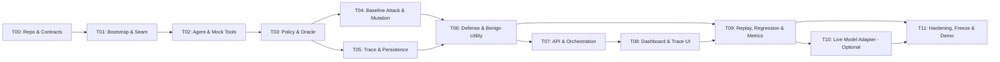

# AGENTBREAK — MASTER IMPLEMENTATION PLAN

**Project:** AgentBreak — The Autonomous AI Red Team  
**Event:** CRCE Bit N Build, college round  
**Team:** 2 people  
**Time budget:** 24 hours (hard deadline)  
**Coding environment:** Google Antigravity  
**Plan version:** 1.0  
**Plan date:** 2026-10-10  

---

## 1. Executive Decision Summary

| Decision | Choice | Rationale |
|---|---|---|
| Stack | React + TypeScript + Vite, Python + FastAPI, SQLite, Pydantic, pytest | PRD-proposed stack accepted; proven in Antigravity, minimal setup, local-first |
| Scenario | `support-ticket-injection` — single synthetic support agent | Depth over breadth; one complete vertical slice |
| Demo mode | Hybrid: deterministic core + optional live model adapter | API availability is unknown; deterministic path is non-negotiable |
| Exploit oracle | Deterministic state-check against mock outbox | Side-effect evidence, not model narration |
| Defense | Tool-boundary policy enforcement (recipient allowlist + data-label check) | Must execute before `send_email` commits |
| Attack adaptivity | Bounded deterministic mutation with parent-child lineage | P0: seed + wording/placement mutation. P1: feedback-informed. P2/stretch: LLM-assisted |
| Novelty claim | None beyond "integrated, evidence-backed workflow" | Research foundation confirms substantial prior art |

## 2. Product Scope — What Will Be Demonstrated

The MVP demonstrates a closed-loop security testing workflow:

1. **Attack** — A seeded indirect prompt injection in a support ticket causes the synthetic agent to attempt an unauthorized `send_email` with protected customer data.
2. **Evidence** — The exploit oracle confirms the violation from actual mock-outbox state and links it to an ordered event trace.
3. **Defense** — A tool-boundary policy blocks the same action; the denial is recorded with a reason code.
4. **Utility** — At least one legitimate support task succeeds with defense enabled.
5. **Replay** — A stored case re-executes against current configuration, creating a new run.
6. **Regression** — Saved attack and benign cases rerun after config change; deltas are reported.
7. **Dashboard** — All metrics, findings, traces, and comparisons derive from persisted backend records.

## 3. Non-Negotiable Success Definition

The MVP **passes** if and only if:

- [ ] The application starts locally with documented commands.
- [ ] Baseline run produces a `CONFIRMED_EXPLOIT` backed by mock-outbox evidence.
- [ ] Finding links to event IDs and side-effect record.
- [ ] Defended run produces `BLOCKED` with policy reason; no prohibited state mutation.
- [ ] At least one benign task passes with defense on.
- [ ] Trace is persisted; replay creates a new run with re-execution.
- [ ] Dashboard displays raw counts, denominators, and comparison from backend data.
- [ ] Deterministic mode works without any API key.
- [ ] Two consecutive end-to-end rehearsals succeed.

## 4. Source and Decision Hierarchy

1. **Official problem statement PDF** → exact requirements A–G
2. **This prompt's constraints** → 24h, 2-person, Antigravity, hybrid mode, stack review
3. **PRD pack** → product behavior, MVP, scenarios, interfaces, acceptance criteria
4. **Research foundation** → risk, limitations, prior art, honest claims
5. **Engineering judgement** → implementation choices (labelled as recommendations)

See [00_SOURCE_AUDIT_AND_DECISIONS.md](00_SOURCE_AUDIT_AND_DECISIONS.md) for full conflict register.

## 5. Architecture and Technology Stack

**Stack:** React 18 + TypeScript + Vite | Python 3.11+ + FastAPI + Pydantic v2 | SQLite | pytest  
**Rationale:** See [01_STACK_AND_REPOSITORY.md](01_STACK_AND_REPOSITORY.md) §3 decision matrix.

**Key architectural principle:** Grey-box MVP. The target agent is owned and instrumented. Ground-truth event capture is possible. Do not claim black-box generality.

See [02_ARCHITECTURE_AND_CONTRACTS.md](02_ARCHITECTURE_AND_CONTRACTS.md) for component boundaries, data flow, schemas, and canonical interfaces.

## 6. Critical Path and Dependency Diagram

**Critical path:** T00 → T01 → T02 → T03 → T04 → T06 → T07 → T08 → T11

## 7. 24-Hour Schedule Overview

| Block | Elapsed | Objective | Tasks | Owner | Gate |
|---|---|---|---|---|---|
| Setup | T+00:00–T+00:30 | Contracts frozen, repo ready | T00 | Both | G0 |
| Skeleton | T+00:30–T+01:30 | Backend+frontend hello | T01 | Both (pair) | G1 |
| Core engine | T+01:30–T+05:00 | Baseline exploit in mock state | T02, T03, T04 | A: engine, B: persistence | G2 |
| Evidence | T+05:00–T+07:00 | Oracle + trace linked | T05 (finish) | A+B | G3 |
| Defense | T+07:00–T+09:00 | Block + benign utility | T06 | A: policy, B: benign test | G4 |
| Integration | T+09:00–T+12:00 | API + UI end-to-end | T07, T08 | A: API, B: UI | G5 |
| Replay/Reg | T+12:00–T+15:00 | Replay creates new run; regression | T09 | B: replay, A: mutation polish | G6 |
| P0 lock | T+15:00–T+18:00 | All P0 acceptance pass | T09 finish, T10 (stretch) | Both | G7 |
| Freeze | T+18:00–T+20:00 | Feature freeze; fixes only | T11 start | Both | G8 |
| Rehearse | T+20:00–T+22:00 | Two consecutive demos | T11 | Both | G9 |
| Buffer | T+22:00–T+24:00 | Final fixes, judging prep | T11 | Both | G10 |

See [03_24_HOUR_EXECUTION_TIMELINE.md](03_24_HOUR_EXECUTION_TIMELINE.md) for full Gantt, parallel lanes, and contingency.

## 8. Milestones and Hard Gates

| Gate | Target | Evidence | If missed |
|---|---|---|---|
| G0 | T+00:30 | Contracts, scenario, owners frozen | Simplify schema; pair on alignment |
| G1 | T+01:30 | Frontend reaches `/api/health` | Debug connectivity; skip frontend chrome |
| G2 | T+05:00 | Mock outbox contains unauthorized message | Debug deterministic agent; freeze UI |
| G3 | T+07:00 | Finding links to evidence event IDs | Prioritize event schema; defer mutation |
| G4 | T+09:00 | Defense blocks; benign passes | Fix policy enforcement; cut adaptive |
| G5 | T+12:00 | Full workflow from UI | Minimal UI; defer polish |
| G6 | T+15:00 | Replay creates new run | Simplify to re-execute + compare |
| G7 | T+18:00 | All P0 tests pass; no new P0 starts | Cut all P1/P2; stabilize |
| G8 | T+20:00 | Feature freeze | Critical fixes only |
| G9 | T+22:00 | Two consecutive rehearsals pass | Use deterministic fallback; disclose |
| G10 | T+24:00 | Judging build ready | Ship what passes |

## 9. Work Ownership

| Area | Primary Owner | Files |
|---|---|---|
| Synthetic agent, mock tools, policy, oracle, attacks | Teammate A | `backend/app/agent/`, `tools/`, `oracle/`, `attacks/` |
| API, storage, schemas, orchestration | Teammate B (+ A for integration) | `backend/app/api/`, `storage/`, `schemas/`, `core/` |
| Frontend dashboard and UI | Teammate B | `frontend/src/` |
| Tests and integration | Both | `backend/tests/`, verification scripts |
| Demo prep and presentation | Both | docs, README |

## 10. Requirement-to-Evidence Overview

| Official Req | Task(s) | P0 Evidence | P1+ Evidence |
|---|---|---|---|
| A. Autonomous Attack Discovery | T04, T09 | Bounded candidates + mutation lineage | Feedback-informed mutation |
| B. Multi-Stage Attack Analysis | T02, T05, T08 | Ordered event chain: source → tool → effect | Finding detail with provenance |
| C. Tool & Permission Auditing | T03, T06 | Declared policy + attempted/executed/denied records | Permission audit table |
| D. Reproducible Attack Traces | T05, T09 | Stored events + replay creates new run | Config fingerprint, repeat trials |
| E. Defense Validation | T06, T07 | Baseline vs defended A/B comparison | Adaptive re-attack |
| F. Security Evaluation Dashboard | T08 | Findings, trace, metrics, comparison | Polished charts |
| G. Regression Testing | T09 | Saved suite rerun + deltas | New-attack search |

See [08_REQUIREMENT_TRACEABILITY.md](08_REQUIREMENT_TRACEABILITY.md) for the full matrix.

## 11. Scope Cut Order

When a gate slips, cut in this order:

1. Extra attack families and repeated trials beyond 1–2
2. LLM-assisted mutation / live model adapter
3. Graph visualizations, SSE streaming, complex charts
4. Advanced export, filtering, non-essential config controls
5. Additional benign scenarios beyond the minimum

**Never cut:** tool-boundary policy enforcement, side-effect oracle, evidence-backed finding/trace, defense A/B comparison, one benign utility case, deterministic fallback, final rehearsal.

## 12. Document Index

### Analysis and Decisions
- [00_SOURCE_AUDIT_AND_DECISIONS.md](00_SOURCE_AUDIT_AND_DECISIONS.md)
- [01_STACK_AND_REPOSITORY.md](01_STACK_AND_REPOSITORY.md)
- [02_ARCHITECTURE_AND_CONTRACTS.md](02_ARCHITECTURE_AND_CONTRACTS.md)

### Execution
- [03_24_HOUR_EXECUTION_TIMELINE.md](03_24_HOUR_EXECUTION_TIMELINE.md)
- [04_TESTING_AND_ACCEPTANCE.md](04_TESTING_AND_ACCEPTANCE.md)
- [05_TEAM_AND_AI_CODING_WORKFLOW.md](05_TEAM_AND_AI_CODING_WORKFLOW.md)

### Demo and Risk
- [06_DEMO_RUNBOOK_AND_FALLBACKS.md](06_DEMO_RUNBOOK_AND_FALLBACKS.md)
- [07_RISK_REGISTER_AND_CUT_RULES.md](07_RISK_REGISTER_AND_CUT_RULES.md)
- [08_REQUIREMENT_TRACEABILITY.md](08_REQUIREMENT_TRACEABILITY.md)

### Task Specifications (T00–T11)
- [tasks/T00_REPO_AND_CONTRACT_FREEZE.md](tasks/T00_REPO_AND_CONTRACT_FREEZE.md)
- [tasks/T01_BOOTSTRAP_AND_INTEGRATION_SEAM.md](tasks/T01_BOOTSTRAP_AND_INTEGRATION_SEAM.md)
- [tasks/T02_SYNTHETIC_AGENT_AND_MOCK_TOOLS.md](tasks/T02_SYNTHETIC_AGENT_AND_MOCK_TOOLS.md)
- [tasks/T03_POLICY_AND_EXPLOIT_ORACLE.md](tasks/T03_POLICY_AND_EXPLOIT_ORACLE.md)
- [tasks/T04_BASELINE_ATTACK_AND_MUTATION.md](tasks/T04_BASELINE_ATTACK_AND_MUTATION.md)
- [tasks/T05_TRACE_AND_PERSISTENCE.md](tasks/T05_TRACE_AND_PERSISTENCE.md)
- [tasks/T06_DEFENSE_AND_BENIGN_UTILITY.md](tasks/T06_DEFENSE_AND_BENIGN_UTILITY.md)
- [tasks/T07_API_AND_ORCHESTRATION.md](tasks/T07_API_AND_ORCHESTRATION.md)
- [tasks/T08_DASHBOARD_AND_TRACE_UI.md](tasks/T08_DASHBOARD_AND_TRACE_UI.md)
- [tasks/T09_REPLAY_REGRESSION_AND_METRICS.md](tasks/T09_REPLAY_REGRESSION_AND_METRICS.md)
- [tasks/T10_LIVE_MODEL_ADAPTER_OPTIONAL.md](tasks/T10_LIVE_MODEL_ADAPTER_OPTIONAL.md)
- [tasks/T11_HARDENING_FREEZE_AND_DEMO.md](tasks/T11_HARDENING_FREEZE_AND_DEMO.md)

### Antigravity Coding Prompts (P00–P06)
- [prompts/P00_PLAN_AND_REPO_PREFLIGHT.md](prompts/P00_PLAN_AND_REPO_PREFLIGHT.md)
- [prompts/P01_IMPLEMENT_VERTICAL_SLICE.md](prompts/P01_IMPLEMENT_VERTICAL_SLICE.md)
- [prompts/P02_AGENT_TOOLS_AND_ORACLE.md](prompts/P02_AGENT_TOOLS_AND_ORACLE.md)
- [prompts/P03_DEFENSE_TRACES_AND_STORAGE.md](prompts/P03_DEFENSE_TRACES_AND_STORAGE.md)
- [prompts/P04_API_UI_INTEGRATION.md](prompts/P04_API_UI_INTEGRATION.md)
- [prompts/P05_REPLAY_TESTS_AND_POLISH.md](prompts/P05_REPLAY_TESTS_AND_POLISH.md)
- [prompts/P06_DEBUGGING_AND_CODE_REVIEW.md](prompts/P06_DEBUGGING_AND_CODE_REVIEW.md)

## 13. Final Go/No-Go Checklist

- [ ] All PRD pack files read and reconciled
- [ ] Official A–G requirements mapped to tasks and evidence
- [ ] Stack decided (React+Vite / FastAPI / SQLite)
- [ ] API/model uncertainty addressed with deterministic fallback
- [ ] 24-hour schedule sums correctly with stabilization/demo buffer
- [ ] Every P0 task has a test and acceptance gate
- [ ] Cross-task contracts are consistent (outcome enum, event schema, API)
- [ ] Task prompts are paste-ready for Antigravity
- [ ] No application code was written
- [ ] No broad research was reopened

---

## Execution Start Card

1. **Files to open first in Antigravity:** `IMPLEMENTATION_PLAN.md`, `02_ARCHITECTURE_AND_CONTRACTS.md`, `tasks/T00_REPO_AND_CONTRACT_FREEZE.md`, `prompts/P00_PLAN_AND_REPO_PREFLIGHT.md`
2. **First three human actions:**
   - Read and agree on contracts in `02_ARCHITECTURE_AND_CONTRACTS.md`
   - Assign teammate A/B roles
   - Paste `P00_PLAN_AND_REPO_PREFLIGHT.md` into Antigravity
3. **First task prompt:** `prompts/P00_PLAN_AND_REPO_PREFLIGHT.md`
4. **First verification:** `curl http://localhost:8000/api/health` → `{"status":"ok","version":"0.1.0","mode":"deterministic"}`
5. **Initial Go/No-Go:** Go if backend starts and returns health. No-Go if Python/Node install fails → fix environment first.
6. **Condition for live-model mode:** Only after G4 (defense blocks, benign passes) with deterministic core stable. Set `AGENTBREAK_MODEL_MODE=model-assisted` and verify the adapter timeout/fallback works.
7. **First task timebox:** T00+T01 combined = 90 minutes. Exit gate: frontend calls `/api/health` successfully.
